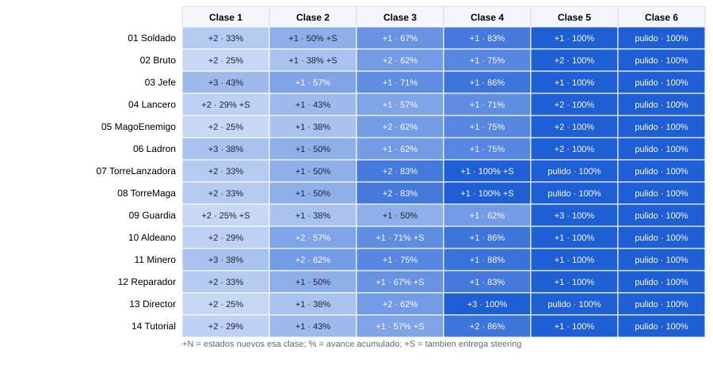
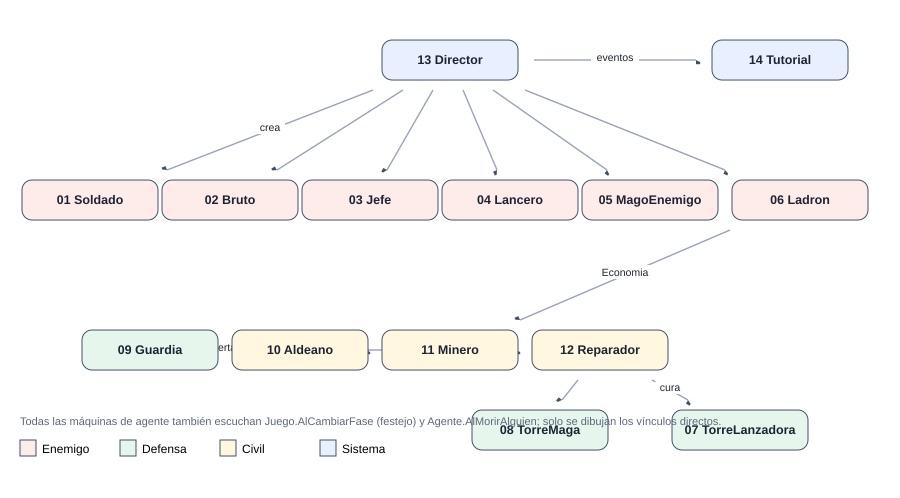

# Defender el Granero de Cristales · Plan del cuarto parcial

[Plan general](00_indice_y_plan.md) · [Guia de inicio](03_como_empezar.md) · [Como subir cambios](04_como_subir_cambios.md) · [Troubleshooting](05_troubleshooting.md) · [Estado general](01_estado_general.md) · [Steering](02_steering_behaviors.md) · [README](../README.md)

Juego de torres con 14 máquinas de estados y 9 steering behaviours, uno o varios por alumno. El instructor entrega el juego base (modelos, mapa, economía, torres, HUD, cámara, efectos); los alumnos escriben **solo código**. 5 clases de 2 horas con entrega calificada (la clase 1 es onboarding) y una sexta de colchón sin contenido nuevo.

## Ruta de lectura recomendada

1. [Guía de inicio](03_como_empezar.md) (todos).
2. [Estado general](01_estado_general.md) (todos).
3. La ficha de tu máquina.
4. [Steering](02_steering_behaviors.md) (si te toca uno, o para saber qué vas a recibir).

## 1. Tabla de pesos

> **Fórmula:** peso = estados + 0.5 × transiciones + eventos que escucha + dependencias externas + 0.5 × vínculos con otras máquinas + 1.5 × steering que integra + extra (1 a 3 puntos por responsabilidad adicional: el Jefe y el Director llevan 3 por ser piezas centrales).  
> Ligera ≤ 21 · Media 22-25 · Alta 26-28 · Muy alta > 28. Las 5 clases del API base que todas usan (Sensor, Cuerpo, Agente, Salud, Reserva) no cuentan como dependencia porque son iguales para todos.

| # | Máquina | Tipo | Estados | Trans. | Eventos | Deps. | Vínculos | Steering | Extra | Peso | Nivel |
| --- | --- | --- | --- | --- | --- | --- | --- | --- | --- | --- | --- |
| 1 | [Soldado enemigo](m01_soldado.md) | Enemigo | 6 | 10 | 4 | 2 | 3 | 2 | 0 | **21.5** | **Media** |
| 2 | [Bruto (enemigo pesado)](m02_bruto.md) | Enemigo | 8 | 9 | 5 | 2 | 2 | 3 | 0 | **25.0** | **Media** |
| 3 | [Jefe (final de la oleada 5)](m03_jefe.md) | Enemigo | 7 | 9 | 5 | 3 | 4 | 3 | 3 | **29.0** | **Muy alta** |
| 4 | [Lancero enemigo](m04_lancero.md) | Enemigo | 7 | 9 | 5 | 2 | 2 | 4 | 0 | **25.5** | **Alta** |
| 5 | [Mago enemigo](m05_magoenemigo.md) | Enemigo | 8 | 10 | 5 | 3 | 2 | 3 | 1 | **27.5** | **Alta** |
| 6 | [Ladron](m06_ladron.md) | Enemigo | 8 | 7 | 4 | 3 | 3 | 4 | 1 | **27.0** | **Alta** |
| 7 | [Torre lanzadora](m07_torrelanzadora.md) | Defensa | 6 | 9 | 3 | 3 | 3 | 1 | 0 | **19.5** | **Ligera** |
| 8 | [Torre maga](m08_torremaga.md) | Defensa | 6 | 8 | 3 | 3 | 2 | 1 | 1 | **19.5** | **Ligera** |
| 9 | [Guardia de la aldea](m09_guardia.md) | Defensa | 8 | 9 | 4 | 3 | 3 | 3 | 1 | **26.5** | **Alta** |
| 10 | [Aldeano](m10_aldeano.md) | Civil | 7 | 7 | 5 | 2 | 3 | 4 | 0 | **25.0** | **Media** |
| 11 | [Minero](m11_minero.md) | Civil | 8 | 9 | 5 | 4 | 3 | 3 | 1 | **28.5** | **Muy alta** |
| 12 | [Reparador](m12_reparador.md) | Civil | 6 | 7 | 5 | 4 | 3 | 2 | 0 | **23.0** | **Media** |
| 13 | [Director de oleadas (GameManager)](m13_director.md) | Sistema | 8 | 8 | 5 | 6 | 6 | 0 | 3 | **29.0** | **Muy alta** |
| 14 | [Tutorial guiado](m14_tutorial.md) | Sistema | 7 | 8 | 4 | 5 | 3 | 0 | 1 | **22.5** | **Media** |
|  | Total máquinas | | | | | | | | | 349.0 |  |

### Steering behaviours

| Behaviour | Peso | Entrega |
| --- | --- | --- |
| [Seek (buscar)](02_steering_behaviors.md#seek-buscar-2-pts) | 2 | Clase 2 |
| [Flee (huir)](02_steering_behaviors.md#flee-huir-2-pts) | 2 | Clase 2 |
| [Arrive (llegar)](02_steering_behaviors.md#arrive-llegar-4-pts) | 4 | Clase 2 |
| [Path Following (seguir camino)](02_steering_behaviors.md#path-following-seguir-camino-7-pts) | 7 | Clase 2 |
| [Pursuit (perseguir con predicción)](02_steering_behaviors.md#pursuit-perseguir-con-predicción-6-pts) | 6 | Clase 3 |
| [Evade (escapar con predicción)](02_steering_behaviors.md#evade-escapar-con-predicción-6-pts) | 6 | Clase 3 |
| [Wander (vagar)](02_steering_behaviors.md#wander-vagar-6-pts) | 6 | Clase 3 |
| [Obstacle Avoidance (evitar obstaculos)](02_steering_behaviors.md#obstacle-avoidance-evitar-obstaculos-10-pts) | 10 | Clase 4 |
| [Hide (esconderse)](02_steering_behaviors.md#hide-esconderse-8-pts) | 8 | Clase 4 |
| Total | 51 |  |

## 2. Reparto entre los 14 alumnos

Cada alumno (cupo) lleva **una máquina** y, si le toca, uno o más steering. Los steering más pesados se asignaron a las máquinas más ligeras para nivelar la carga. Cambia “Alumno 01..14” por los nombres reales.

| Cupo | Alumno | Máquina | Peso máq. | Steering a cargo | Peso steer. | Total | Carga |
| --- | --- | --- | --- | --- | --- | --- | --- |
| **01** | Alumno 01 | [Soldado enemigo](m01_soldado.md) | 21.5 | PathFollowing | 7 | **28.5** |  |
| **02** | Alumno 02 | [Bruto (enemigo pesado)](m02_bruto.md) | 25.0 | Arrive | 4 | **29.0** |  |
| **03** | Alumno 03 | [Jefe (final de la oleada 5)](m03_jefe.md) | 29.0 | — | 0 | **29.0** |  |
| **04** | Alumno 04 | [Lancero enemigo](m04_lancero.md) | 25.5 | Seek | 2 | **27.5** |  |
| **05** | Alumno 05 | [Mago enemigo](m05_magoenemigo.md) | 27.5 | — | 0 | **27.5** |  |
| **06** | Alumno 06 | [Ladron](m06_ladron.md) | 27.0 | — | 0 | **27.0** |  |
| **07** | Alumno 07 | [Torre lanzadora](m07_torrelanzadora.md) | 19.5 | Hide | 8 | **27.5** |  |
| **08** | Alumno 08 | [Torre maga](m08_torremaga.md) | 19.5 | ObstacleAvoidance | 10 | **29.5** |  |
| **09** | Alumno 09 | [Guardia de la aldea](m09_guardia.md) | 26.5 | Flee | 2 | **28.5** |  |
| **10** | Alumno 10 | [Aldeano](m10_aldeano.md) | 25.0 | Wander | 6 | **31.0** |  |
| **11** | Alumno 11 | [Minero](m11_minero.md) | 28.5 | — | 0 | **28.5** |  |
| **12** | Alumno 12 | [Reparador](m12_reparador.md) | 23.0 | Evade | 6 | **29.0** |  |
| **13** | Alumno 13 | [Director de oleadas (GameManager)](m13_director.md) | 29.0 | — | 0 | **29.0** |  |
| **14** | Alumno 14 | [Tutorial guiado](m14_tutorial.md) | 22.5 | Pursuit | 6 | **28.5** |  |
| Mínimo / máximo / promedio | | | | | | 27.0 / 31.0 / 28.6 | |

> Los cupos 13 (Director) y 14 (Tutorial) son los dos “sistema”: el Director es la pieza central y debe empezar a funcionar desde la clase 1 para que los demás puedan probar con oleadas reales; el Tutorial solo depende de eventos y es independiente.

## 3. Calendario: qué se entrega en cada clase

### Calendario de clases

| Clase | Día | Límite para crear el PR | Rama |
| --- | --- | --- | --- |
| **1** | Lun 9 nov | Lun 9 nov, 23:59 (CDMX) | `clase-1/<cupo>-<maquina>` |
| **2** | Mié 11 nov | Mié 11 nov, 23:59 (CDMX) | `clase-2/<cupo>-<maquina>` |
| **3** | Mié 18 nov | Mié 18 nov, 23:59 (CDMX) | `clase-3/<cupo>-<maquina>` |
| **4** | Lun 23 nov | Lun 23 nov, 23:59 (CDMX) | `clase-4/<cupo>-<maquina>` |
| **5** | Mié 25 nov | Mié 25 nov, 23:59 (CDMX) | `clase-5/<cupo>-<maquina>` |
| **6** | Lun 30 nov | Lun 30 nov, 23:59 (CDMX) | `clase-6/<cupo>-<maquina>` |

> **Puente:** el lunes 16 de noviembre no hay clase. Entre la clase 2 (mié 11) y la clase 3 (mié 18) pasa una semana completa: es el momento para adelantar o ponerse al corriente. Guías: [Cómo subir tus cambios](04_como_subir_cambios.md) · [Troubleshooting (si el pipeline falla)](05_troubleshooting.md).

Cada celda dice los estados que deben funcionar al terminar esa clase (acumulado entre paréntesis). La clase 1 es onboarding (controller + estado inicial + primer commit). La clase 5 cierra la máquina completa. La clase 6 es colchón: solo para corregir pendientes.

| Cupo | Máquina | Clase 1 Lun 9 nov | Clase 2 Mié 11 nov | Clase 3 Mié 18 nov | Clase 4 Lun 23 nov | Clase 5 Mié 25 nov | Clase 6 Lun 30 nov |
| --- | --- | --- | --- | --- | --- | --- | --- |
| **01** | [Soldado](m01_soldado.md) | Avanzar (1/6) | Muerto (2/6) **Steering:** PathFollowing | Perseguir (3/6) | Atacar, Aturdido (5/6) | Festejo (6/6) | colch&oacute;n (6/6) |
| **02** | [Bruto](m02_bruto.md) | Avanzar (1/8) | Muerto (2/8) **Steering:** Arrive | Perseguir, CargarGolpe (4/8) | GolpePesado, Recuperar (6/8) | Furia, Festejo (8/8) | colch&oacute;n (8/8) |
| **03** | [Jefe](m03_jefe.md) | Aparicion (1/7) | Avanzar (2/7) | Muerto, Atacar (4/7) | Invocar, OndaChoque (6/7) | Furia (7/7) | colch&oacute;n (7/7) |
| **04** | [Lancero](m04_lancero.md) | Avanzar (1/7) | Muerto (2/7) **Steering:** Seek | Acercarse, Estocada (4/7) | Retroceder, Aturdido (6/7) | Festejo (7/7) | colch&oacute;n (7/7) |
| **05** | [MagoEnemigo](m05_magoenemigo.md) | Avanzar (1/8) | Muerto, Posicionarse (3/8) | Lanzar, Recargar (5/8) | Huir, Aturdido (7/8) | Festejo (8/8) | colch&oacute;n (8/8) |
| **06** | [Ladron](m06_ladron.md) | Merodear (1/8) | Acercarse, Muerto (3/8) | Robar, Huir (5/8) | Escapar, Aturdido (7/8) | Festejo (8/8) | colch&oacute;n (8/8) |
| **07** | [TorreLanzadora](m07_torrelanzadora.md) | Vigilando (1/6) | Destruida, Apuntando (3/6) | Disparando, Recargando (5/6) | colch&oacute;n (5/6) **Steering:** Hide | Danada (6/6) | colch&oacute;n (6/6) |
| **08** | [TorreMaga](m08_torremaga.md) | Vigilando (1/6) | Destruida, Cargando (3/6) | Lanzando, Enfriando (5/6) | colch&oacute;n (5/6) **Steering:** ObstacleAvoidance | Sobrecarga (6/6) | colch&oacute;n (6/6) |
| **09** | [Guardia](m09_guardia.md) | Patrullar (1/8) | Muerto (2/8) **Steering:** Flee | Perseguir, Combatir (4/8) | Alertar, Regresar (6/8) | Descansar, Festejo (8/8) | colch&oacute;n (8/8) |
| **10** | [Aldeano](m10_aldeano.md) | Vagar (1/7) | Muerto, Asustarse (3/7) | Huir (4/7) **Steering:** Wander | Esconderse, Charlar (6/7) | Festejo (7/7) | colch&oacute;n (7/7) |
| **11** | [Minero](m11_minero.md) | IrAMina (1/8) | Minar, Muerto (3/8) | IrAlGranero, Depositar (5/8) | Huir, Esconderse (7/8) | Festejo (8/8) | colch&oacute;n (8/8) |
| **12** | [Reparador](m12_reparador.md) | Esperar (1/6) | Muerto (2/6) | IrAReparar (3/6) **Steering:** Evade | Martillar, Huir (5/6) | Festejo (6/6) | colch&oacute;n (6/6) |
| **13** | [Director](m13_director.md) | Preparacion (1/8) | Aviso, Oleada (3/8) | Limpieza, Bono (5/8) | Jefe, Victoria (7/8) | Derrota (8/8) | colch&oacute;n (8/8) |
| **14** | [Tutorial](m14_tutorial.md) | Bienvenida (1/7) | ElegirPlataforma, Construir (3/7) | Gemas (4/7) **Steering:** Pursuit | LlamarOleada, Observar (6/7) | Fin (7/7) | colch&oacute;n (7/7) |

### Avance acumulado por clase (mapa de calor)

### Steering por clase

| Clase | Behaviours que deben quedar listos |
| --- | --- |
| **1** | — |
| **2** | Seek (cupo 04), Flee (cupo 09), Arrive (cupo 02), PathFollowing (cupo 01) |
| **3** | Pursuit (cupo 14), Evade (cupo 12), Wander (cupo 10) |
| **4** | ObstacleAvoidance (cupo 08), Hide (cupo 07) |
| **5** | — |
| **6** | colchón (sin contenido nuevo) |

### Avance porcentual (estados) por clase

| Clase | 1 Lun 9 nov | 2 Mie 11 nov | 3 Mie 18 nov | 4 Lun 23 nov | 5 Mie 25 nov | 6 Lun 30 nov |
| --- | --- | --- | --- | --- | --- | --- |
| 01 Soldado | 17% | 33% | 50% | 83% | 100% | 100% |
| 02 Bruto | 12% | 25% | 50% | 75% | 100% | 100% |
| 03 Jefe | 14% | 29% | 57% | 86% | 100% | 100% |
| 04 Lancero | 14% | 29% | 57% | 86% | 100% | 100% |
| 05 MagoEnemigo | 12% | 38% | 62% | 88% | 100% | 100% |
| 06 Ladron | 12% | 38% | 62% | 88% | 100% | 100% |
| 07 TorreLanzadora | 17% | 50% | 83% | 83% | 100% | 100% |
| 08 TorreMaga | 17% | 50% | 83% | 83% | 100% | 100% |
| 09 Guardia | 12% | 25% | 50% | 75% | 100% | 100% |
| 10 Aldeano | 14% | 43% | 57% | 86% | 100% | 100% |
| 11 Minero | 12% | 38% | 62% | 88% | 100% | 100% |
| 12 Reparador | 17% | 33% | 50% | 83% | 100% | 100% |
| 13 Director | 12% | 38% | 62% | 88% | 100% | 100% |
| 14 Tutorial | 14% | 43% | 57% | 86% | 100% | 100% |

### Rúbrica por clase

| Criterio | Puntos | Qué se revisa |
| --- | --- | --- |
| Funciona en el juego | 50 | El agente/sistema hace lo pedido en Play, sin errores en consola, con el prefab real. |
| Estados entregados | 30 | Cumple los estados de ESA clase (ver tabla). Cada estado que falta resta proporcionalmente. |
| Codigo y rendimiento | 20 | Una clase por estado con prefijo del rol, ASCII, sin new/LINQ en Update, eventos desuscritos, cero basura medido. |
| Total por clase | 100 | La calificación final es el promedio de las 5 entregas de las clases 1 a 5 (cada una pesa igual). La clase 6 es colchón y no cuenta. |

## 4. Dependencias

### 4.1 Quién necesita qué steering

| Máquina | Seek | Flee | Arrive | PathFollowing | Pursuit | Evade | Wander | ObstacleAvoidance | Hide |
| --- | --- | --- | --- | --- | --- | --- | --- | --- | --- |
| [Soldado](m01_soldado.md) | ● |  |  | ● |  |  |  |  |  |
| [Bruto](m02_bruto.md) | ● |  |  | ● |  |  |  | ● |  |
| [Jefe](m03_jefe.md) | ● |  |  | ● |  |  |  | ● |  |
| [Lancero](m04_lancero.md) | ● | ● | ● | ● |  |  |  |  |  |
| [MagoEnemigo](m05_magoenemigo.md) |  |  | ● | ● |  | ● |  |  |  |
| [Ladron](m06_ladron.md) |  |  | ● | ● |  | ● | ● |  |  |
| [TorreLanzadora](m07_torrelanzadora.md) |  |  |  |  | ● |  |  |  |  |
| [TorreMaga](m08_torremaga.md) |  |  |  |  | ● |  |  |  |  |
| [Guardia](m09_guardia.md) |  |  | ● | ● | ● |  |  |  |  |
| [Aldeano](m10_aldeano.md) |  | ● | ● |  |  |  | ● |  | ● |
| [Minero](m11_minero.md) |  | ● | ● | ● |  |  |  |  |  |
| [Reparador](m12_reparador.md) |  | ● | ● |  |  |  |  |  |  |
| [Director](m13_director.md) |  |  |  |  |  |  |  |  |  |
| [Tutorial](m14_tutorial.md) |  |  |  |  |  |  |  |  |  |
| Responsable (cupo) | 04 | 09 | 02 | 01 | 14 | 12 | 10 | 08 | 07 |
| Entrega (clase) | 2 | 2 | 2 | 2 | 3 | 3 | 3 | 4 | 4 |

Mientras el steering no llegue, tu estado usa movimiento directo con `Cuerpo.Mover`. Cuando el compañero lo entregue, cambias una línea. Nadie se queda bloqueado.

### 4.2 Contratos de comunicación entre máquinas

Ninguna máquina llama directamente a otra: todo pasa por estos puntos de contacto ya programados en el juego base.

| Punto de contacto | Tipo | Para qué | Quién lo usa |
| --- | --- | --- | --- |
| `Agente.AlMorirAlguien(Agente)` | evento estático | Director (cuenta bajas y detecta la muerte del Jefe), todos los demás la ignoran. | Soldado..Jefe, Torres, civiles |
| `Juego.AlCambiarFase(FaseJuego)` | evento | Todos los agentes: al llegar Victoria/Derrota pasan a Festejo (o Llorar). | Director (publica) → todas |
| `Juego.AlAcercarse(n) / AlComenzar(n)` | evento | TextoCentral, Cámara y Tutorial reaccionan a las oleadas. | Director → Tutorial, UI |
| `Alertas.Emitir(pos, radio, origen) / Alertas.AlAlerta` | evento estático | Los civiles se asustan y huyen cuando el Guardia da la alarma. | Guardia → Aldeano, Minero, Reparador |
| `Juego.Aparecer(rol, pos, rot)` | método | Crea un agente del pool; lo usan el Director y el Jefe (invocar). | Director, Jefe |
| `Juego.Preparar(n) / Lanzar(n) / Terminar(victoria) / FijarEnemigosVivos(n)` | métodos | API del Director hacia el juego base (HUD, plataformas, fin de partida). | Director |
| `Economia.Agregar / Gastar / Robar / AlCambiar` | estático + evento | Gemas del jugador: el Minero suma, el Ladrón roba, el Director da bonos, el HUD y el Tutorial escuchan. | Minero, Ladron, Director, Tutorial |
| `Salud.AlDanar / AlCurar / AlMorir` | eventos | Cada máquina escucha su propia salud; el Reparador cura al granero y el granero cambia de estado solo. | Todas, Reparador, Granero |
| `Sensor.HostilMasCercano / Contar / DistanciaPlana` | métodos | “Ver” al enemigo: única fuente de percepción (cada 0.2 s, no cada frame). | Todas |
| `Efectos.Reproducir(Fx.X, pos, escala, seg)` | método | Efectos visuales ya hechos: Explosion, Fuego, Aura, Curacion, OndaSuelo... | Jefe, Torres, Reparador |
| `CamaraRTS.I.Sacudir(fuerza) / TextoCentral.I.Mostrar(...)` | métodos | Temblor de cámara y mensajes en el centro de la pantalla. | Jefe, Director, Tutorial |
| `ProyectilBase.Lanzar(...)` | método | Disparos con Reserva (sin instanciar en juego). | Mago, Torres |
| `Steering.<Nombre>(...)` | método estático | Movimiento: depende del compañero responsable (ver 4.1). | Ver matriz |

### 4.3 Mapa de dependencias entre máquinas

## 5. Documentos

- [Estado general](01_estado_general.md): Estado, Contexto y Máquina (referencia base).
- [Steering behaviours](02_steering_behaviors.md): los 9, con diagrama y firma.
- [01 Soldado enemigo](m01_soldado.md)
- [02 Bruto (enemigo pesado)](m02_bruto.md)
- [03 Jefe (final de la oleada 5)](m03_jefe.md)
- [04 Lancero enemigo](m04_lancero.md)
- [05 Mago enemigo](m05_magoenemigo.md)
- [06 Ladron](m06_ladron.md)
- [07 Torre lanzadora](m07_torrelanzadora.md)
- [08 Torre maga](m08_torremaga.md)
- [09 Guardia de la aldea](m09_guardia.md)
- [10 Aldeano](m10_aldeano.md)
- [11 Minero](m11_minero.md)
- [12 Reparador](m12_reparador.md)
- [13 Director de oleadas (GameManager)](m13_director.md)
- [14 Tutorial guiado](m14_tutorial.md)

> Las notas de cada máquina (estados, transiciones, esqueleto, entregas) están en su página. Los números de peso y los nombres de las clases coinciden con el código del proyecto (`LEEME_DIRECTRICES.md`).
