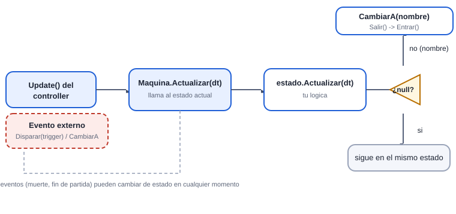
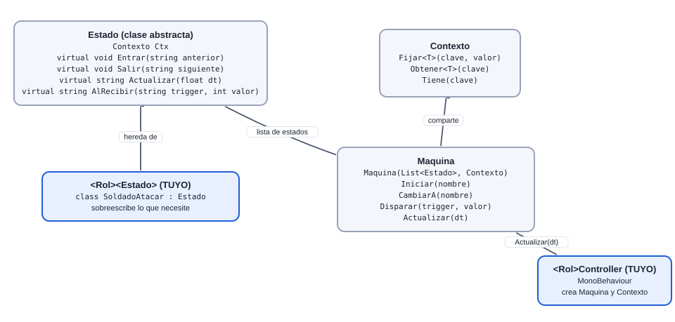
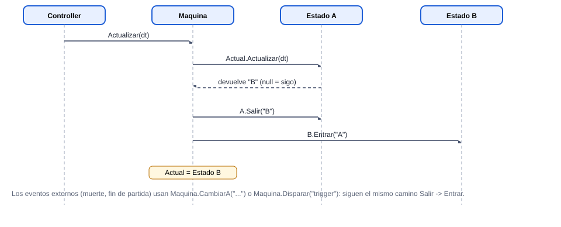

# Estado, Contexto y Máquina (máquina de estados base)

[Plan general](00_indice_y_plan.md) · [Guia de inicio](03_como_empezar.md) · [Estado general](01_estado_general.md) · [Steering](02_steering_behaviors.md) · [README](../README.md)

Es la base común de las 14 máquinas. Ya está programada: tu trabajo es escribir **estados** (clases que heredan de `Estado`) y un **controller** que arma la `Maquina`.

## 1. Las tres clases

### Estado

Una conducta. Cuatro métodos:

- `Entrar(string anterior)` al llegar
- `Salir(string siguiente)` al irse
- `string Actualizar(float dt)` cada frame
- `string AlRecibir(string trigger, int valor)` eventos

Los dos últimos devuelven el **nombre del siguiente estado** o `null`.

### Contexto

Diccionario compartido entre todos los estados de UNA máquina: `Fijar(clave, valor)` y `Obtener<T>(clave)`. Guarda el Agente, timers, el objetivo actual, banderas (por ejemplo “ya entró en furia”).

### Máquina

Tiene la lista de estados y el actual: `Iniciar(nombre)`, `CambiarA(nombre)` (para transiciones globales como Muerto), `Disparar(trigger)` y `Actualizar(dt)`.

## 2. Diagrama de flujo: qué pasa en cada frame



## 3. Ejemplo mínimo (dos estados)

```csharp
public class DemoPatrulla : Estado
{
    float t;
    public override void Entrar(string anterior) { t = 0f; Ctx.Obtener<Agente>("agente").Animar(Anim.Caminar); }
    public override string Actualizar(float dt)
    {
        t += dt;
        return t > 3f ? "DemoEspera" : null;     // cambia de estado devolviendo su nombre
    }
}

public class DemoEspera : Estado
{
    public override void Entrar(string anterior) { Ctx.Obtener<Agente>("agente").Animar(Anim.Idle); }
    public override string AlRecibir(string trigger, int valor)
    {
        return trigger == "alerta" ? "DemoPatrulla" : null;   // reacciona a un evento
    }
}
```

## 4. Convenciones (se califican)

| Regla | Por qué |
| --- | --- |
| Todo dentro de `namespace Alumnos.<TuMaquina>` | Aisla tu código del de los demás: dos alumnos pueden tener una clase con el mismo nombre sin chocar. El `ControladorAuto` encuentra tu controller aunque esté en un namespace. |
| Nombre de clase = `<Rol><Estado>` (`SoldadoAtacar`) | Evita chocar con las clases del juego base (`Sensor`, `Agente`...): una clase tuya con ese nombre taparía la del instructor dentro de tu namespace. |
| Un archivo por estado | Facilita el trabajo en equipo y el control de versiones. |
| Los archivos `Steering*.cs` van SIN namespace | `Steering` es una clase parcial global; todos los behaviours deben ser parte de ella. |
| Los estados no se referencian entre sí; solo devuelven nombres | As&iacute; se puede quitar o agregar un estado sin romper los dem&aacute;s. |
| Datos compartidos en el Contexto | El estado no guarda referencias a otros estados. |
| Nada de `new`, LINQ, `Find`, `GetComponent` en `Actualizar` | Rendimiento: el juego debe mantener 60 fps con 100+ agentes. |
| Suscribir eventos en `OnEnable` y quitar en `OnDisable` | Los agentes se reutilizan (Reserva); si no, quedan suscripciones fantasma. |
| Código en ASCII | Sin acentos ni &ntilde;: evita problemas de codificaci&oacute;n entre equipos. |

## 5. Máquinas de referencia ya hechas

Mira estas antes de empezar; son el modelo a seguir:

| Archivo | Qué muestra |
| --- | --- |
| `Scripts/Estados/GraneroEstados.cs` | Estados Sano / Danado / Critico / Destruido con destello rojo y cristales que se rompen. |
| `Scripts/Estados/TextoCentral.cs` | Texto animado en el centro (entra, se mantiene, sale). |
| `Scripts/Base/CamaraRTS.cs` | Estados de cámara: libre, enfocar granero, victoria, derrota. |
| `Scripts/Base/SlotTorre.cs` | Estados visuales de la plataforma: Reposo, Hover, Desbloqueo. |
| `Scripts/Base/CerebroDemo.cs` | Cerebro de ejemplo que mueve a todos los roles (sin máquinas de estados). |

## 6. Diagrama de clases



## 7. Secuencia de un cambio de estado



## 8. Las 5 preguntas para diseñar tu máquina

1. ¿Qué estados tiene? (un verbo por estado)
2. ¿Cuál es el inicial?
3. ¿Qué condición dispara cada flecha?
4. ¿Qué puede pasar desde cualquier estado? (muerte, fin de partida)
5. ¿Qué datos comparten los estados? (al `Contexto`)

Ver el ejemplo resuelto de pies a cabeza en la [guía de inicio](03_como_empezar.md).

## 9. Estados globales: cómo se implementan

```csharp
// En el controller:
void OnEnable()  { maq.Iniciar("SoldadoAvanzar"); ag.salud.AlMorir += AlMorir; Juego.I.AlCambiarFase += AlFase; }
void OnDisable() { ag.salud.AlMorir -= AlMorir;   Juego.I.AlCambiarFase -= AlFase; }

void AlMorir(GameObject origen) { maq.CambiarA("SoldadoMuerto"); }     // desde CUALQUIER estado
void AlFase(FaseJuego f)        { if (f == FaseJuego.Derrota) maq.CambiarA("SoldadoFestejo"); }
```

Cuida que `Juego.I` exista cuando el agente se activa (en la escena del juego siempre existe).
