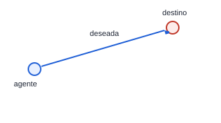
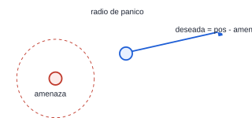
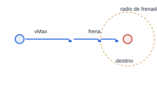
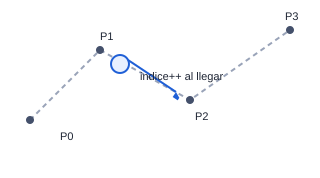
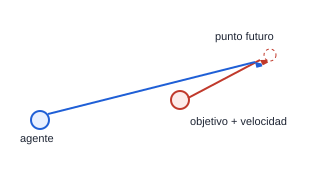
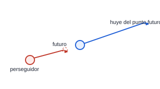
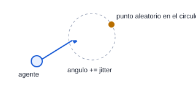
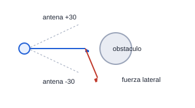
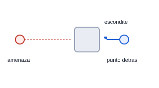
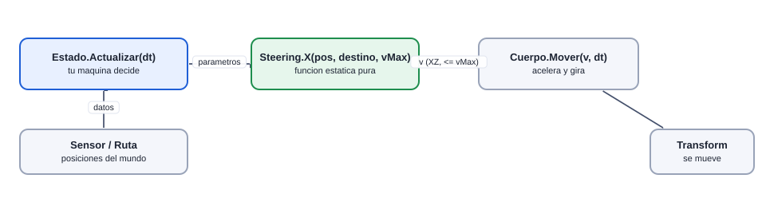

# Steering behaviours

[Plan general](00_indice_y_plan.md) · [Guia de inicio](03_como_empezar.md) · [Como subir cambios](04_como_subir_cambios.md) · [Troubleshooting](05_troubleshooting.md) · [Estado general](01_estado_general.md) · [Steering](02_steering_behaviors.md) · [README](../README.md)

Son funciones de movimiento: reciben posiciones y devuelven la **velocidad deseada**. La máquina de estados decide *cuándo* usar cada una; el steering decide *cómo* moverse.

> **Contrato común** (para que las piezas de 14 personas encajen)
> >
> - Cada behaviour vive en SU archivo: `SteeringSeek.cs`, `SteeringFlee.cs`... como `public static partial class Steering` (sin namespace).
> - Devuelve la velocidad deseada en el plano XZ (`y = 0`), con magnitud ≤ `vMax`. Quien llama la pasa a `Cuerpo.Mover(v, dt)`.
> - Sin `new` ni arreglos temporales: nada de basura. Si necesita memoria, el estado la guarda y la pasa por `ref`.
> - No usa `Find` ni `GetComponent`. Recibe todo por parámetros.
> - Sin flocking (no hay separación/cohesión/alineación).
> - Puede llamar a otros behaviours (`Arrive` usa la misma idea que `Seek`).

## Resumen y complejidad

| Behaviour | Peso | Entrega | Responsable | Lo usan |
| --- | --- | --- | --- | --- |
| [Seek (buscar)](#seek-buscar-2-pts) | 2 | Clase 1 | Cupo 04 (Lancero) | Soldado, Bruto, Jefe, Lancero |
| [Flee (huir)](#flee-huir-2-pts) | 2 | Clase 1 | Cupo 09 (Guardia) | Lancero, Aldeano, Minero, Reparador |
| [Arrive (llegar)](#arrive-llegar-4-pts) | 4 | Clase 2 | Cupo 02 (Bruto) | Lancero, MagoEnemigo, Ladron, Guardia, Aldeano, Minero, Reparador |
| [Path Following (seguir camino)](#path-following-seguir-camino-7-pts) | 7 | Clase 2 | Cupo 01 (Soldado) | Soldado, Bruto, Jefe, Lancero, MagoEnemigo, Ladron, Guardia, Minero |
| [Pursuit (perseguir con predicción)](#pursuit-perseguir-con-predicción-6-pts) | 6 | Clase 3 | Cupo 14 (Tutorial) | Guardia, TorreLanzadora, TorreMaga |
| [Evade (escapar con predicción)](#evade-escapar-con-predicción-6-pts) | 6 | Clase 3 | Cupo 12 (Reparador) | MagoEnemigo, Ladron |
| [Wander (vagar)](#wander-vagar-6-pts) | 6 | Clase 3 | Cupo 10 (Aldeano) | Ladron, Aldeano |
| [Obstacle Avoidance (evitar obstaculos)](#obstacle-avoidance-evitar-obstaculos-10-pts) | 10 | Clase 4 | Cupo 08 (TorreMaga) | Bruto, Jefe, Aldeano |
| [Hide (esconderse)](#hide-esconderse-8-pts) | 8 | Clase 4 | Cupo 07 (TorreLanzadora) | Aldeano |
| Total | 51 |  | | |

Pesos: 2 = fórmula de una línea; 4 = un parámetro de frenado; 6 = predicción o estado interno; 7 = lista de puntos con índice; 8 = busca el mejor punto entre varios; 10 = raycasts y sin basura.

## Seek (buscar) **2 pts**

Ir hacia un punto objetivo a velocidad maxima.

**Firma:**

```csharp
public static Vector3 Seek(Vector3 pos, Vector3 destino, float vMax);
```

**Pasos:**

1. deseada = (destino - pos) en plano XZ
2. devolver deseada normalizada * vMax



**Responsable:** cupo 04 (Lancero) · **entrega:** clase 1 · **lo usan:** [Soldado](m01_soldado.md), [Bruto](m02_bruto.md), [Jefe](m03_jefe.md), [Lancero](m04_lancero.md)

**Prueba de aceptación:** Un agente de prueba llega a un punto movil sin atravesar el suelo y se detiene a 0.3 m (o sigue pasando, segun el caso).

## Flee (huir) **2 pts**

Alejarse de una amenaza. Es el inverso de Seek.

**Firma:**

```csharp
public static Vector3 Flee(Vector3 pos, Vector3 amenaza, float vMax, float radioPanico);
```

**Pasos:**

1. deseada = (pos - amenaza)
2. si distancia > radioPanico: devolver 0 (a salvo)
3. devolver deseada normalizada * vMax



**Responsable:** cupo 09 (Guardia) · **entrega:** clase 1 · **lo usan:** [Lancero](m04_lancero.md), [Aldeano](m10_aldeano.md), [Minero](m11_minero.md), [Reparador](m12_reparador.md)

**Prueba de aceptación:** El agente se aleja de un cursor/enemigo y se detiene al salir del radio de panico.

## Arrive (llegar) **4 pts**

Ir a un punto frenando suavemente al acercarse, sin pasarse.

**Firma:**

```csharp
public static Vector3 Arrive(Vector3 pos, Vector3 destino, float vMax, float radioFrenado);
```

**Pasos:**

1. d = distancia al destino
2. si d > radioFrenado: velocidad = vMax
3. si no: velocidad = vMax * (d / radioFrenado)
4. devolver dirección * velocidad



**Responsable:** cupo 02 (Bruto) · **entrega:** clase 2 · **lo usan:** [Lancero](m04_lancero.md), [MagoEnemigo](m05_magoenemigo.md), [Ladron](m06_ladron.md), [Guardia](m09_guardia.md), [Aldeano](m10_aldeano.md), [Minero](m11_minero.md), [Reparador](m12_reparador.md)

**Prueba de aceptación:** El agente se detiene en el punto sin vibrar (a menos de 0.1 m) y sin oscilar.

## Path Following (seguir camino) **7 pts**

Seguir una lista de puntos (la Ruta del nivel o un Camino de NavMesh) pasando de uno al siguiente.

**Firma:**

```csharp
public static Vector3 PathFollowing(Vector3 pos, Vector3[] puntos, ref int indice, float tolerancia, float vMax);
```

**Pasos:**

1. destino = puntos[indice]
2. si distancia &lt; tolerancia: indice++ (y si era el último, devolver 0)
3. devolver Seek(pos, destino, vMax)
4. versión extra: adelantar el objetivo para suavizar las esquinas



**Responsable:** cupo 01 (Soldado) · **entrega:** clase 2 · **lo usan:** [Soldado](m01_soldado.md), [Bruto](m02_bruto.md), [Jefe](m03_jefe.md), [Lancero](m04_lancero.md), [MagoEnemigo](m05_magoenemigo.md), [Ladron](m06_ladron.md), [Guardia](m09_guardia.md), [Minero](m11_minero.md)

**Prueba de aceptación:** Recorre toda la Ruta del nivel sin saltarse esquinas y sin reiniciar el indice por error (apoyarse en Camino).

## Pursuit (perseguir con predicción) **6 pts**

Ir donde estara el objetivo, no donde esta. Tambien sirve para apuntar proyectiles con anticipacion.

**Firma:**

```csharp
public static Vector3 Pursuit(Vector3 pos, Vector3 posObj, Vector3 velObj, float vMax, out Vector3 puntoFuturo);
```

**Pasos:**

1. t = distancia / (vMax + magnitud de velObj)
2. puntoFuturo = posObj + velObj * t
3. devolver Seek(pos, puntoFuturo, vMax)



**Responsable:** cupo 14 (Tutorial) · **entrega:** clase 3 · **lo usan:** [Guardia](m09_guardia.md), [TorreLanzadora](m07_torrelanzadora.md), [TorreMaga](m08_torremaga.md)

**Prueba de aceptación:** Intercepta a un agente que camina en línea recta en mucho menos tiempo que Seek.

## Evade (escapar con predicción) **6 pts**

Huir de donde estara el perseguidor, no de donde esta ahora.

**Firma:**

```csharp
public static Vector3 Evade(Vector3 pos, Vector3 posPer, Vector3 velPer, float vMax);
```

**Pasos:**

1. t = distancia / (vMax + magnitud de velPer)
2. puntoFuturo = posPer + velPer * t
3. devolver Flee(pos, puntoFuturo, vMax, radio grande)



**Responsable:** cupo 12 (Reparador) · **entrega:** clase 3 · **lo usan:** [MagoEnemigo](m05_magoenemigo.md), [Ladron](m06_ladron.md)

**Prueba de aceptación:** Dura más tiempo sin ser alcanzado por un perseguidor con Pursuit que con Flee simple.

## Wander (vagar) **6 pts**

Movimiento errante creible: gira poco a poco, sin cambiar de dirección de golpe.

**Firma:**

```csharp
public static Vector3 Wander(Vector3 pos, Vector3 adelante, ref float angulo, float radio, float distancia, float jitter, float vMax);
```

**Pasos:**

1. angulo += random(-jitter, jitter) (guardado por ref)
2. punto = pos + adelante*distancia + (cos(angulo), sin(angulo))*radio
3. devolver Seek(pos, punto, vMax)



**Responsable:** cupo 10 (Aldeano) · **entrega:** clase 3 · **lo usan:** [Ladron](m06_ladron.md), [Aldeano](m10_aldeano.md)

**Prueba de aceptación:** Recorre una zona 30 s sin quedarse quieto ni moverse a tirones; no se sale del NavMesh.

## Obstacle Avoidance (evitar obstaculos) **10 pts**

Esquivar arboles, rocas y edificios en el camino con 'antenas' (raycasts) hacia adelante.

**Firma:**

```csharp
public static Vector3 ObstacleAvoidance(Vector3 pos, Vector3 adelante, Vector3 deseada, float largo, float vMax, LayerMask capas);
```

**Pasos:**

1. lanzar 3 antenas (centro, +30, -30 grados) con Physics.RaycastNonAlloc
2. si una toca: fuerza lateral = normal del golpe * (1 - dist/largo)
3. devolver deseada + fuerza, limitado a vMax



**Responsable:** cupo 08 (TorreMaga) · **entrega:** clase 4 · **lo usan:** [Bruto](m02_bruto.md), [Jefe](m03_jefe.md), [Aldeano](m10_aldeano.md)

**Prueba de aceptación:** Rodea un arbol y una roca de la escena sin atorarse ni generar basura (hits en arreglo reutilizado).

## Hide (esconderse) **8 pts**

Ponerse detras de un obstaculo para quedar fuera de la vista de la amenaza.

**Firma:**

```csharp
public static Vector3 Hide(Vector3 pos, Vector3 amenaza, Vector3[] escondites, float[] radios, float vMax, out Vector3 mejorPunto);
```

**Pasos:**

1. para cada escondite: punto = escondite + (escondite - amenaza).normalizado * (radio + margen)
2. elegir el punto más cercano
3. devolver Arrive(pos, mejorPunto, vMax, 3)



**Responsable:** cupo 07 (TorreLanzadora) · **entrega:** clase 4 · **lo usan:** [Aldeano](m10_aldeano.md)

**Prueba de aceptación:** El aldeano termina siempre con una roca/casa entre el y el enemigo.

## Anexo A: cómo se usa un steering dentro de un estado



```csharp
public override string Actualizar(float dt)
{
    // v = velocidad deseada que calcula el steering (nada de new ni asignaciones)
    Vector3 v = Steering.Seek(ag.Pos, objetivo.Pos, ag.cuerpo.velocidadMax);
    ag.cuerpo.Mover(v, dt);
    ag.cuerpo.Mirar(v, dt);
    return null;
}
```

El estado decide *cuándo*; el steering decide *cómo*. Si el responsable aún no entrega su behaviour, calcula la dirección a mano y reemplázala después por la llamada a `Steering.X`.

## Anexo B: plantilla de un archivo de steering

```csharp
// SteeringSeek.cs  (Assets/_Alumnos/Steering/)  -- SIN namespace: Steering es una clase global
using UnityEngine;

public static partial class Steering
{
    public static Vector3 Seek(Vector3 pos, Vector3 destino, float vMax)
    {
        Vector3 d = destino - pos;
        d.y = 0f;
        if (d.sqrMagnitude < 0.0001f) return Vector3.zero;
        return d.normalized * vMax;
    }
}
```

## Anexo C: pasos para empezar tu steering

1. Lee tu sección arriba (diagrama, firma, pasos, prueba).
2. Crea `Assets/_Alumnos/Steering/Steering<Nombre>.cs` con la plantilla.
3. Escribe la función con solo `Vector3`, `float` y `ref`: sin `new` ni `GetComponent`.
4. Pruébala con un script de prueba en tu carpeta de máquina (ver tu ficha).
5. Haz commit y PR; tus compañeros empiezan a usarla.
