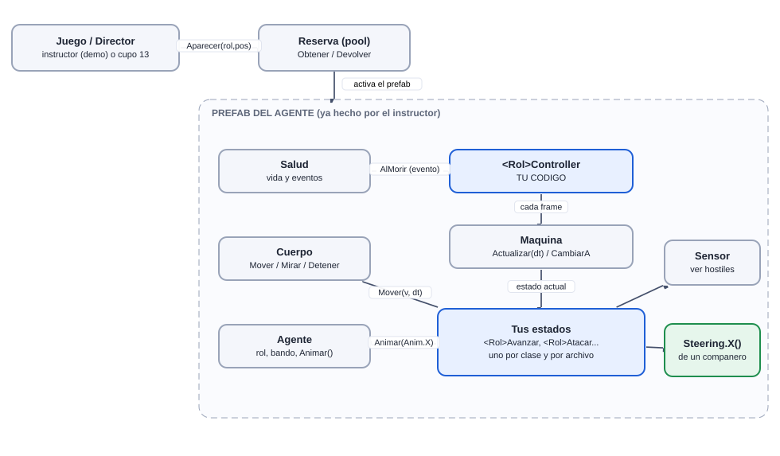
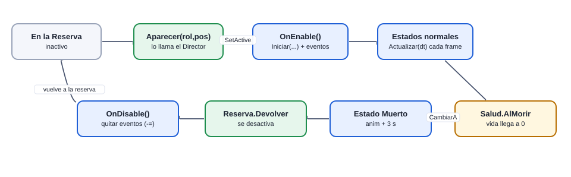
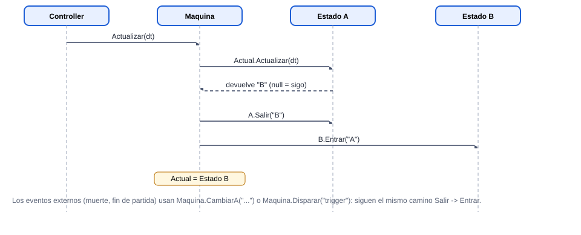
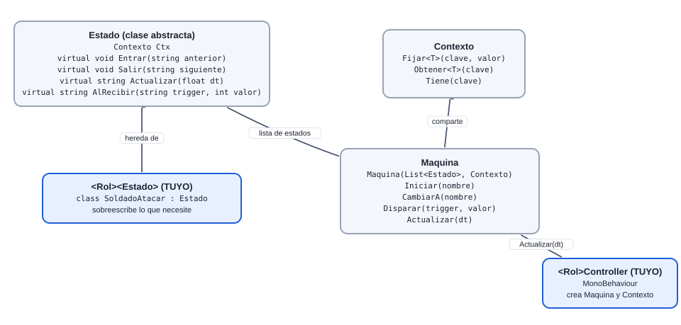
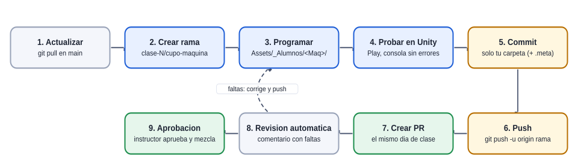
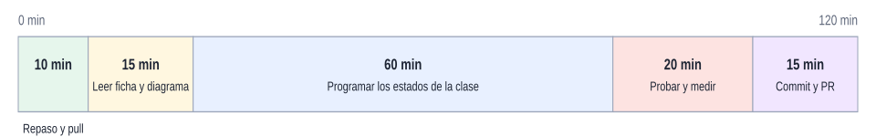

# Guía de inicio: de cero a tu primer estado

[Plan general](00_indice_y_plan.md) · [Guia de inicio](03_como_empezar.md) · [Estado general](01_estado_general.md) · [Steering](02_steering_behaviors.md) · [README](../README.md)

Si es tu primera vez con máquinas de estados o con este proyecto, lee esta página en orden. Son 10 pasos y 6 diagramas; al final sabes qué hacer en la primera hora.

## 1. Qué vas a construir

Un **agente** (un soldado, un guardia, una torre...) decide qué hacer con una **máquina de estados**: en cada momento está en *un solo estado* (Avanzar, Atacar, Huir...) y cambia a otro cuando se cumple una condición (vio un enemigo, recibió daño, terminó un temporizador). El instructor ya hizo el modelo, las animaciones, el mapa y la economía: tú escribes **solo código**.

## 2. Cómo encajan las piezas



- **Azul**: lo escribes tú. **Gris**: ya existe, solo lo usas. **Verde**: lo escribe un compañero (steering) o el Director.
- El Director *aparece* al agente desde la Reserva; tu `<Rol>Controller` se añade solo (`ControladorAuto` lo busca por nombre) y mueve tu máquina cada frame.
- Tus estados nunca se llaman entre sí: devuelven el *nombre* del siguiente estado y la `Maquina` hace el cambio.

## 3. El ciclo de vida de un agente



Los agentes **se reutilizan** (Reserva): por eso todo se reinicia en `OnEnable` y los eventos se quitan en `OnDisable`. Si no, el siguiente soldado hereda el estado y las suscripciones del anterior.

## 4. Qué pasa cuando cambia un estado



## 5. Las tres clases base



Más detalle en [Estado general](01_estado_general.md).

## 6. Tu primera hora (paso a paso)

1. **Clona el repo** y abre el proyecto con Unity `6000.3.10f1` en una ruta corta (ej. `C:\td\`). La primera apertura tarda varios minutos.
2. **Mira el juego sin tocar nada:** abre `Assets/_Granero/Escenas/Granero.unity` y pulsa Play. Elige una plataforma con clic, construye con `1` / `2` y llama la oleada con `ESPACIO`. Todos los agentes se mueven con un *cerebro demo* del instructor.
3. **Lee las máquinas de referencia** (`Assets/_Granero/Scripts/Estados/GraneroEstados.cs` y `SlotTorre.cs`): son pequeñas y usan la misma estructura que usarás tú.
4. **Abre tu ficha** (página de tu máquina): mira el diagrama, la tabla de estados y qué se entrega en la clase 1.
5. **Crea tu rama:** `git checkout -b clase-1/<cupo>-<maquina>`.
6. **Crea el controller** y el primer estado en `Assets/_Alumnos/<TuMaquina>/` copiando el esqueleto de tu ficha.
7. **Play:** en cuanto existe `<Rol>Controller`, el demo deja de mover a tu rol y lo hace tu máquina. Si ves la animación de tu primer estado, ya está vivo.
8. **Agrega un estado a la vez** y prueba cada uno antes del siguiente (de a poquito: un estado + una transición).
9. **Revisa la consola:** 0 errores y 0 avisos de tu código.
10. **Commit y PR** el mismo día (ver el flujo de abajo).

## 7. El flujo de trabajo con Git



> Solo se suben cambios de `Assets/_Alumnos/<TuMaquina>/` (y tus `Steering*.cs`). Si Unity modificó otros archivos (escenas, ProjectSettings), usa `git restore` antes del commit.

## 8. Cómo aprovechar las 2 horas de clase



Sugerencia de reparto del tiempo. La entrega de cada clase se califica con la [rúbrica](00_indice_y_plan.md).

## 9. Cómo diseñar una máquina (5 preguntas)

1. **¿Qué estados tiene?** Cada verbo distinto que el agente hace (caminar, perseguir, atacar...).
2. **¿Cuál es el inicial?** El primero al aparecer.
3. **¿Qué lo hace cambiar?** Para cada flecha escribe la condición (distancia, tiempo, vida, evento).
4. **¿Qué es global?** Lo que puede pasar desde cualquier estado: morir y festejar.
5. **¿Qué datos comparten los estados?** El objetivo, un temporizador, si ya entró en furia: van al `Contexto`.

Dibuja el diagrama en papel *antes* de escribir código y compáralo con el de tu ficha.

## 10. Errores típicos de los primeros días

| Síntoma | Causa probable |
| --- | --- |
| El agente no se mueve | Falta `Cuerpo.Mover(v, dt)` en `Actualizar`, o `v` es cero (destino igual a la posición). |
| No cambia de estado | Devuelves `null` siempre, o el nombre del estado está mal escrito (debe ser el de la clase, ej. `SoldadoAtacar`). |
| Error: *state not found* / no encuentra el estado | No lo registraste en la lista `new Maquina(new List<Estado> {...})`. |
| El segundo enemigo se comporta raro | No reiniciaste en `OnEnable` (los agentes se reutilizan). |
| Error de clase duplicada o la clase base «deja de funcionar» | Tu clase se llama igual que una del juego base (ej. `Sensor`). Usa el prefijo del rol (`SoldadoAtacar`) y tu `namespace Alumnos.<Maquina>`. |
| Mi controller no se activa | Debe llamarse `<Rol>Controller` (ej. `SoldadoController`), heredar de `MonoBehaviour` y estar en la carpeta del proyecto (no en un asmdef aparte). |
| La animación no cambia | Usa `agente.Animar(Anim.X)` con las constantes de `Anim`; si el rol no tiene esa animación sale un aviso en consola. |
| El juego se pone lento | `new`, `GetComponent` o `Sensor` cada frame dentro de `Actualizar`. |

## 11. Ejemplo completo: dos estados

```csharp
// SoldadoController.cs
using System.Collections.Generic;
using UnityEngine;

namespace Alumnos.Soldado
{
public class SoldadoController : MonoBehaviour
{
    Maquina maq;
    readonly Contexto ctx = new Contexto();
    Agente ag;

    void Awake()
    {
        ag = GetComponent<Agente>();
        ctx.Fijar("agente", ag);
        maq = new Maquina(new List<Estado> { new SoldadoAvanzar(), new SoldadoMuerto() }, ctx);
    }
    void OnEnable()  { maq.Iniciar("SoldadoAvanzar"); ag.salud.AlMorir += AlMorir; }
    void OnDisable() { ag.salud.AlMorir -= AlMorir; }
    void AlMorir(GameObject origen) { maq.CambiarA("SoldadoMuerto"); }
    void Update() { maq.Actualizar(Time.deltaTime); }
}
}

// SoldadoAvanzar.cs
using UnityEngine;

namespace Alumnos.Soldado
{
public class SoldadoAvanzar : Estado
{
    Agente ag;
    int indice;                                   // siguiente punto de la ruta
    public override void Entrar(string anterior)
    {
        ag = Ctx.Obtener<Agente>("agente");       // una sola vez, no en Actualizar
        ag.Animar(Anim.Caminar);
        indice = 0;
    }
    public override string Actualizar(float dt)
    {
        Vector3 destino = Ruta.Puntos[indice];
        if (Sensor.DistanciaPlana(ag.Pos, destino) < 0.6f && indice < Ruta.Puntos.Length - 1) indice++;
        Vector3 dir = (destino - ag.Pos); dir.y = 0f;
        ag.cuerpo.Mover(dir.normalized * ag.cuerpo.velocidadMax, dt);
        ag.cuerpo.Mirar(dir, dt);
        return null;                              // null = sigo en este estado
    }
}
}

// SoldadoMuerto.cs
using UnityEngine;

namespace Alumnos.Soldado
{
public class SoldadoMuerto : Estado
{
    float t;
    public override void Entrar(string anterior)
    {
        t = 0f;
        var ag = Ctx.Obtener<Agente>("agente");
        ag.cuerpo.Detener();
        ag.Animar(Anim.Muerte1);
    }
    public override string Actualizar(float dt)
    {
        t += dt;
        if (t > 3f) Reserva.Devolver(Ctx.Obtener<Agente>("agente").gameObject);   // vuelve al pool
        return null;
    }
}
}
```

Este ejemplo sirve para la clase 1 del Soldado. Cambia el rol y las animaciones para tu máquina. Si una constante de `Anim` no existe para tu rol, mira `Assets/_Granero/Scripts/Base/Tipos.cs`.

## 12. Siguiente lectura

- [Estado general](01_estado_general.md) (referencia de las 3 clases).
- [Steering behaviours](02_steering_behaviors.md) (si te tocan o los vas a usar).
- La ficha de tu máquina (enlaces en el [plan general](00_indice_y_plan.md)).
