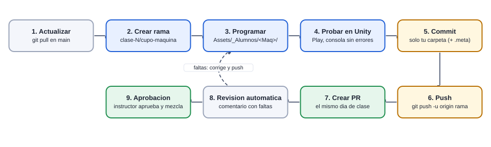
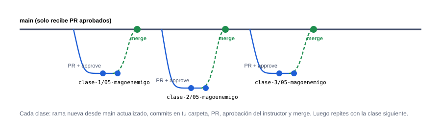

# Cómo subir tus cambios (paso a paso)

[Plan general](00_indice_y_plan.md) · [Guia de inicio](03_como_empezar.md) · [Como subir cambios](04_como_subir_cambios.md) · [Troubleshooting](05_troubleshooting.md) · [Estado general](01_estado_general.md) · [Steering](02_steering_behaviors.md) · [README](../README.md)

Esta guía te lleva de “ya programé algo” a “mi entrega está revisada”. Todo con consola; al final tienes los mismos pasos en GitHub Desktop. Si algo falla: [Troubleshooting (si el pipeline falla)](05_troubleshooting.md).

## 1. El camino completo





> **Reglas:** 1) nadie sube directo a `main`; 2) una rama y un PR por clase; 3) el PR se crea el día de la clase (límite 23:59 hora CDMX); 4) solo se sube tu carpeta; 5) el instructor aprueba y hace el merge.

## 2. Una sola vez: preparación

1. **Acepta la invitación** al repositorio (correo de GitHub o [github.com/BanyoLoper/tower-defense/invitations](https://github.com/BanyoLoper/tower-defense/invitations)). Sin esto no puedes subir ramas.
2. **Instala Git** (`git --version` debe responder) y, si quieres, la CLI de GitHub (`gh --version`).
3. **Tu identidad:**

```bash
git config --global user.name "Tu Nombre"
git config --global user.email "tu-correo@ejemplo.com"
git config --global core.longpaths true      # evita 'Filename too long' en Windows
git config --global pull.rebase false        # pull = merge, mas simple de entender
```

4. **Iniciar sesión en GitHub** (la primera vez que hagas push Git abre el navegador; o con la CLI):

```bash
gh auth login            # elige GitHub.com > HTTPS > navegador
gh auth status           # debe decir 'Logged in'
```

5. **Clona el repo** en una ruta CORTA (ej. `C:\td`; las rutas largas rompen Git en Windows) y abre esa carpeta con Unity `6000.3.10f1`:

```bash
cd C:\
git clone https://github.com/BanyoLoper/tower-defense.git td
cd td
git status               # debe decir: On branch main, working tree clean
```

## 3. Cada clase: los 8 pasos

El ejemplo usa al cupo **05 (MagoEnemigo)** en la clase 2. Cambia clase, cupo y máquina por los tuyos (están en la tabla del README).

### Paso 1 · Actualiza main

```bash
git checkout main
git pull
```

Trae lo que el instructor ya aprobó (incluida tu clase anterior, si ya se hizo merge).

### Paso 2 · Crea tu rama

```bash
git checkout -b clase-2/05-magoenemigo
```

El nombre es `clase-<N>/<cupo>-<maquina en minúsculas>`. Si te equivocas, ver Troubleshooting. Si tu PR de la clase anterior aún no se mergea: `git checkout -b clase-2/05-magoenemigo clase-1/05-magoenemigo`.

### Paso 3 · Programa y prueba

```bash
# Unity: escribe tus estados, Play, consola sin errores
```

Solo dentro de `Assets/_Alumnos/<TuMaquina>/` (y tus `Steering*.cs`).

### Paso 4 · Mira qué cambió

```bash
git status
```

Debe aparecer SOLO tu carpeta. Si ves `ProjectSettings`, `Packages` o escenas: `git restore ProjectSettings Packages Assets/_Granero`.

### Paso 5 · Guarda (commit)

```bash
git add Assets/_Alumnos/MagoEnemigo
git commit -m "clase 2: MagoEnemigo - Posicionarse"
```

Agrega solo tu carpeta (nunca `git add -A` ni `git add .`). Incluye los `.meta`.

### Paso 6 · Sube la rama

```bash
git push -u origin clase-2/05-magoenemigo
```

La primera vez lleva `-u`; después basta `git push`.

### Paso 7 · Crea el Pull Request

```bash
gh pr create --base main --title "Clase 2 - MagoEnemigo (cupo 05)" --body "Estados: Posicionarse"
```

Sin la CLI: abre `https://github.com/BanyoLoper/tower-defense/pulls` → *New pull request* → base `main`, compare tu rama → *Create pull request*. La fecha límite se mide **cuando creas el PR**.

### Paso 8 · Lee el reporte

```bash
gh pr view --comments
gh pr checks
```

En 1–2 minutos aparece un comentario del Action con ✅ (cumple), ❌ (falta) y ⚠️ (aviso). Sin CLI: pestaña *Conversation* del PR.

## 4. Si el reporte dice que falta algo

No cierres el PR ni crees otro: corrige en la misma rama y vuelve a subir. El PR se actualiza solo y el Action se ejecuta de nuevo.

```bash
# corrige lo que dice el reporte...
git status
git add Assets/_Alumnos/MagoEnemigo
git commit -m "clase 2: corregir segun la revision"
git push
```

> Corregir después del límite no te vuelve tardío: lo que cuenta es el día en que se **creó** el PR. Por eso crea el PR aunque esté incompleto y méjralo con commits.

## 5. Después del merge: prepara la siguiente clase

```bash
git checkout main
git pull
git branch -d clase-2/05-magoenemigo     # opcional: borra la rama local ya usada
git checkout -b clase-3/05-magoenemigo
```

## 6. Qué se sube y qué no

| Sí | No |
| --- | --- |
| `Assets/_Alumnos/<TuMaquina>/*.cs` y sus `.meta` | Escenas, prefabs, `ProjectSettings/`, `Packages/`, `Assets/_Granero/` |
| `Assets/_Alumnos/Steering/Steering<Nombre>.cs` (solo los tuyos) | Archivos de otros compañeros |
| Nada más | `Library/`, `Temp/`, `Logs/`, `obj/` (ya están ignorados) |

## 7. Lo mismo en GitHub Desktop

1. **Actualiza:** en *Current Branch* elige `main` → *Fetch origin* → *Pull origin*.
2. **Rama:** *Current Branch* → *New Branch* → escribe `clase-2/05-magoenemigo` → *Create Branch* (base: `main`).
3. **Programa** en Unity.
4. **Commit:** en la pestaña *Changes* desmarca todo lo que NO sea tu carpeta (clic derecho → *Discard changes* para lo ajeno), escribe el mensaje → *Commit to clase-2/05-magoenemigo*.
5. **Push:** botón *Publish branch* (o *Push origin* si ya estaba publicada).
6. **PR:** *Create Pull Request* (abre el navegador) → base `main` → *Create pull request*.
7. **Reporte:** pestaña *Conversation* del PR; corrige, commit y push y se actualiza solo.

> ¿Algo salió mal? Ve a [Troubleshooting (si el pipeline falla)](05_troubleshooting.md): está ordenado por el mensaje exacto que muestra el pipeline.
