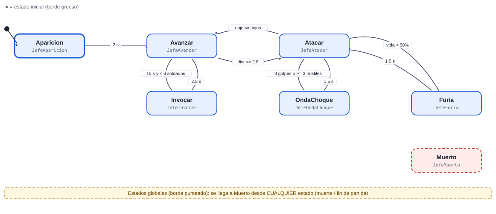
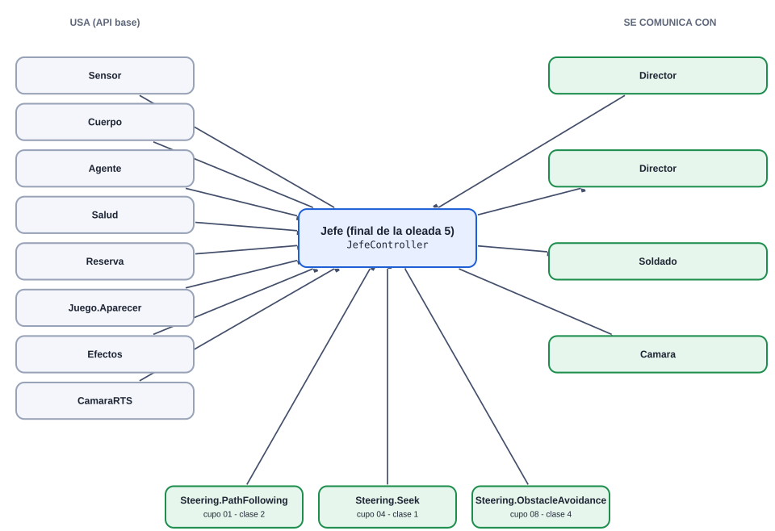
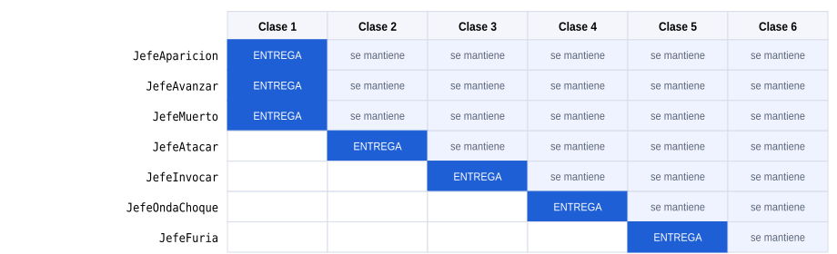
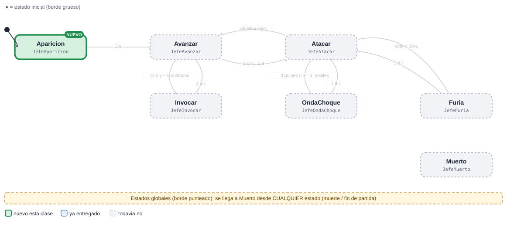
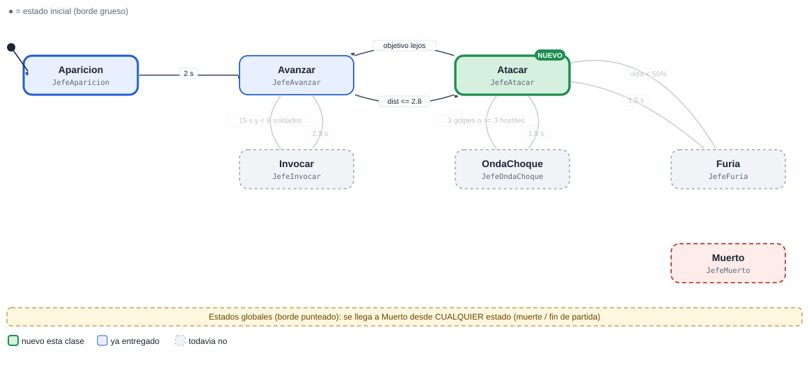
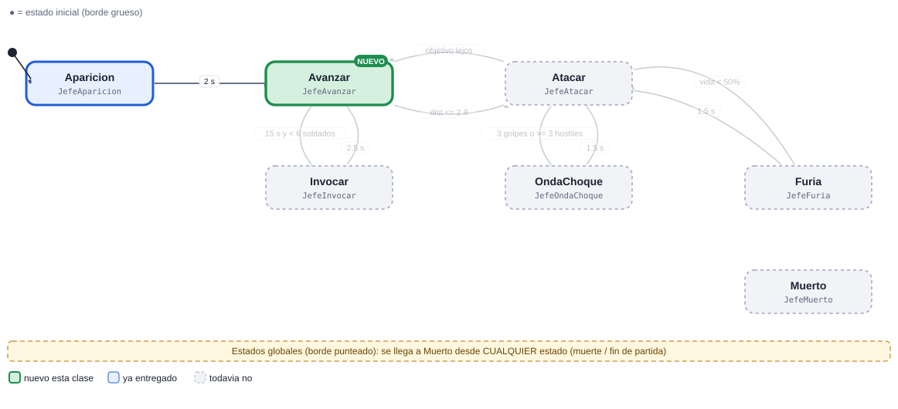
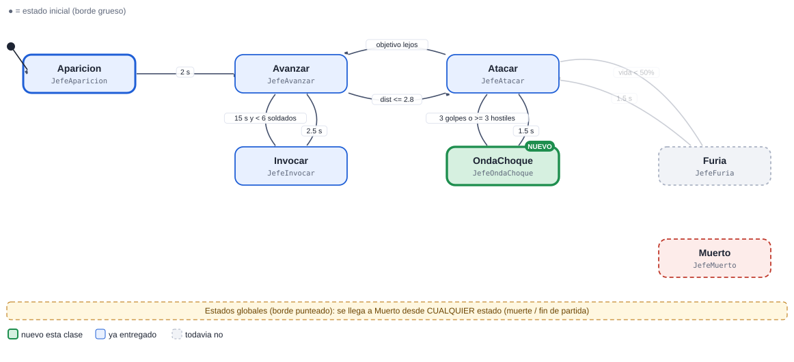
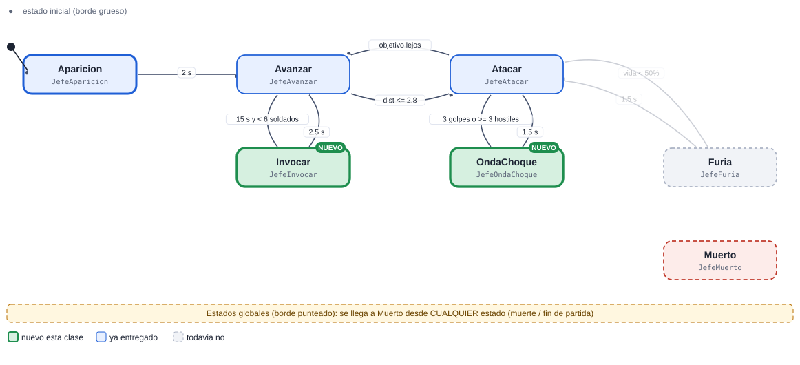
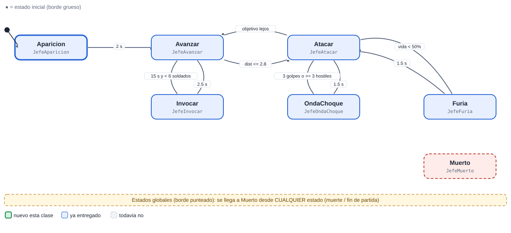

# 03 · Jefe (final de la oleada 5)

[Plan general](00_indice_y_plan.md) · [Guia de inicio](03_como_empezar.md) · [Como subir cambios](04_como_subir_cambios.md) · [Troubleshooting](05_troubleshooting.md) · [Estado general](01_estado_general.md) · [Steering](02_steering_behaviors.md) · [README](../README.md)

**Muy alta**  **Enemigo**

El jefe final. Tiene fases: aparece con un rugido, pelea, invoca refuerzos y lanza una onda de choque. Por debajo del 50% de vida entra en furia. Su muerte es la condición de victoria.

Peso de la máquina: **29.0 pts** · Steering a cargo: **0 pts** (ninguno) · Total del cupo 03: **29.0 pts** · Estados: **7** · Transiciones: **9**

## 1. Diagrama de estados



Las flechas se leen "desde → hasta" con la condición que dispara el cambio. El estado inicial es el de borde grueso. Cada estado devuelve el nombre del siguiente estado en `Actualizar` o `AlRecibir` (o `null` para quedarse).

> Documentos de apoyo: [Cómo subir tus cambios](04_como_subir_cambios.md) · [Troubleshooting (si el pipeline falla)](05_troubleshooting.md) · [Guía de inicio](03_como_empezar.md).

## Cómo empezar (primeros 30 minutos)

1. **Rama:** `git checkout main; git pull; git checkout -b clase-1/03-jefe`
2. **Mira tu agente en el juego:** abre `Assets/_Granero/Escenas/Granero.unity` y pulsa Play. Observa cómo se mueve con el cerebro demo; tu máquina lo va a reemplazar. *Aparece: oleada 5.*
3. **Crea estos archivos** en `Assets/_Alumnos/Jefe/`: `JefeController.cs`, `JefeAparicion.cs`, `JefeAvanzar.cs`, `JefeMuerto.cs`.
4. **Copia el esqueleto** de la sección de código más abajo (controller + primer estado) y registra tus estados en `new Maquina(new List<Estado> {...})`.
5. **Primer estado:** en `Entrar` pide la animación (`Enojado`) y en `Actualizar` haz lo mínimo (mover con `Cuerpo.Mover`).
6. **Play:** en cuanto existe `JefeController`, el sistema lo usa en lugar del demo. Si ves tu primer estado funcionando, sigue con el siguiente.
7. **Commit y PR** el mismo día (flujo en la [guía de inicio](03_como_empezar.md)).

Guía completa con diagramas: [guía de inicio](03_como_empezar.md).

## 2. Estados

| Estado (clase) | Qué hace | Animación | Steering |
| --- | --- | --- | --- |
| `JefeAparicion` | Rugido de entrada (2 s): Fx.OndaSuelo + CamaraRTS.I.Sacudir. | Enojado | — |
| `JefeAvanzar` | Camina la ruta hacia el granero. | Caminar | PathFollowing + ObstacleAvoidance |
| `JefeAtacar` | Combo de 3 golpes (Atacar1-3) con daño 70. | Atacar1-3 | Seek |
| `JefeInvocar` | Cada 15 s llama 3 Soldados con Juego.Aparecer (max 6 vivos). | Enojado + Fx.Aura | — |
| `JefeOndaChoque` | Ataque en área (radio 5): daño a todos los hostiles cercanos + Fx.Explosion. | Atacar3 + Fx | — |
| `JefeFuria` | Vida &lt; 50%: más rápido y combos más cortos. Una sola vez. | Enojado | — |
| `JefeMuerto` (global) | Global: Fx.Explosion y aviso al Director. | Muerte1 | — |

## 3. Transiciones

| Desde | Hacia | Condición |
| --- | --- | --- |
| Aparicion | Avanzar | 2 s |
| Avanzar | Atacar | dist &lt;= 2.8 |
| Atacar | Avanzar | objetivo lejos |
| Avanzar | Invocar | 15 s y &lt; 6 soldados |
| Invocar | Avanzar | 2.5 s |
| Atacar | OndaChoque | 3 golpes o >= 3 hostiles |
| OndaChoque | Atacar | 1.5 s |
| Atacar | Furia | vida &lt; 50% |
| Furia | Atacar | 1.5 s |
| *cualquiera* | Muerto | la vida llega a 0 (`Salud.AlMorir`) |

**Eventos que escucha:** `dano`, `muerte`, `vida_baja`, `timer_invocar`, `fin_juego`

## 4. Dependencias

### Mapa de dependencias



### 4.1 API base (ya hecha por el instructor)

| Clase | Qué usas |
| --- | --- |
| `Sensor` | HostilMasCercano / Contar, cada 0.2 s |
| `Cuerpo` | Mover / Mirar / Detener |
| `Agente` | Animar(Anim.X), Hostiles, DistanciaBorde |
| `Salud` | eventos AlDanar / AlMorir |
| `Reserva` | devolver el objeto al morir (pooling) |
| `Juego.Aparecer` | crear los refuerzos |
| `Efectos` | Fx.OndaSuelo, Fx.Aura, Fx.Explosion |
| `CamaraRTS` | CamaraRTS.I.Sacudir(fuerza) |

### 4.2 Comunicación con otras máquinas

| Con quién | Sentido | Cómo se comunican |
| --- | --- | --- |
| Director | recibe de | El Director lo crea (oleada 5) y espera su muerte. |
| Director | envía a | Al morir, Agente.AlMorirAlguien avisa; el Director termina con victoria. |
| Soldado | envía a | Invoca soldados (los controla su propia máquina). |
| Camara | envía a | Pide temblor en Aparicion y OndaChoque. |

> Regla de oro: las máquinas **no se llaman entre sí**. Se comunican solo por la API base y sus eventos (`Agente.AlMorirAlguien`, `Juego.AlCambiarFase`, `Alertas.AlAlerta`, `Economia`, `Sensor`...). Así nadie queda bloqueado esperando el código de un compañero.

### 4.3 Steering behaviours que usa (los programa otro compañero)

| Behaviour | Responsable | Se entrega en | Mientras tanto |
| --- | --- | --- | --- |
| [`Steering.PathFollowing`](02_steering_behaviors.md#path-following-seguir-camino-7-pts) | Cupo 01 (Soldado) | Clase 2 | usa `Cuerpo.Mover` con dirección directa hacia el objetivo |
| [`Steering.Seek`](02_steering_behaviors.md#seek-buscar-2-pts) | Cupo 04 (Lancero) | Clase 1 | usa `Cuerpo.Mover` con dirección directa hacia el objetivo |
| [`Steering.ObstacleAvoidance`](02_steering_behaviors.md#obstacle-avoidance-evitar-obstaculos-10-pts) | Cupo 08 (TorreMaga) | Clase 4 | usa `Cuerpo.Mover` con dirección directa hacia el objetivo |

El archivo `Steering.cs` ya existe como clase parcial vacía: cada responsable agrega SU archivo `Steering<Nombre>.cs`. Tu máquina solo llama a `Steering.<Nombre>(...)` cuando exista.

## 5. Entregas por clase



Azul: se entrega ese día. Celeste: se mantiene funcionando en las clases siguientes (se vuelve a revisar).

| Clase y día | Estados nuevos | Acumulado | Qué debe funcionar | Steering |
| --- | --- | --- | --- | --- |
| **1** Lun 9 nov | Aparicion, Avanzar, Muerto | 3/7 · 43% | Entrada con rugido (Fx + cámara), camina la ruta y muere. | — |
| **2** Mié 11 nov | Atacar | 4/7 · 57% | Combo de 3 golpes con daño y alcance correctos. | — |
| **3** Mié 18 nov | Invocar | 5/7 · 71% | Invoca soldados con Juego.Aparecer, con límite y cooldown. | — |
| **4** Lun 23 nov | OndaChoque | 6/7 · 86% | Ataque en área con Efectos y daño por radio (sin basura). | — |
| **5** Mié 25 nov | Furia | 7/7 · 100% | Fase de furia y avisos al Director/Camara. Integracion con la victoria. | — |
| **6** Lun 30 nov | (pulido) | 7/7 · 100% | Balance (que sea ganable), pulido, cero basura, demo. | — |

Guías: [Cómo subir tus cambios](04_como_subir_cambios.md) · [Troubleshooting (si el pipeline falla)](05_troubleshooting.md).

### Detalle de cada entrega (qué entregar, cómo comprobarlo y qué comandos usar)

> Antes de tu primera entrega lee **[Cómo subir tus cambios](04_como_subir_cambios.md)**. Si el pipeline marca algo en rojo: **[Troubleshooting (si el pipeline falla)](05_troubleshooting.md)**. Todas las fechas son el día de clase; el lunes 16 de noviembre es puente (no hay clase).

### Clase 1 · Lun 9 nov · PR a más tardar ese día, 23:59 (CDMX)

**Rama:** `clase-1/03-jefe`  ·  **Avance esperado:** 3 de 7 estados (43%)



| Archivo (en `Assets/_Alumnos/Jefe/`) | Qué debe tener |
| --- | --- |
| `JefeController.cs` | **Nuevo.** `class JefeController : MonoBehaviour` dentro de `namespace Alumnos.Jefe`. Crea el `Contexto`, la `Maquina` con tus estados e inicia en `Aparicion`. |
| `JefeAparicion.cs` | **Nuevo.** `class JefeAparicion : Estado`. Rugido de entrada (2 s): Fx.OndaSuelo + CamaraRTS.I.Sacudir. Animación: `Enojado`. |
| `JefeAvanzar.cs` | **Nuevo.** `class JefeAvanzar : Estado`. Camina la ruta hacia el granero. Animación: `Caminar`. |
| `JefeMuerto.cs` | **Nuevo.** `class JefeMuerto : Estado`. Global: Fx.Explosion y aviso al Director. Animación: `Muerte1`. |
| `*.meta` | Cada archivo nuevo trae su `.meta` (Unity lo crea al abrir el proyecto). Sube los dos. |

**Qué debe verse en Play al terminar esta clase**

- Entrada con rugido (Fx + cámara), camina la ruta y muere.
- Cómo probarlo: abre `Granero.unity`, pulsa Play y espera la oleada con ESPACIO. Tu agente aparece: oleada 5.

**Lo que revisa el Action en esta clase** (debe existir cada clase, hereda de `Estado` y estar registrada en el controller): `JefeAparicion`, `JefeAvanzar`, `JefeMuerto`.

Todavía NO se pide: `JefeAtacar`, `JefeInvocar`, `JefeOndaChoque`, `JefeFuria`.

**Lista de comprobación antes del PR**

- [ ] Unity compila: la consola está vacía (sin errores rojos).
- [ ] Probado en Play (lo de arriba funciona).
- [ ] `git status` solo muestra archivos de `Assets/_Alumnos/Jefe/` (y sus `.meta`).
- [ ] Todo tu código está dentro de `namespace Alumnos.Jefe` (los `Steering*.cs` no llevan namespace) y es ASCII (sin acentos ni ñ).
- [ ] La rama se llama exactamente `clase-1/03-jefe` y el PR se crea hoy (máximo el Lun 9 nov).
- [ ] Leíste el comentario del Action en tu PR y corregiste cada ❌.

**Comandos de esta entrega** (copiar y pegar; si algo falla ve a [Troubleshooting (si el pipeline falla)](05_troubleshooting.md)):

```bash
git checkout main
git pull
git checkout -b clase-1/03-jefe
# ... programas y pruebas en Unity ...
git status
git add Assets/_Alumnos/Jefe
git commit -m "clase 1: Jefe - Aparicion, Avanzar, Muerto"
git push -u origin clase-1/03-jefe
```

### Clase 2 · Mié 11 nov · PR a más tardar ese día, 23:59 (CDMX)

**Rama:** `clase-2/03-jefe`  ·  **Avance esperado:** 4 de 7 estados (57%)



| Archivo (en `Assets/_Alumnos/Jefe/`) | Qué debe tener |
| --- | --- |
| `JefeController.cs` | **Lo modificas.** Registra en la lista de la máquina los estados nuevos: `new JefeAtacar()`. |
| `JefeAtacar.cs` | **Nuevo.** `class JefeAtacar : Estado`. Combo de 3 golpes (Atacar1-3) con daño 70. Animación: `Atacar1-3`. |
| `*.meta` | Cada archivo nuevo trae su `.meta` (Unity lo crea al abrir el proyecto). Sube los dos. |

**Qué debe verse en Play al terminar esta clase**

- Combo de 3 golpes con daño y alcance correctos.
- Cómo probarlo: abre `Granero.unity`, pulsa Play y espera la oleada con ESPACIO. Tu agente aparece: oleada 5.

**Lo que revisa el Action en esta clase** (debe existir cada clase, hereda de `Estado` y estar registrada en el controller): `JefeAparicion`, `JefeAvanzar`, `JefeMuerto`, `JefeAtacar`.

Todavía NO se pide: `JefeInvocar`, `JefeOndaChoque`, `JefeFuria`.

**Lista de comprobación antes del PR**

- [ ] Unity compila: la consola está vacía (sin errores rojos).
- [ ] Probado en Play (lo de arriba funciona).
- [ ] `git status` solo muestra archivos de `Assets/_Alumnos/Jefe/` (y sus `.meta`).
- [ ] Todo tu código está dentro de `namespace Alumnos.Jefe` (los `Steering*.cs` no llevan namespace) y es ASCII (sin acentos ni ñ).
- [ ] La rama se llama exactamente `clase-2/03-jefe` y el PR se crea hoy (máximo el Mié 11 nov).
- [ ] Leíste el comentario del Action en tu PR y corregiste cada ❌.

**Comandos de esta entrega** (copiar y pegar; si algo falla ve a [Troubleshooting (si el pipeline falla)](05_troubleshooting.md)):

```bash
git checkout main
git pull
git checkout -b clase-2/03-jefe
# ... programas y pruebas en Unity ...
git status
git add Assets/_Alumnos/Jefe
git commit -m "clase 2: Jefe - Atacar"
git push -u origin clase-2/03-jefe
```

### Clase 3 · Mié 18 nov · PR a más tardar ese día, 23:59 (CDMX)

**Rama:** `clase-3/03-jefe`  ·  **Avance esperado:** 5 de 7 estados (71%)



| Archivo (en `Assets/_Alumnos/Jefe/`) | Qué debe tener |
| --- | --- |
| `JefeController.cs` | **Lo modificas.** Registra en la lista de la máquina los estados nuevos: `new JefeInvocar()`. |
| `JefeInvocar.cs` | **Nuevo.** `class JefeInvocar : Estado`. Cada 15 s llama 3 Soldados con Juego.Aparecer (max 6 vivos). Animación: `Enojado + Fx.Aura`. |
| `*.meta` | Cada archivo nuevo trae su `.meta` (Unity lo crea al abrir el proyecto). Sube los dos. |

**Qué debe verse en Play al terminar esta clase**

- Invoca soldados con Juego.Aparecer, con límite y cooldown.
- Cómo probarlo: abre `Granero.unity`, pulsa Play y espera la oleada con ESPACIO. Tu agente aparece: oleada 5.

**Lo que revisa el Action en esta clase** (debe existir cada clase, hereda de `Estado` y estar registrada en el controller): `JefeAparicion`, `JefeAvanzar`, `JefeMuerto`, `JefeAtacar`, `JefeInvocar`.

Todavía NO se pide: `JefeOndaChoque`, `JefeFuria`.

**Lista de comprobación antes del PR**

- [ ] Unity compila: la consola está vacía (sin errores rojos).
- [ ] Probado en Play (lo de arriba funciona).
- [ ] `git status` solo muestra archivos de `Assets/_Alumnos/Jefe/` (y sus `.meta`).
- [ ] Todo tu código está dentro de `namespace Alumnos.Jefe` (los `Steering*.cs` no llevan namespace) y es ASCII (sin acentos ni ñ).
- [ ] La rama se llama exactamente `clase-3/03-jefe` y el PR se crea hoy (máximo el Mié 18 nov).
- [ ] Leíste el comentario del Action en tu PR y corregiste cada ❌.

**Comandos de esta entrega** (copiar y pegar; si algo falla ve a [Troubleshooting (si el pipeline falla)](05_troubleshooting.md)):

```bash
git checkout main
git pull
git checkout -b clase-3/03-jefe
# ... programas y pruebas en Unity ...
git status
git add Assets/_Alumnos/Jefe
git commit -m "clase 3: Jefe - Invocar"
git push -u origin clase-3/03-jefe
```

### Clase 4 · Lun 23 nov · PR a más tardar ese día, 23:59 (CDMX)

**Rama:** `clase-4/03-jefe`  ·  **Avance esperado:** 6 de 7 estados (86%)



| Archivo (en `Assets/_Alumnos/Jefe/`) | Qué debe tener |
| --- | --- |
| `JefeController.cs` | **Lo modificas.** Registra en la lista de la máquina los estados nuevos: `new JefeOndaChoque()`. |
| `JefeOndaChoque.cs` | **Nuevo.** `class JefeOndaChoque : Estado`. Ataque en área (radio 5): daño a todos los hostiles cercanos + Fx.Explosion. Animación: `Atacar3 + Fx`. |
| `*.meta` | Cada archivo nuevo trae su `.meta` (Unity lo crea al abrir el proyecto). Sube los dos. |

**Qué debe verse en Play al terminar esta clase**

- Ataque en área con Efectos y daño por radio (sin basura).
- Cómo probarlo: abre `Granero.unity`, pulsa Play y espera la oleada con ESPACIO. Tu agente aparece: oleada 5.

**Lo que revisa el Action en esta clase** (debe existir cada clase, hereda de `Estado` y estar registrada en el controller): `JefeAparicion`, `JefeAvanzar`, `JefeMuerto`, `JefeAtacar`, `JefeInvocar`, `JefeOndaChoque`.

Todavía NO se pide: `JefeFuria`.

**Lista de comprobación antes del PR**

- [ ] Unity compila: la consola está vacía (sin errores rojos).
- [ ] Probado en Play (lo de arriba funciona).
- [ ] `git status` solo muestra archivos de `Assets/_Alumnos/Jefe/` (y sus `.meta`).
- [ ] Todo tu código está dentro de `namespace Alumnos.Jefe` (los `Steering*.cs` no llevan namespace) y es ASCII (sin acentos ni ñ).
- [ ] La rama se llama exactamente `clase-4/03-jefe` y el PR se crea hoy (máximo el Lun 23 nov).
- [ ] Leíste el comentario del Action en tu PR y corregiste cada ❌.

**Comandos de esta entrega** (copiar y pegar; si algo falla ve a [Troubleshooting (si el pipeline falla)](05_troubleshooting.md)):

```bash
git checkout main
git pull
git checkout -b clase-4/03-jefe
# ... programas y pruebas en Unity ...
git status
git add Assets/_Alumnos/Jefe
git commit -m "clase 4: Jefe - OndaChoque"
git push -u origin clase-4/03-jefe
```

### Clase 5 · Mié 25 nov · PR a más tardar ese día, 23:59 (CDMX)

**Rama:** `clase-5/03-jefe`  ·  **Avance esperado:** 7 de 7 estados (100%)



| Archivo (en `Assets/_Alumnos/Jefe/`) | Qué debe tener |
| --- | --- |
| `JefeController.cs` | **Lo modificas.** Registra en la lista de la máquina los estados nuevos: `new JefeFuria()`. |
| `JefeFuria.cs` | **Nuevo.** `class JefeFuria : Estado`. Vida &lt; 50%: más rápido y combos más cortos. Una sola vez. Animación: `Enojado`. |
| `*.meta` | Cada archivo nuevo trae su `.meta` (Unity lo crea al abrir el proyecto). Sube los dos. |

**Qué debe verse en Play al terminar esta clase**

- Fase de furia y avisos al Director/Camara. Integracion con la victoria.
- Cómo probarlo: abre `Granero.unity`, pulsa Play y espera la oleada con ESPACIO. Tu agente aparece: oleada 5.

**Lo que revisa el Action en esta clase** (debe existir cada clase, hereda de `Estado` y estar registrada en el controller): `JefeAparicion`, `JefeAvanzar`, `JefeMuerto`, `JefeAtacar`, `JefeInvocar`, `JefeOndaChoque`, `JefeFuria`.

**Lista de comprobación antes del PR**

- [ ] Unity compila: la consola está vacía (sin errores rojos).
- [ ] Probado en Play (lo de arriba funciona).
- [ ] `git status` solo muestra archivos de `Assets/_Alumnos/Jefe/` (y sus `.meta`).
- [ ] Todo tu código está dentro de `namespace Alumnos.Jefe` (los `Steering*.cs` no llevan namespace) y es ASCII (sin acentos ni ñ).
- [ ] La rama se llama exactamente `clase-5/03-jefe` y el PR se crea hoy (máximo el Mié 25 nov).
- [ ] Leíste el comentario del Action en tu PR y corregiste cada ❌.

**Comandos de esta entrega** (copiar y pegar; si algo falla ve a [Troubleshooting (si el pipeline falla)](05_troubleshooting.md)):

```bash
git checkout main
git pull
git checkout -b clase-5/03-jefe
# ... programas y pruebas en Unity ...
git status
git add Assets/_Alumnos/Jefe
git commit -m "clase 5: Jefe - Furia"
git push -u origin clase-5/03-jefe
```

### Clase 6 · Lun 30 nov · PR a más tardar ese día, 23:59 (CDMX)

**Rama:** `clase-6/03-jefe`  ·  **Avance esperado:** 7 de 7 estados (100%)



| Archivo (en `Assets/_Alumnos/Jefe/`) | Qué debe tener |
| --- | --- |
| `JefeController.cs` | **Lo modificas.** Registra en la lista de la máquina los estados nuevos: ninguno nuevo (solo ajustes). |
| (todos tus archivos) | Pulido final: ver la lista de comprobación de abajo. No hay estados nuevos. |
| `*.meta` | Cada archivo nuevo trae su `.meta` (Unity lo crea al abrir el proyecto). Sube los dos. |

**Qué debe verse en Play al terminar esta clase**

- Balance (que sea ganable), pulido, cero basura, demo.
- Una oleada completa de principio a fin sin errores ni avisos en la consola.
- Profiler: `GC Alloc` en 0 B dentro de tus `Actualizar` (medido en Play).
- Pooling correcto: el segundo agente que reaparece se comporta igual que el primero (todo se reinicia en `OnEnable`/`Entrar`).
- Demo en vivo de 3 minutos mostrando cada estado y cada transición de tu diagrama.

**Lo que revisa el Action en esta clase** (debe existir cada clase, hereda de `Estado` y estar registrada en el controller): `JefeAparicion`, `JefeAvanzar`, `JefeMuerto`, `JefeAtacar`, `JefeInvocar`, `JefeOndaChoque`, `JefeFuria`.

**Lista de comprobación antes del PR**

- [ ] Unity compila: la consola está vacía (sin errores rojos).
- [ ] Probado en Play (lo de arriba funciona).
- [ ] `git status` solo muestra archivos de `Assets/_Alumnos/Jefe/` (y sus `.meta`).
- [ ] Todo tu código está dentro de `namespace Alumnos.Jefe` (los `Steering*.cs` no llevan namespace) y es ASCII (sin acentos ni ñ).
- [ ] La rama se llama exactamente `clase-6/03-jefe` y el PR se crea hoy (máximo el Lun 30 nov).
- [ ] Leíste el comentario del Action en tu PR y corregiste cada ❌.

**Comandos de esta entrega** (copiar y pegar; si algo falla ve a [Troubleshooting (si el pipeline falla)](05_troubleshooting.md)):

```bash
git checkout main
git pull
git checkout -b clase-6/03-jefe
# ... programas y pruebas en Unity ...
git status
git add Assets/_Alumnos/Jefe
git commit -m "clase 6: Jefe - pulido final"
git push -u origin clase-6/03-jefe
```

### Rúbrica (igual en todas las clases)

| Criterio | Puntos | Qué se revisa |
| --- | --- | --- |
| Funciona en el juego | 50 | El agente/sistema hace lo pedido en Play, sin errores en consola, con el prefab real. |
| Estados entregados | 30 | Cumple los estados de ESA clase (ver tabla). Cada estado que falta resta proporcionalmente. |
| Codigo y rendimiento | 20 | Una clase por estado con prefijo del rol, ASCII, sin new/LINQ en Update, eventos desuscritos, cero basura medido. |
| Total por clase | 100 | La calificación final es el promedio de las 6 entregas (cada clase pesa igual). |

## 6. Esqueleto de código

Punto de partida. Copia el patrón del `SoldadoController`/estados de referencia; el resto de estados siguen la misma forma. Nombres de clase únicos: `Jefe<Estado>`.

```csharp
// JefeController.cs
using System.Collections.Generic;
using UnityEngine;

namespace Alumnos.Jefe
{
public class JefeController : MonoBehaviour
{
    Maquina maq;
    readonly Contexto ctx = new Contexto();
    Agente ag;

    void Awake()
    {
        ag = GetComponent<Agente>();
        ctx.Fijar("agente", ag);
        ctx.Fijar("ctrl", this);
        maq = new Maquina(new List<Estado> { new JefeAparicion(), new JefeAvanzar(), new JefeAtacar(), new JefeInvocar(), new JefeOndaChoque(), new JefeFuria(), new JefeMuerto() }, ctx);
    }

    void OnEnable()   // OJO: los agentes vienen de la Reserva (se reutilizan): reinicia todo aqui
    {
        maq.Iniciar("JefeAparicion");
        ag.salud.AlMorir += AlMorir;
    }

    void OnDisable()
    {
        ag.salud.AlMorir -= AlMorir;   // siempre desuscribirse
    }

    void AlMorir(GameObject origen) { maq.CambiarA("JefeMuerto"); }

    void Update() { maq.Actualizar(Time.deltaTime); }
}
}

// JefeAparicion.cs  (un archivo por estado; mismo namespace y prefijo del rol)
using UnityEngine;

namespace Alumnos.Jefe
{
public class JefeAparicion : Estado
{
    float t;
    public override void Entrar(string anterior)
    {
        t = 0f;
        var ag = Ctx.Obtener<Agente>("agente");
        ag.Animar(Anim.Caminar);   // usa las constantes de la clase Anim
    }
    public override string Actualizar(float dt)
    {
        t += dt;
        // TODO: logica del estado; devuelve el NOMBRE del siguiente estado o null para quedarse
        return null;
    }
    public override string AlRecibir(string trigger, int valor) { return null; }
}
}
```

## 7. Reglas que se califican siempre

- Todo tu código va dentro de `namespace Alumnos.<TuMaquina>` (ej. `Alumnos.MagoEnemigo`). Los archivos `Steering*.cs` NO llevan namespace.
- Una clase por estado, hereda de `Estado`, nombre con prefijo del rol. Ninguna clase puede llamarse igual que una del juego base.
- Nada de `new`, LINQ, `GetComponent` ni `Find` dentro de `Actualizar`: guarda referencias en `Entrar` o en el Contexto.
- El Sensor se consulta cada 0.2 s, no cada frame.
- Suscripciones a eventos en `OnEnable`, baja en `OnDisable` (los agentes se reutilizan).
- Todo el código en ASCII (sin acentos ni ñ).
