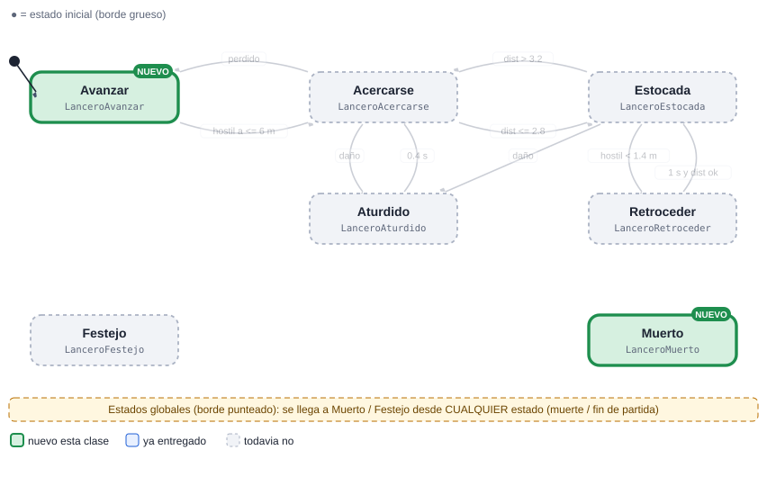
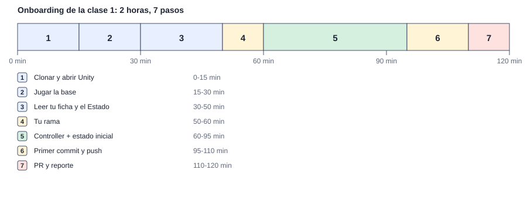
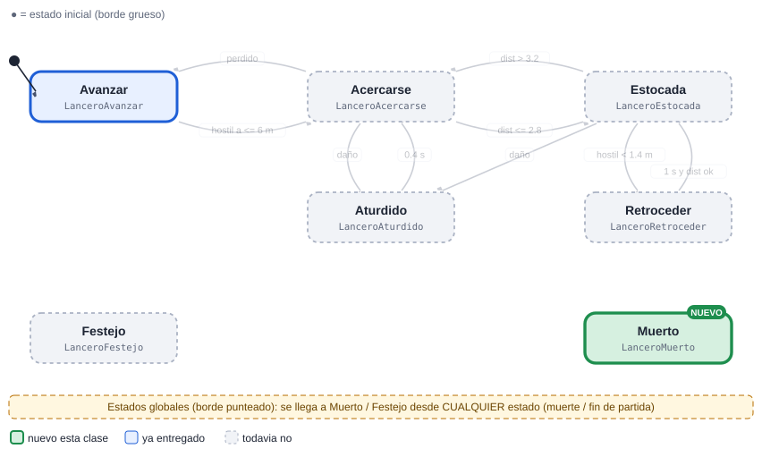
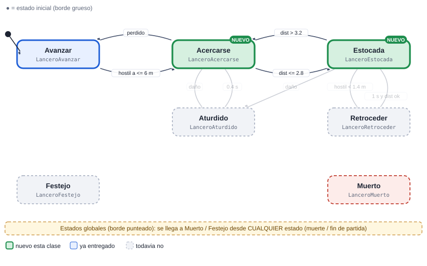
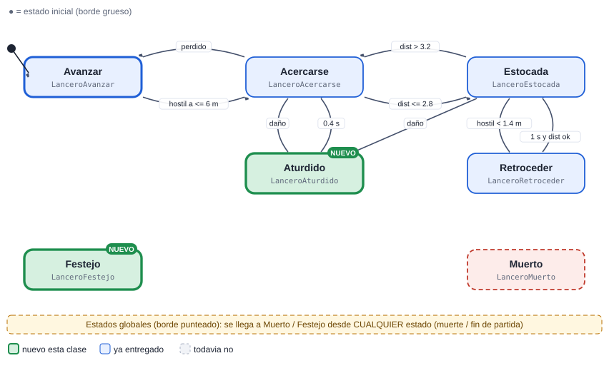
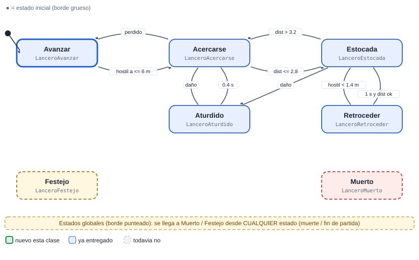

# 04 · Lancero enemigo

[Plan general](00_indice_y_plan.md) · [Guia de inicio](03_como_empezar.md) · [Como subir cambios](04_como_subir_cambios.md) · [Troubleshooting](05_troubleshooting.md) · [Estado general](01_estado_general.md) · [Steering](02_steering_behaviors.md) · [README](../README.md)

**Alta**  **Enemigo**

Ataca desde media distancia (2.8 m) y no le gusta que se le acerquen: si un hostil entra a su espacio, retrocede y vuelve a picar. Es la primera máquina con Flee.

Peso de la máquina: **25.5 pts** · Steering a cargo: **2 pts** (Seek (2 pts)) · Total del cupo 04: **27.5 pts** · Estados: **7** · Transiciones: **9**

## 1. Diagrama de estados


Las flechas se leen "desde → hasta" con la condición que dispara el cambio. El estado inicial es el de borde grueso. Cada estado devuelve el nombre del siguiente estado en `Actualizar` o `AlRecibir` (o `null` para quedarse).

> Documentos de apoyo: [Cómo subir tus cambios](04_como_subir_cambios.md) · [Troubleshooting (si el pipeline falla)](05_troubleshooting.md) · [Guía de inicio](03_como_empezar.md).

## Cómo empezar (primeros 30 minutos)

1. **Rama:** `git checkout main; git pull; git checkout -b clase-1/04-lancero`
2. **Mira tu agente en el juego:** abre `Assets/_Granero/Escenas/Granero.unity` y pulsa Play. Observa cómo se mueve con el cerebro demo; tu máquina lo va a reemplazar. *Aparece: desde la oleada 2.*
3. **Crea estos archivos** en `Assets/_Alumnos/Lancero/`: `LanceroController.cs`, `LanceroAvanzar.cs`, `LanceroMuerto.cs`.
4. **Copia el esqueleto** de la sección de código más abajo (controller + primer estado) y registra tus estados en `new Maquina(new List<Estado> {...})`.
5. **Primer estado:** en `Entrar` pide la animación (`Caminar`) y en `Actualizar` haz lo mínimo (mover con `Cuerpo.Mover`).
6. **Play:** en cuanto existe `LanceroController`, el sistema lo usa en lugar del demo. Si ves tu primer estado funcionando, sigue con el siguiente.
7. **Commit y PR** el mismo día (flujo en la [guía de inicio](03_como_empezar.md)).

Guía completa con diagramas: [guía de inicio](03_como_empezar.md).

## 2. Estados

| Estado (clase) | Qué hace | Animación | Steering |
| --- | --- | --- | --- |
| `LanceroAvanzar` | Sigue la ruta. | Caminar | PathFollowing |
| `LanceroAcercarse` | Va hacia el hostil hasta quedar a ~2.8 m. | Correr | Seek |
| `LanceroEstocada` | Pica con la lanza desde su alcance (daño 11). | Atacar1 / Atacar2 | Arrive (ajuste fino) |
| `LanceroRetroceder` | Si el hostil esta a &lt; 1.4 m, se aleja 1 s para recuperar distancia. | Caminar | Flee |
| `LanceroAturdido` | Reaccion al daño. | Dano1 | — |
| `LanceroFestejo` (global) | Global. | Celebrar1 | — |
| `LanceroMuerto` (global) | Global. | Muerte1 | — |

## 3. Transiciones

| Desde | Hacia | Condición |
| --- | --- | --- |
| Avanzar | Acercarse | hostil a &lt;= 6 m |
| Acercarse | Avanzar | perdido |
| Acercarse | Estocada | dist &lt;= 2.8 |
| Estocada | Acercarse | dist > 3.2 |
| Estocada | Retroceder | hostil &lt; 1.4 m |
| Retroceder | Estocada | 1 s y dist ok |
| Acercarse | Aturdido | daño |
| Estocada | Aturdido | daño |
| Aturdido | Acercarse | 0.4 s |
| *cualquiera* | Muerto | la vida llega a 0 (`Salud.AlMorir`) |
| *cualquiera* | Festejo | fin de partida (`Juego.AlCambiarFase`) |

**Eventos que escucha:** `dano`, `muerte`, `fin_juego`, `hostil_visto`, `hostil_muy_cerca`

## 4. Dependencias

### Mapa de dependencias


### 4.1 API base (ya hecha por el instructor)

| Clase | Qué usas |
| --- | --- |
| `Sensor` | HostilMasCercano / Contar, cada 0.2 s |
| `Cuerpo` | Mover / Mirar / Detener |
| `Agente` | Animar(Anim.X), Hostiles, DistanciaBorde |
| `Salud` | eventos AlDanar / AlMorir |
| `Reserva` | devolver el objeto al morir (pooling) |
| `Ruta` | Ruta.Puntos |
| `Steering` | Seek, Flee, Arrive, PathFollowing |

### 4.2 Comunicación con otras máquinas

| Con quién | Sentido | Cómo se comunican |
| --- | --- | --- |
| Director | recibe de | Lo crea desde la oleada 2. |
| Aldeano / Guardia | envía a | Provoca huida y combate. |

> Regla de oro: las máquinas **no se llaman entre sí**. Se comunican solo por la API base y sus eventos (`Agente.AlMorirAlguien`, `Juego.AlCambiarFase`, `Alertas.AlAlerta`, `Economia`, `Sensor`...). Así nadie queda bloqueado esperando el código de un compañero.

### 4.3 Steering behaviours que usa (los programa otro compañero)

| Behaviour | Responsable | Se entrega en | Mientras tanto |
| --- | --- | --- | --- |
| [`Steering.PathFollowing`](02_steering_behaviors.md#path-following-seguir-camino-7-pts) | Cupo 01 (Soldado) | Clase 2 | usa `Cuerpo.Mover` con dirección directa hacia el objetivo |
| [`Steering.Seek`](02_steering_behaviors.md#seek-buscar-2-pts) | Cupo 04 (Lancero) | Clase 1 | usa `Cuerpo.Mover` con dirección directa hacia el objetivo |
| [`Steering.Flee`](02_steering_behaviors.md#flee-huir-2-pts) | Cupo 09 (Guardia) | Clase 1 | usa `Cuerpo.Mover` con dirección directa hacia el objetivo |
| [`Steering.Arrive`](02_steering_behaviors.md#arrive-llegar-4-pts) | Cupo 02 (Bruto) | Clase 2 | usa `Cuerpo.Mover` con dirección directa hacia el objetivo |

El archivo `Steering.cs` ya existe como clase parcial vacía: cada responsable agrega SU archivo `Steering<Nombre>.cs`. Tu máquina solo llama a `Steering.<Nombre>(...)` cuando exista.

## 5. Steering que debes programar tú (cupo 04)

| Behaviour | Pts | Entrega | Lo usan |
| --- | --- | --- | --- |
| [Seek (buscar)](02_steering_behaviors.md#seek-buscar-2-pts) | 2 | Clase 1 | Soldado, Bruto, Jefe, Lancero |

### Cómo probar tu steering aislado

Crea en tu carpeta de máquina un script de prueba (no se usa en el juego final) y ponlo en un objeto con un `Cuerpo` sobre el NavMesh de la escena:

```csharp
using UnityEngine;

namespace Alumnos.Lancero   // el namespace de tu MAQUINA (el probe no es parte de Steering)
{
public class ProbeSeek : MonoBehaviour   // nombre unico: Probe + tu steering
{
    public Transform objetivo;
    public float vMax = 3f;
    Cuerpo cuerpo;
    void Awake() { cuerpo = GetComponent<Cuerpo>(); }
    void Update()
    {
        Vector3 v = Steering.Seek(transform.position, objetivo.position, vMax);   // ajusta los parametros a tu firma
        cuerpo.Mover(v, Time.deltaTime);
    }
}
}
```

## 6. Entregas por clase


Azul: se entrega ese día. Celeste: se mantiene funcionando en las clases siguientes (se vuelve a revisar).

| Clase y día | Estados nuevos | Acumulado | Qué debe funcionar | Steering |
| --- | --- | --- | --- | --- |
| **1** Lun 9 nov | Avanzar, Muerto | 2/7 · 29% | Esqueleto, ruta y muerte. | Seek |
| **2** Mié 11 nov | Acercarse | 3/7 · 43% | Persecucion hasta distancia de ataque con Seek. | — |
| **3** Mié 18 nov | Estocada | 4/7 · 57% | Ataque a media distancia con cadencia. | — |
| **4** Lun 23 nov | Retroceder | 5/7 · 71% | Mantiene distancia con Flee; ciclo estocada-retroceso estable. | — |
| **5** Mié 25 nov | Aturdido, Festejo | 7/7 · 100% | Reaccion al daño y festejo. | — |
| **6** Lun 30 nov | (pulido) | 7/7 · 100% | Pulido, cero basura, demo. | — |

Guías: [Cómo subir tus cambios](04_como_subir_cambios.md) · [Troubleshooting (si el pipeline falla)](05_troubleshooting.md).

### Detalle de cada entrega (qué entregar, cómo comprobarlo y qué comandos usar)

> Antes de tu primera entrega lee **[Cómo subir tus cambios](04_como_subir_cambios.md)**. Si el pipeline marca algo en rojo: **[Troubleshooting (si el pipeline falla)](05_troubleshooting.md)**. Todas las fechas son el día de clase; el lunes 16 de noviembre es puente (no hay clase).

### Clase 1 · Lun 9 nov · PR a más tardar ese día, 23:59 (CDMX)

**Rama:** `clase-1/04-lancero`  ·  **Avance esperado:** 2 de 7 estados (29%)  ·  **Steering:** Seek



| Archivo (en `Assets/_Alumnos/Lancero/`) | Qué debe tener |
| --- | --- |
| `LanceroController.cs` | **Nuevo.** `class LanceroController : MonoBehaviour` dentro de `namespace Alumnos.Lancero`. Crea el `Contexto`, la `Maquina` con tus estados e inicia en `Avanzar`. |
| `LanceroAvanzar.cs` | **Nuevo.** `class LanceroAvanzar : Estado`. Sigue la ruta. Animación: `Caminar`. |
| `LanceroMuerto.cs` | **Nuevo.** `class LanceroMuerto : Estado`. Global. Animación: `Muerte1`. |
| `../Steering/SteeringSeek.cs` | **Nuevo.** `public static partial class Steering` (SIN namespace) con `public static Vector3 Seek(Vector3 pos, Vector3 destino, float vMax)`. Prueba: Un agente de prueba llega a un punto movil sin atravesar el suelo y se detiene a 0.3 m (o sigue pasando, segun el caso). |
| `*.meta` | Cada archivo nuevo trae su `.meta` (Unity lo crea al abrir el proyecto). Sube los dos. |

**Qué debe verse en Play al terminar esta clase**

- Esqueleto, ruta y muerte.
- Cómo probarlo: abre `Granero.unity`, pulsa Play y espera la oleada con ESPACIO. Tu agente aparece: desde la oleada 2.

**Lo que revisa el Action en esta clase** (debe existir cada clase, hereda de `Estado` y estar registrada en el controller): `LanceroAvanzar`, `LanceroMuerto` y las del steering de esta clase.

Todavía NO se pide: `LanceroAcercarse`, `LanceroEstocada`, `LanceroRetroceder`, `LanceroAturdido`, `LanceroFestejo`.

**Lista de comprobación antes del PR**

- [ ] Unity compila: la consola está vacía (sin errores rojos).
- [ ] Probado en Play (lo de arriba funciona).
- [ ] `git status` solo muestra archivos de `Assets/_Alumnos/Lancero/` y de `Assets/_Alumnos/Steering/` (y sus `.meta`).
- [ ] Todo tu código está dentro de `namespace Alumnos.Lancero` (los `Steering*.cs` no llevan namespace) y es ASCII (sin acentos ni ñ).
- [ ] La rama se llama exactamente `clase-1/04-lancero` y el PR se crea hoy (máximo el Lun 9 nov).
- [ ] Leíste el comentario del Action en tu PR y corregiste cada ❌.

**Comandos de esta entrega** (copiar y pegar; si algo falla ve a [Troubleshooting (si el pipeline falla)](05_troubleshooting.md)):

```bash
git checkout main
git pull
git checkout -b clase-1/04-lancero
# ... programas y pruebas en Unity ...
git status
git add Assets/_Alumnos/Lancero  Assets/_Alumnos/Steering
git commit -m "clase 1: Lancero - Avanzar, Muerto"
git push -u origin clase-1/04-lancero
```

### Clase 2 · Mié 11 nov · PR a más tardar ese día, 23:59 (CDMX)

**Rama:** `clase-2/04-lancero`  ·  **Avance esperado:** 3 de 7 estados (43%)



| Archivo (en `Assets/_Alumnos/Lancero/`) | Qué debe tener |
| --- | --- |
| `LanceroController.cs` | **Lo modificas.** Registra en la lista de la máquina los estados nuevos: `new LanceroAcercarse()`. |
| `LanceroAcercarse.cs` | **Nuevo.** `class LanceroAcercarse : Estado`. Va hacia el hostil hasta quedar a ~2.8 m. Animación: `Correr`. |
| `*.meta` | Cada archivo nuevo trae su `.meta` (Unity lo crea al abrir el proyecto). Sube los dos. |

**Qué debe verse en Play al terminar esta clase**

- Persecucion hasta distancia de ataque con Seek.
- Cómo probarlo: abre `Granero.unity`, pulsa Play y espera la oleada con ESPACIO. Tu agente aparece: desde la oleada 2.

**Lo que revisa el Action en esta clase** (debe existir cada clase, hereda de `Estado` y estar registrada en el controller): `LanceroAvanzar`, `LanceroMuerto`, `LanceroAcercarse`.

Todavía NO se pide: `LanceroEstocada`, `LanceroRetroceder`, `LanceroAturdido`, `LanceroFestejo`.

**Lista de comprobación antes del PR**

- [ ] Unity compila: la consola está vacía (sin errores rojos).
- [ ] Probado en Play (lo de arriba funciona).
- [ ] `git status` solo muestra archivos de `Assets/_Alumnos/Lancero/` y de `Assets/_Alumnos/Steering/` (y sus `.meta`).
- [ ] Todo tu código está dentro de `namespace Alumnos.Lancero` (los `Steering*.cs` no llevan namespace) y es ASCII (sin acentos ni ñ).
- [ ] La rama se llama exactamente `clase-2/04-lancero` y el PR se crea hoy (máximo el Mié 11 nov).
- [ ] Leíste el comentario del Action en tu PR y corregiste cada ❌.

**Comandos de esta entrega** (copiar y pegar; si algo falla ve a [Troubleshooting (si el pipeline falla)](05_troubleshooting.md)):

```bash
git checkout main
git pull
git checkout -b clase-2/04-lancero
# ... programas y pruebas en Unity ...
git status
git add Assets/_Alumnos/Lancero
git commit -m "clase 2: Lancero - Acercarse"
git push -u origin clase-2/04-lancero
```

### Clase 3 · Mié 18 nov · PR a más tardar ese día, 23:59 (CDMX)

**Rama:** `clase-3/04-lancero`  ·  **Avance esperado:** 4 de 7 estados (57%)



| Archivo (en `Assets/_Alumnos/Lancero/`) | Qué debe tener |
| --- | --- |
| `LanceroController.cs` | **Lo modificas.** Registra en la lista de la máquina los estados nuevos: `new LanceroEstocada()`. |
| `LanceroEstocada.cs` | **Nuevo.** `class LanceroEstocada : Estado`. Pica con la lanza desde su alcance (daño 11). Animación: `Atacar1 / Atacar2`. |
| `*.meta` | Cada archivo nuevo trae su `.meta` (Unity lo crea al abrir el proyecto). Sube los dos. |

**Qué debe verse en Play al terminar esta clase**

- Ataque a media distancia con cadencia.
- Cómo probarlo: abre `Granero.unity`, pulsa Play y espera la oleada con ESPACIO. Tu agente aparece: desde la oleada 2.

**Lo que revisa el Action en esta clase** (debe existir cada clase, hereda de `Estado` y estar registrada en el controller): `LanceroAvanzar`, `LanceroMuerto`, `LanceroAcercarse`, `LanceroEstocada`.

Todavía NO se pide: `LanceroRetroceder`, `LanceroAturdido`, `LanceroFestejo`.

**Lista de comprobación antes del PR**

- [ ] Unity compila: la consola está vacía (sin errores rojos).
- [ ] Probado en Play (lo de arriba funciona).
- [ ] `git status` solo muestra archivos de `Assets/_Alumnos/Lancero/` y de `Assets/_Alumnos/Steering/` (y sus `.meta`).
- [ ] Todo tu código está dentro de `namespace Alumnos.Lancero` (los `Steering*.cs` no llevan namespace) y es ASCII (sin acentos ni ñ).
- [ ] La rama se llama exactamente `clase-3/04-lancero` y el PR se crea hoy (máximo el Mié 18 nov).
- [ ] Leíste el comentario del Action en tu PR y corregiste cada ❌.

**Comandos de esta entrega** (copiar y pegar; si algo falla ve a [Troubleshooting (si el pipeline falla)](05_troubleshooting.md)):

```bash
git checkout main
git pull
git checkout -b clase-3/04-lancero
# ... programas y pruebas en Unity ...
git status
git add Assets/_Alumnos/Lancero
git commit -m "clase 3: Lancero - Estocada"
git push -u origin clase-3/04-lancero
```

### Clase 4 · Lun 23 nov · PR a más tardar ese día, 23:59 (CDMX)

**Rama:** `clase-4/04-lancero`  ·  **Avance esperado:** 5 de 7 estados (71%)



| Archivo (en `Assets/_Alumnos/Lancero/`) | Qué debe tener |
| --- | --- |
| `LanceroController.cs` | **Lo modificas.** Registra en la lista de la máquina los estados nuevos: `new LanceroRetroceder()`. |
| `LanceroRetroceder.cs` | **Nuevo.** `class LanceroRetroceder : Estado`. Si el hostil esta a &lt; 1.4 m, se aleja 1 s para recuperar distancia. Animación: `Caminar`. |
| `*.meta` | Cada archivo nuevo trae su `.meta` (Unity lo crea al abrir el proyecto). Sube los dos. |

**Qué debe verse en Play al terminar esta clase**

- Mantiene distancia con Flee; ciclo estocada-retroceso estable.
- Cómo probarlo: abre `Granero.unity`, pulsa Play y espera la oleada con ESPACIO. Tu agente aparece: desde la oleada 2.

**Lo que revisa el Action en esta clase** (debe existir cada clase, hereda de `Estado` y estar registrada en el controller): `LanceroAvanzar`, `LanceroMuerto`, `LanceroAcercarse`, `LanceroEstocada`, `LanceroRetroceder`.

Todavía NO se pide: `LanceroAturdido`, `LanceroFestejo`.

**Lista de comprobación antes del PR**

- [ ] Unity compila: la consola está vacía (sin errores rojos).
- [ ] Probado en Play (lo de arriba funciona).
- [ ] `git status` solo muestra archivos de `Assets/_Alumnos/Lancero/` y de `Assets/_Alumnos/Steering/` (y sus `.meta`).
- [ ] Todo tu código está dentro de `namespace Alumnos.Lancero` (los `Steering*.cs` no llevan namespace) y es ASCII (sin acentos ni ñ).
- [ ] La rama se llama exactamente `clase-4/04-lancero` y el PR se crea hoy (máximo el Lun 23 nov).
- [ ] Leíste el comentario del Action en tu PR y corregiste cada ❌.

**Comandos de esta entrega** (copiar y pegar; si algo falla ve a [Troubleshooting (si el pipeline falla)](05_troubleshooting.md)):

```bash
git checkout main
git pull
git checkout -b clase-4/04-lancero
# ... programas y pruebas en Unity ...
git status
git add Assets/_Alumnos/Lancero
git commit -m "clase 4: Lancero - Retroceder"
git push -u origin clase-4/04-lancero
```

### Clase 5 · Mié 25 nov · PR a más tardar ese día, 23:59 (CDMX)

**Rama:** `clase-5/04-lancero`  ·  **Avance esperado:** 7 de 7 estados (100%)



| Archivo (en `Assets/_Alumnos/Lancero/`) | Qué debe tener |
| --- | --- |
| `LanceroController.cs` | **Lo modificas.** Registra en la lista de la máquina los estados nuevos: `new LanceroAturdido()`, `new LanceroFestejo()`. |
| `LanceroAturdido.cs` | **Nuevo.** `class LanceroAturdido : Estado`. Reaccion al daño. Animación: `Dano1`. |
| `LanceroFestejo.cs` | **Nuevo.** `class LanceroFestejo : Estado`. Global. Animación: `Celebrar1`. |
| `*.meta` | Cada archivo nuevo trae su `.meta` (Unity lo crea al abrir el proyecto). Sube los dos. |

**Qué debe verse en Play al terminar esta clase**

- Reaccion al daño y festejo.
- Cómo probarlo: abre `Granero.unity`, pulsa Play y espera la oleada con ESPACIO. Tu agente aparece: desde la oleada 2.

**Lo que revisa el Action en esta clase** (debe existir cada clase, hereda de `Estado` y estar registrada en el controller): `LanceroAvanzar`, `LanceroMuerto`, `LanceroAcercarse`, `LanceroEstocada`, `LanceroRetroceder`, `LanceroAturdido`, `LanceroFestejo`.

**Lista de comprobación antes del PR**

- [ ] Unity compila: la consola está vacía (sin errores rojos).
- [ ] Probado en Play (lo de arriba funciona).
- [ ] `git status` solo muestra archivos de `Assets/_Alumnos/Lancero/` y de `Assets/_Alumnos/Steering/` (y sus `.meta`).
- [ ] Todo tu código está dentro de `namespace Alumnos.Lancero` (los `Steering*.cs` no llevan namespace) y es ASCII (sin acentos ni ñ).
- [ ] La rama se llama exactamente `clase-5/04-lancero` y el PR se crea hoy (máximo el Mié 25 nov).
- [ ] Leíste el comentario del Action en tu PR y corregiste cada ❌.

**Comandos de esta entrega** (copiar y pegar; si algo falla ve a [Troubleshooting (si el pipeline falla)](05_troubleshooting.md)):

```bash
git checkout main
git pull
git checkout -b clase-5/04-lancero
# ... programas y pruebas en Unity ...
git status
git add Assets/_Alumnos/Lancero
git commit -m "clase 5: Lancero - Aturdido, Festejo"
git push -u origin clase-5/04-lancero
```

### Clase 6 · Lun 30 nov · PR a más tardar ese día, 23:59 (CDMX)

**Rama:** `clase-6/04-lancero`  ·  **Avance esperado:** 7 de 7 estados (100%)



| Archivo (en `Assets/_Alumnos/Lancero/`) | Qué debe tener |
| --- | --- |
| `LanceroController.cs` | **Lo modificas.** Registra en la lista de la máquina los estados nuevos: ninguno nuevo (solo ajustes). |
| (todos tus archivos) | Pulido final: ver la lista de comprobación de abajo. No hay estados nuevos. |
| `*.meta` | Cada archivo nuevo trae su `.meta` (Unity lo crea al abrir el proyecto). Sube los dos. |

**Qué debe verse en Play al terminar esta clase**

- Pulido, cero basura, demo.
- Una oleada completa de principio a fin sin errores ni avisos en la consola.
- Profiler: `GC Alloc` en 0 B dentro de tus `Actualizar` (medido en Play).
- Pooling correcto: el segundo agente que reaparece se comporta igual que el primero (todo se reinicia en `OnEnable`/`Entrar`).
- Demo en vivo de 3 minutos mostrando cada estado y cada transición de tu diagrama.

**Lo que revisa el Action en esta clase** (debe existir cada clase, hereda de `Estado` y estar registrada en el controller): `LanceroAvanzar`, `LanceroMuerto`, `LanceroAcercarse`, `LanceroEstocada`, `LanceroRetroceder`, `LanceroAturdido`, `LanceroFestejo`.

**Lista de comprobación antes del PR**

- [ ] Unity compila: la consola está vacía (sin errores rojos).
- [ ] Probado en Play (lo de arriba funciona).
- [ ] `git status` solo muestra archivos de `Assets/_Alumnos/Lancero/` y de `Assets/_Alumnos/Steering/` (y sus `.meta`).
- [ ] Todo tu código está dentro de `namespace Alumnos.Lancero` (los `Steering*.cs` no llevan namespace) y es ASCII (sin acentos ni ñ).
- [ ] La rama se llama exactamente `clase-6/04-lancero` y el PR se crea hoy (máximo el Lun 30 nov).
- [ ] Leíste el comentario del Action en tu PR y corregiste cada ❌.

**Comandos de esta entrega** (copiar y pegar; si algo falla ve a [Troubleshooting (si el pipeline falla)](05_troubleshooting.md)):

```bash
git checkout main
git pull
git checkout -b clase-6/04-lancero
# ... programas y pruebas en Unity ...
git status
git add Assets/_Alumnos/Lancero
git commit -m "clase 6: Lancero - pulido final"
git push -u origin clase-6/04-lancero
```

### Rúbrica (igual en todas las clases)

| Criterio | Puntos | Qué se revisa |
| --- | --- | --- |
| Funciona en el juego | 50 | El agente/sistema hace lo pedido en Play, sin errores en consola, con el prefab real. |
| Estados entregados | 30 | Cumple los estados de ESA clase (ver tabla). Cada estado que falta resta proporcionalmente. |
| Codigo y rendimiento | 20 | Una clase por estado con prefijo del rol, ASCII, sin new/LINQ en Update, eventos desuscritos, cero basura medido. |
| Total por clase | 100 | La calificación final es el promedio de las 6 entregas (cada clase pesa igual). |

## 7. Esqueleto de código

Punto de partida. Copia el patrón del `SoldadoController`/estados de referencia; el resto de estados siguen la misma forma. Nombres de clase únicos: `Lancero<Estado>`.

```csharp
// LanceroController.cs
using System.Collections.Generic;
using UnityEngine;

namespace Alumnos.Lancero
{
public class LanceroController : MonoBehaviour
{
    Maquina maq;
    readonly Contexto ctx = new Contexto();
    Agente ag;

    void Awake()
    {
        ag = GetComponent<Agente>();
        ctx.Fijar("agente", ag);
        ctx.Fijar("ctrl", this);
        maq = new Maquina(new List<Estado> { new LanceroAvanzar(), new LanceroAcercarse(), new LanceroEstocada(), new LanceroRetroceder(), new LanceroAturdido(), new LanceroFestejo(), new LanceroMuerto() }, ctx);
    }

    void OnEnable()   // OJO: los agentes vienen de la Reserva (se reutilizan): reinicia todo aqui
    {
        maq.Iniciar("LanceroAvanzar");
        ag.salud.AlMorir += AlMorir;
    }

    void OnDisable()
    {
        ag.salud.AlMorir -= AlMorir;   // siempre desuscribirse
    }

    void AlMorir(GameObject origen) { maq.CambiarA("LanceroMuerto"); }

    void Update() { maq.Actualizar(Time.deltaTime); }
}
}

// LanceroAvanzar.cs  (un archivo por estado; mismo namespace y prefijo del rol)
using UnityEngine;

namespace Alumnos.Lancero
{
public class LanceroAvanzar : Estado
{
    float t;
    public override void Entrar(string anterior)
    {
        t = 0f;
        var ag = Ctx.Obtener<Agente>("agente");
        ag.Animar(Anim.Caminar);   // usa las constantes de la clase Anim
    }
    public override string Actualizar(float dt)
    {
        t += dt;
        // TODO: logica del estado; devuelve el NOMBRE del siguiente estado o null para quedarse
        return null;
    }
    public override string AlRecibir(string trigger, int valor) { return null; }
}
}
```

## 8. Reglas que se califican siempre

- Todo tu código va dentro de `namespace Alumnos.<TuMaquina>` (ej. `Alumnos.MagoEnemigo`). Los archivos `Steering*.cs` NO llevan namespace.
- Una clase por estado, hereda de `Estado`, nombre con prefijo del rol. Ninguna clase puede llamarse igual que una del juego base.
- Nada de `new`, LINQ, `GetComponent` ni `Find` dentro de `Actualizar`: guarda referencias en `Entrar` o en el Contexto.
- El Sensor se consulta cada 0.2 s, no cada frame.
- Suscripciones a eventos en `OnEnable`, baja en `OnDisable` (los agentes se reutilizan).
- Todo el código en ASCII (sin acentos ni ñ).
