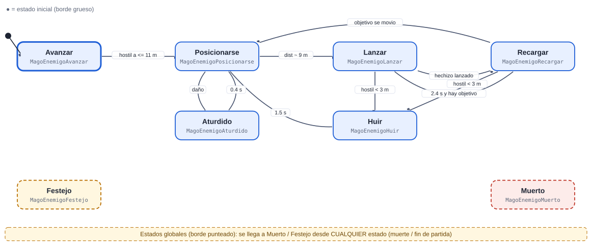
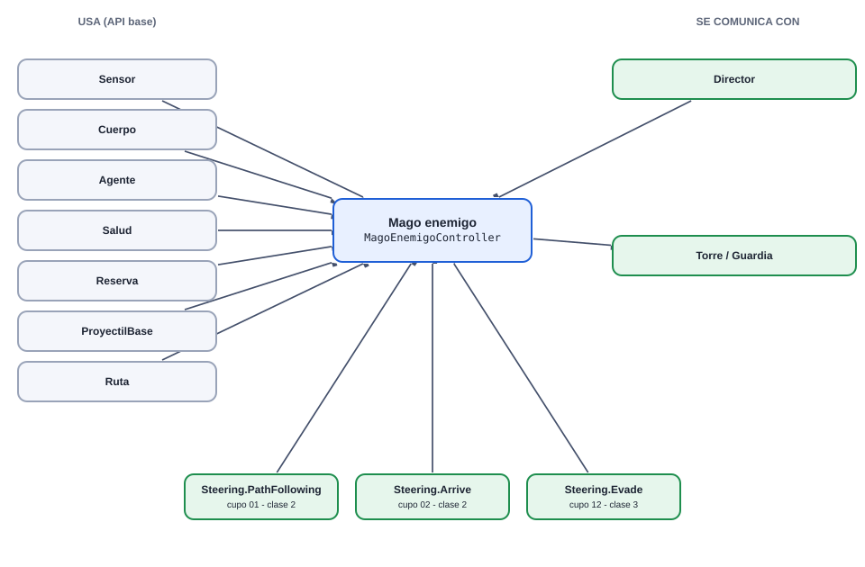
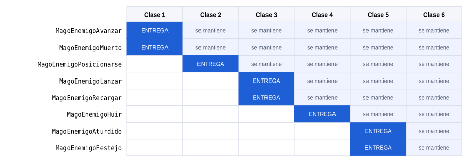
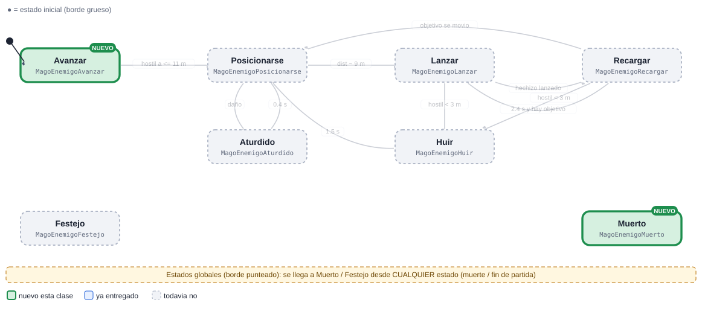
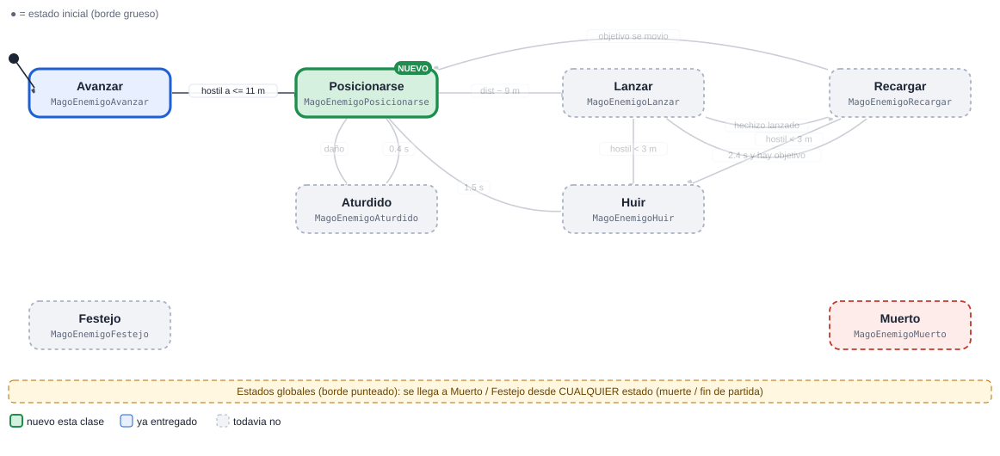
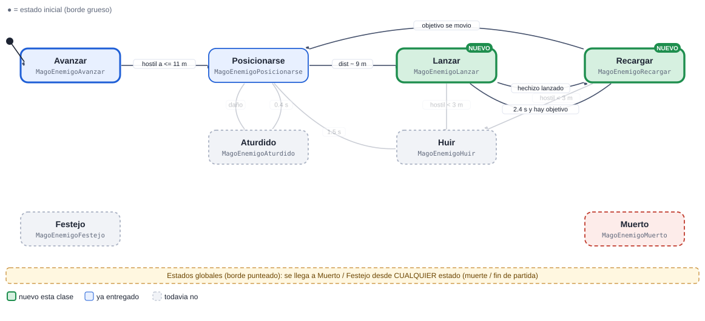
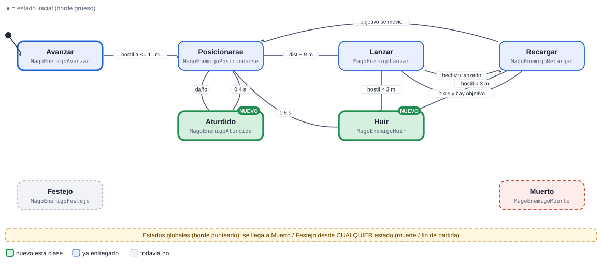
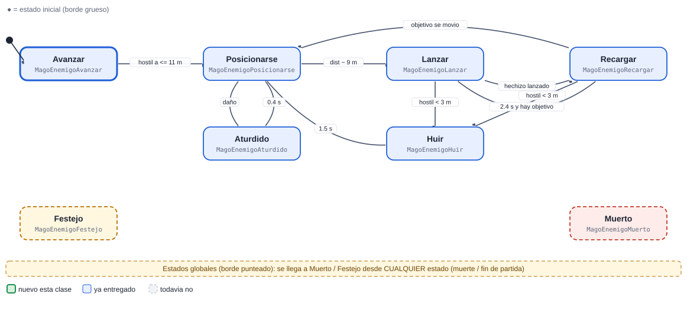

# 05 · Mago enemigo

[Plan general](00_indice_y_plan.md) · [Guia de inicio](03_como_empezar.md) · [Como subir cambios](04_como_subir_cambios.md) · [Troubleshooting](05_troubleshooting.md) · [Estado general](01_estado_general.md) · [Steering](02_steering_behaviors.md) · [README](../README.md)

**Alta**  **Enemigo**

Lanza bolas de fuego desde lejos (9 m). Busca la distancia ideal, lanza, recarga y huye si lo alcanzan. Usa proyectiles con Reserva.

Peso de la máquina: **27.5 pts** · Steering a cargo: **0 pts** (ninguno) · Total del cupo 05: **27.5 pts** · Estados: **8** · Transiciones: **10**

## 1. Diagrama de estados



Las flechas se leen "desde → hasta" con la condición que dispara el cambio. El estado inicial es el de borde grueso. Cada estado devuelve el nombre del siguiente estado en `Actualizar` o `AlRecibir` (o `null` para quedarse).

> Documentos de apoyo: [Cómo subir tus cambios](04_como_subir_cambios.md) · [Troubleshooting (si el pipeline falla)](05_troubleshooting.md) · [Guía de inicio](03_como_empezar.md).

## Cómo empezar (primeros 30 minutos)

1. **Rama:** `git checkout main; git pull; git checkout -b clase-1/05-magoenemigo`
2. **Mira tu agente en el juego:** abre `Assets/_Granero/Escenas/Granero.unity` y pulsa Play. Observa cómo se mueve con el cerebro demo; tu máquina lo va a reemplazar. *Aparece: desde la oleada 3.*
3. **Crea estos archivos** en `Assets/_Alumnos/MagoEnemigo/`: `MagoEnemigoController.cs`, `MagoEnemigoAvanzar.cs`, `MagoEnemigoMuerto.cs`.
4. **Copia el esqueleto** de la sección de código más abajo (controller + primer estado) y registra tus estados en `new Maquina(new List<Estado> {...})`.
5. **Primer estado:** en `Entrar` pide la animación (`Caminar`) y en `Actualizar` haz lo mínimo (mover con `Cuerpo.Mover`).
6. **Play:** en cuanto existe `MagoEnemigoController`, el sistema lo usa en lugar del demo. Si ves tu primer estado funcionando, sigue con el siguiente.
7. **Commit y PR** el mismo día (flujo en la [guía de inicio](03_como_empezar.md)).

Guía completa con diagramas: [guía de inicio](03_como_empezar.md).

## 2. Estados

| Estado (clase) | Qué hace | Animación | Steering |
| --- | --- | --- | --- |
| `MagoEnemigoAvanzar` | Sigue la ruta. | Caminar | PathFollowing |
| `MagoEnemigoPosicionarse` | Se coloca a ~9 m del objetivo y frena suave. | Caminar | Arrive |
| `MagoEnemigoLanzar` | Cast con proyectil: ProyectilBase.Lanzar(...) a mitad de la animación. | HechizoLanzar | — |
| `MagoEnemigoRecargar` | Espera 2.4 s entre hechizos. | HechizoIdle | — |
| `MagoEnemigoHuir` | Si un hostil esta a &lt; 3 m, se escapa 1.5 s anticipando su trayectoria. | Correr | Evade |
| `MagoEnemigoAturdido` | Reaccion al daño. | Dano1 | — |
| `MagoEnemigoFestejo` (global) | Global. | Celebrar1 | — |
| `MagoEnemigoMuerto` (global) | Global. | Muerte1 | — |

## 3. Transiciones

| Desde | Hacia | Condición |
| --- | --- | --- |
| Avanzar | Posicionarse | hostil a &lt;= 11 m |
| Posicionarse | Lanzar | dist ~ 9 m |
| Lanzar | Recargar | hechizo lanzado |
| Recargar | Lanzar | 2.4 s y hay objetivo |
| Recargar | Posicionarse | objetivo se movio |
| Lanzar | Huir | hostil &lt; 3 m |
| Recargar | Huir | hostil &lt; 3 m |
| Huir | Posicionarse | 1.5 s |
| Posicionarse | Aturdido | daño |
| Aturdido | Posicionarse | 0.4 s |
| *cualquiera* | Muerto | la vida llega a 0 (`Salud.AlMorir`) |
| *cualquiera* | Festejo | fin de partida (`Juego.AlCambiarFase`) |

**Eventos que escucha:** `dano`, `muerte`, `fin_juego`, `hostil_visto`, `hostil_muy_cerca`

## 4. Dependencias

### Mapa de dependencias



### 4.1 API base (ya hecha por el instructor)

| Clase | Qué usas |
| --- | --- |
| `Sensor` | HostilMasCercano / Contar, cada 0.2 s |
| `Cuerpo` | Mover / Mirar / Detener |
| `Agente` | Animar(Anim.X), Hostiles, DistanciaBorde |
| `Salud` | eventos AlDanar / AlMorir |
| `Reserva` | devolver el objeto al morir (pooling) |
| `ProyectilBase` | Lanzar(quien,destino,bando,daño) con Reserva |
| `Steering` | Arrive, Evade, PathFollowing |
| `Ruta` | Ruta.Puntos |

### 4.2 Comunicación con otras máquinas

| Con quién | Sentido | Cómo se comunican |
| --- | --- | --- |
| Director | recibe de | Lo crea desde la oleada 3. |
| Torre / Guardia | envía a | Es su objetivo prioritario por ser fragil. |

> Regla de oro: las máquinas **no se llaman entre sí**. Se comunican solo por la API base y sus eventos (`Agente.AlMorirAlguien`, `Juego.AlCambiarFase`, `Alertas.AlAlerta`, `Economia`, `Sensor`...). Así nadie queda bloqueado esperando el código de un compañero.

### 4.3 Steering behaviours que usa (los programa otro compañero)

| Behaviour | Responsable | Se entrega en | Mientras tanto |
| --- | --- | --- | --- |
| [`Steering.PathFollowing`](02_steering_behaviors.md#path-following-seguir-camino-7-pts) | Cupo 01 (Soldado) | Clase 2 | usa `Cuerpo.Mover` con dirección directa hacia el objetivo |
| [`Steering.Arrive`](02_steering_behaviors.md#arrive-llegar-4-pts) | Cupo 02 (Bruto) | Clase 2 | usa `Cuerpo.Mover` con dirección directa hacia el objetivo |
| [`Steering.Evade`](02_steering_behaviors.md#evade-escapar-con-predicción-6-pts) | Cupo 12 (Reparador) | Clase 3 | usa `Cuerpo.Mover` con dirección directa hacia el objetivo |

El archivo `Steering.cs` ya existe como clase parcial vacía: cada responsable agrega SU archivo `Steering<Nombre>.cs`. Tu máquina solo llama a `Steering.<Nombre>(...)` cuando exista.

## 5. Entregas por clase



Azul: se entrega ese día. Celeste: se mantiene funcionando en las clases siguientes (se vuelve a revisar).

| Clase y día | Estados nuevos | Acumulado | Qué debe funcionar | Steering |
| --- | --- | --- | --- | --- |
| **1** Lun 9 nov | Avanzar, Muerto | 2/8 · 25% | Esqueleto, ruta y muerte. | — |
| **2** Mié 11 nov | Posicionarse | 3/8 · 38% | Se detiene a la distancia ideal con Arrive. | — |
| **3** Mié 18 nov | Lanzar, Recargar | 5/8 · 62% | Dispara proyectiles con cooldown; el daño llega al impacto. | — |
| **4** Lun 23 nov | Huir | 6/8 · 75% | Evade/escape al ser alcanzado y regreso a Posicionarse. | — |
| **5** Mié 25 nov | Aturdido, Festejo | 8/8 · 100% | Reacciones y festejo. | — |
| **6** Lun 30 nov | (pulido) | 8/8 · 100% | Pulido, pooling de proyectiles, cero basura, demo. | — |

Guías: [Cómo subir tus cambios](04_como_subir_cambios.md) · [Troubleshooting (si el pipeline falla)](05_troubleshooting.md).

### Detalle de cada entrega (qué entregar, cómo comprobarlo y qué comandos usar)

> Antes de tu primera entrega lee **[Cómo subir tus cambios](04_como_subir_cambios.md)**. Si el pipeline marca algo en rojo: **[Troubleshooting (si el pipeline falla)](05_troubleshooting.md)**. Todas las fechas son el día de clase; el lunes 16 de noviembre es puente (no hay clase).

### Clase 1 · Lun 9 nov · PR a más tardar ese día, 23:59 (CDMX)

**Rama:** `clase-1/05-magoenemigo`  ·  **Avance esperado:** 2 de 8 estados (25%)



| Archivo (en `Assets/_Alumnos/MagoEnemigo/`) | Qué debe tener |
| --- | --- |
| `MagoEnemigoController.cs` | **Nuevo.** `class MagoEnemigoController : MonoBehaviour` dentro de `namespace Alumnos.MagoEnemigo`. Crea el `Contexto`, la `Maquina` con tus estados e inicia en `Avanzar`. |
| `MagoEnemigoAvanzar.cs` | **Nuevo.** `class MagoEnemigoAvanzar : Estado`. Sigue la ruta. Animación: `Caminar`. |
| `MagoEnemigoMuerto.cs` | **Nuevo.** `class MagoEnemigoMuerto : Estado`. Global. Animación: `Muerte1`. |
| `*.meta` | Cada archivo nuevo trae su `.meta` (Unity lo crea al abrir el proyecto). Sube los dos. |

**Qué debe verse en Play al terminar esta clase**

- Esqueleto, ruta y muerte.
- Cómo probarlo: abre `Granero.unity`, pulsa Play y espera la oleada con ESPACIO. Tu agente aparece: desde la oleada 3.

**Lo que revisa el Action en esta clase** (debe existir cada clase, hereda de `Estado` y estar registrada en el controller): `MagoEnemigoAvanzar`, `MagoEnemigoMuerto`.

Todavía NO se pide: `MagoEnemigoPosicionarse`, `MagoEnemigoLanzar`, `MagoEnemigoRecargar`, `MagoEnemigoHuir`, `MagoEnemigoAturdido`, `MagoEnemigoFestejo`.

**Lista de comprobación antes del PR**

- [ ] Unity compila: la consola está vacía (sin errores rojos).
- [ ] Probado en Play (lo de arriba funciona).
- [ ] `git status` solo muestra archivos de `Assets/_Alumnos/MagoEnemigo/` (y sus `.meta`).
- [ ] Todo tu código está dentro de `namespace Alumnos.MagoEnemigo` (los `Steering*.cs` no llevan namespace) y es ASCII (sin acentos ni ñ).
- [ ] La rama se llama exactamente `clase-1/05-magoenemigo` y el PR se crea hoy (máximo el Lun 9 nov).
- [ ] Leíste el comentario del Action en tu PR y corregiste cada ❌.

**Comandos de esta entrega** (copiar y pegar; si algo falla ve a [Troubleshooting (si el pipeline falla)](05_troubleshooting.md)):

```bash
git checkout main
git pull
git checkout -b clase-1/05-magoenemigo
# ... programas y pruebas en Unity ...
git status
git add Assets/_Alumnos/MagoEnemigo
git commit -m "clase 1: MagoEnemigo - Avanzar, Muerto"
git push -u origin clase-1/05-magoenemigo
```

### Clase 2 · Mié 11 nov · PR a más tardar ese día, 23:59 (CDMX)

**Rama:** `clase-2/05-magoenemigo`  ·  **Avance esperado:** 3 de 8 estados (38%)



| Archivo (en `Assets/_Alumnos/MagoEnemigo/`) | Qué debe tener |
| --- | --- |
| `MagoEnemigoController.cs` | **Lo modificas.** Registra en la lista de la máquina los estados nuevos: `new MagoEnemigoPosicionarse()`. |
| `MagoEnemigoPosicionarse.cs` | **Nuevo.** `class MagoEnemigoPosicionarse : Estado`. Se coloca a ~9 m del objetivo y frena suave. Animación: `Caminar`. |
| `*.meta` | Cada archivo nuevo trae su `.meta` (Unity lo crea al abrir el proyecto). Sube los dos. |

**Qué debe verse en Play al terminar esta clase**

- Se detiene a la distancia ideal con Arrive.
- Cómo probarlo: abre `Granero.unity`, pulsa Play y espera la oleada con ESPACIO. Tu agente aparece: desde la oleada 3.

**Lo que revisa el Action en esta clase** (debe existir cada clase, hereda de `Estado` y estar registrada en el controller): `MagoEnemigoAvanzar`, `MagoEnemigoMuerto`, `MagoEnemigoPosicionarse`.

Todavía NO se pide: `MagoEnemigoLanzar`, `MagoEnemigoRecargar`, `MagoEnemigoHuir`, `MagoEnemigoAturdido`, `MagoEnemigoFestejo`.

**Lista de comprobación antes del PR**

- [ ] Unity compila: la consola está vacía (sin errores rojos).
- [ ] Probado en Play (lo de arriba funciona).
- [ ] `git status` solo muestra archivos de `Assets/_Alumnos/MagoEnemigo/` (y sus `.meta`).
- [ ] Todo tu código está dentro de `namespace Alumnos.MagoEnemigo` (los `Steering*.cs` no llevan namespace) y es ASCII (sin acentos ni ñ).
- [ ] La rama se llama exactamente `clase-2/05-magoenemigo` y el PR se crea hoy (máximo el Mié 11 nov).
- [ ] Leíste el comentario del Action en tu PR y corregiste cada ❌.

**Comandos de esta entrega** (copiar y pegar; si algo falla ve a [Troubleshooting (si el pipeline falla)](05_troubleshooting.md)):

```bash
git checkout main
git pull
git checkout -b clase-2/05-magoenemigo
# ... programas y pruebas en Unity ...
git status
git add Assets/_Alumnos/MagoEnemigo
git commit -m "clase 2: MagoEnemigo - Posicionarse"
git push -u origin clase-2/05-magoenemigo
```

### Clase 3 · Mié 18 nov · PR a más tardar ese día, 23:59 (CDMX)

**Rama:** `clase-3/05-magoenemigo`  ·  **Avance esperado:** 5 de 8 estados (62%)


| Archivo (en `Assets/_Alumnos/MagoEnemigo/`) | Qué debe tener |
| --- | --- |
| `MagoEnemigoController.cs` | **Lo modificas.** Registra en la lista de la máquina los estados nuevos: `new MagoEnemigoLanzar()`, `new MagoEnemigoRecargar()`. |
| `MagoEnemigoLanzar.cs` | **Nuevo.** `class MagoEnemigoLanzar : Estado`. Cast con proyectil: ProyectilBase.Lanzar(...) a mitad de la animación. Animación: `HechizoLanzar`. |
| `MagoEnemigoRecargar.cs` | **Nuevo.** `class MagoEnemigoRecargar : Estado`. Espera 2.4 s entre hechizos. Animación: `HechizoIdle`. |
| `*.meta` | Cada archivo nuevo trae su `.meta` (Unity lo crea al abrir el proyecto). Sube los dos. |

**Qué debe verse en Play al terminar esta clase**

- Dispara proyectiles con cooldown; el daño llega al impacto.
- Cómo probarlo: abre `Granero.unity`, pulsa Play y espera la oleada con ESPACIO. Tu agente aparece: desde la oleada 3.

**Lo que revisa el Action en esta clase** (debe existir cada clase, hereda de `Estado` y estar registrada en el controller): `MagoEnemigoAvanzar`, `MagoEnemigoMuerto`, `MagoEnemigoPosicionarse`, `MagoEnemigoLanzar`, `MagoEnemigoRecargar`.

Todavía NO se pide: `MagoEnemigoHuir`, `MagoEnemigoAturdido`, `MagoEnemigoFestejo`.

**Lista de comprobación antes del PR**

- [ ] Unity compila: la consola está vacía (sin errores rojos).
- [ ] Probado en Play (lo de arriba funciona).
- [ ] `git status` solo muestra archivos de `Assets/_Alumnos/MagoEnemigo/` (y sus `.meta`).
- [ ] Todo tu código está dentro de `namespace Alumnos.MagoEnemigo` (los `Steering*.cs` no llevan namespace) y es ASCII (sin acentos ni ñ).
- [ ] La rama se llama exactamente `clase-3/05-magoenemigo` y el PR se crea hoy (máximo el Mié 18 nov).
- [ ] Leíste el comentario del Action en tu PR y corregiste cada ❌.

**Comandos de esta entrega** (copiar y pegar; si algo falla ve a [Troubleshooting (si el pipeline falla)](05_troubleshooting.md)):

```bash
git checkout main
git pull
git checkout -b clase-3/05-magoenemigo
# ... programas y pruebas en Unity ...
git status
git add Assets/_Alumnos/MagoEnemigo
git commit -m "clase 3: MagoEnemigo - Lanzar, Recargar"
git push -u origin clase-3/05-magoenemigo
```

### Clase 4 · Lun 23 nov · PR a más tardar ese día, 23:59 (CDMX)

**Rama:** `clase-4/05-magoenemigo`  ·  **Avance esperado:** 6 de 8 estados (75%)



| Archivo (en `Assets/_Alumnos/MagoEnemigo/`) | Qué debe tener |
| --- | --- |
| `MagoEnemigoController.cs` | **Lo modificas.** Registra en la lista de la máquina los estados nuevos: `new MagoEnemigoHuir()`. |
| `MagoEnemigoHuir.cs` | **Nuevo.** `class MagoEnemigoHuir : Estado`. Si un hostil esta a &lt; 3 m, se escapa 1.5 s anticipando su trayectoria. Animación: `Correr`. |
| `*.meta` | Cada archivo nuevo trae su `.meta` (Unity lo crea al abrir el proyecto). Sube los dos. |

**Qué debe verse en Play al terminar esta clase**

- Evade/escape al ser alcanzado y regreso a Posicionarse.
- Cómo probarlo: abre `Granero.unity`, pulsa Play y espera la oleada con ESPACIO. Tu agente aparece: desde la oleada 3.

**Lo que revisa el Action en esta clase** (debe existir cada clase, hereda de `Estado` y estar registrada en el controller): `MagoEnemigoAvanzar`, `MagoEnemigoMuerto`, `MagoEnemigoPosicionarse`, `MagoEnemigoLanzar`, `MagoEnemigoRecargar`, `MagoEnemigoHuir`.

Todavía NO se pide: `MagoEnemigoAturdido`, `MagoEnemigoFestejo`.

**Lista de comprobación antes del PR**

- [ ] Unity compila: la consola está vacía (sin errores rojos).
- [ ] Probado en Play (lo de arriba funciona).
- [ ] `git status` solo muestra archivos de `Assets/_Alumnos/MagoEnemigo/` (y sus `.meta`).
- [ ] Todo tu código está dentro de `namespace Alumnos.MagoEnemigo` (los `Steering*.cs` no llevan namespace) y es ASCII (sin acentos ni ñ).
- [ ] La rama se llama exactamente `clase-4/05-magoenemigo` y el PR se crea hoy (máximo el Lun 23 nov).
- [ ] Leíste el comentario del Action en tu PR y corregiste cada ❌.

**Comandos de esta entrega** (copiar y pegar; si algo falla ve a [Troubleshooting (si el pipeline falla)](05_troubleshooting.md)):

```bash
git checkout main
git pull
git checkout -b clase-4/05-magoenemigo
# ... programas y pruebas en Unity ...
git status
git add Assets/_Alumnos/MagoEnemigo
git commit -m "clase 4: MagoEnemigo - Huir"
git push -u origin clase-4/05-magoenemigo
```

### Clase 5 · Mié 25 nov · PR a más tardar ese día, 23:59 (CDMX)

**Rama:** `clase-5/05-magoenemigo`  ·  **Avance esperado:** 8 de 8 estados (100%)



| Archivo (en `Assets/_Alumnos/MagoEnemigo/`) | Qué debe tener |
| --- | --- |
| `MagoEnemigoController.cs` | **Lo modificas.** Registra en la lista de la máquina los estados nuevos: `new MagoEnemigoAturdido()`, `new MagoEnemigoFestejo()`. |
| `MagoEnemigoAturdido.cs` | **Nuevo.** `class MagoEnemigoAturdido : Estado`. Reaccion al daño. Animación: `Dano1`. |
| `MagoEnemigoFestejo.cs` | **Nuevo.** `class MagoEnemigoFestejo : Estado`. Global. Animación: `Celebrar1`. |
| `*.meta` | Cada archivo nuevo trae su `.meta` (Unity lo crea al abrir el proyecto). Sube los dos. |

**Qué debe verse en Play al terminar esta clase**

- Reacciones y festejo.
- Cómo probarlo: abre `Granero.unity`, pulsa Play y espera la oleada con ESPACIO. Tu agente aparece: desde la oleada 3.

**Lo que revisa el Action en esta clase** (debe existir cada clase, hereda de `Estado` y estar registrada en el controller): `MagoEnemigoAvanzar`, `MagoEnemigoMuerto`, `MagoEnemigoPosicionarse`, `MagoEnemigoLanzar`, `MagoEnemigoRecargar`, `MagoEnemigoHuir`, `MagoEnemigoAturdido`, `MagoEnemigoFestejo`.

**Lista de comprobación antes del PR**

- [ ] Unity compila: la consola está vacía (sin errores rojos).
- [ ] Probado en Play (lo de arriba funciona).
- [ ] `git status` solo muestra archivos de `Assets/_Alumnos/MagoEnemigo/` (y sus `.meta`).
- [ ] Todo tu código está dentro de `namespace Alumnos.MagoEnemigo` (los `Steering*.cs` no llevan namespace) y es ASCII (sin acentos ni ñ).
- [ ] La rama se llama exactamente `clase-5/05-magoenemigo` y el PR se crea hoy (máximo el Mié 25 nov).
- [ ] Leíste el comentario del Action en tu PR y corregiste cada ❌.

**Comandos de esta entrega** (copiar y pegar; si algo falla ve a [Troubleshooting (si el pipeline falla)](05_troubleshooting.md)):

```bash
git checkout main
git pull
git checkout -b clase-5/05-magoenemigo
# ... programas y pruebas en Unity ...
git status
git add Assets/_Alumnos/MagoEnemigo
git commit -m "clase 5: MagoEnemigo - Aturdido, Festejo"
git push -u origin clase-5/05-magoenemigo
```

### Clase 6 · Lun 30 nov · PR a más tardar ese día, 23:59 (CDMX)

**Rama:** `clase-6/05-magoenemigo`  ·  **Avance esperado:** 8 de 8 estados (100%)



| Archivo (en `Assets/_Alumnos/MagoEnemigo/`) | Qué debe tener |
| --- | --- |
| `MagoEnemigoController.cs` | **Lo modificas.** Registra en la lista de la máquina los estados nuevos: ninguno nuevo (solo ajustes). |
| (todos tus archivos) | Pulido final: ver la lista de comprobación de abajo. No hay estados nuevos. |
| `*.meta` | Cada archivo nuevo trae su `.meta` (Unity lo crea al abrir el proyecto). Sube los dos. |

**Qué debe verse en Play al terminar esta clase**

- Pulido, pooling de proyectiles, cero basura, demo.
- Una oleada completa de principio a fin sin errores ni avisos en la consola.
- Profiler: `GC Alloc` en 0 B dentro de tus `Actualizar` (medido en Play).
- Pooling correcto: el segundo agente que reaparece se comporta igual que el primero (todo se reinicia en `OnEnable`/`Entrar`).
- Demo en vivo de 3 minutos mostrando cada estado y cada transición de tu diagrama.

**Lo que revisa el Action en esta clase** (debe existir cada clase, hereda de `Estado` y estar registrada en el controller): `MagoEnemigoAvanzar`, `MagoEnemigoMuerto`, `MagoEnemigoPosicionarse`, `MagoEnemigoLanzar`, `MagoEnemigoRecargar`, `MagoEnemigoHuir`, `MagoEnemigoAturdido`, `MagoEnemigoFestejo`.

**Lista de comprobación antes del PR**

- [ ] Unity compila: la consola está vacía (sin errores rojos).
- [ ] Probado en Play (lo de arriba funciona).
- [ ] `git status` solo muestra archivos de `Assets/_Alumnos/MagoEnemigo/` (y sus `.meta`).
- [ ] Todo tu código está dentro de `namespace Alumnos.MagoEnemigo` (los `Steering*.cs` no llevan namespace) y es ASCII (sin acentos ni ñ).
- [ ] La rama se llama exactamente `clase-6/05-magoenemigo` y el PR se crea hoy (máximo el Lun 30 nov).
- [ ] Leíste el comentario del Action en tu PR y corregiste cada ❌.

**Comandos de esta entrega** (copiar y pegar; si algo falla ve a [Troubleshooting (si el pipeline falla)](05_troubleshooting.md)):

```bash
git checkout main
git pull
git checkout -b clase-6/05-magoenemigo
# ... programas y pruebas en Unity ...
git status
git add Assets/_Alumnos/MagoEnemigo
git commit -m "clase 6: MagoEnemigo - pulido final"
git push -u origin clase-6/05-magoenemigo
```

### Rúbrica (igual en todas las clases)

| Criterio | Puntos | Qué se revisa |
| --- | --- | --- |
| Funciona en el juego | 50 | El agente/sistema hace lo pedido en Play, sin errores en consola, con el prefab real. |
| Estados entregados | 30 | Cumple los estados de ESA clase (ver tabla). Cada estado que falta resta proporcionalmente. |
| Codigo y rendimiento | 20 | Una clase por estado con prefijo del rol, ASCII, sin new/LINQ en Update, eventos desuscritos, cero basura medido. |
| Total por clase | 100 | La calificación final es el promedio de las 6 entregas (cada clase pesa igual). |

## 6. Esqueleto de código

Punto de partida. Copia el patrón del `SoldadoController`/estados de referencia; el resto de estados siguen la misma forma. Nombres de clase únicos: `MagoEnemigo<Estado>`.

```csharp
// MagoEnemigoController.cs
using System.Collections.Generic;
using UnityEngine;

namespace Alumnos.MagoEnemigo
{
public class MagoEnemigoController : MonoBehaviour
{
    Maquina maq;
    readonly Contexto ctx = new Contexto();
    Agente ag;

    void Awake()
    {
        ag = GetComponent<Agente>();
        ctx.Fijar("agente", ag);
        ctx.Fijar("ctrl", this);
        maq = new Maquina(new List<Estado> { new MagoEnemigoAvanzar(), new MagoEnemigoPosicionarse(), new MagoEnemigoLanzar(), new MagoEnemigoRecargar(), new MagoEnemigoHuir(), new MagoEnemigoAturdido(), new MagoEnemigoFestejo(), new MagoEnemigoMuerto() }, ctx);
    }

    void OnEnable()   // OJO: los agentes vienen de la Reserva (se reutilizan): reinicia todo aqui
    {
        maq.Iniciar("MagoEnemigoAvanzar");
        ag.salud.AlMorir += AlMorir;
    }

    void OnDisable()
    {
        ag.salud.AlMorir -= AlMorir;   // siempre desuscribirse
    }

    void AlMorir(GameObject origen) { maq.CambiarA("MagoEnemigoMuerto"); }

    void Update() { maq.Actualizar(Time.deltaTime); }
}
}

// MagoEnemigoAvanzar.cs  (un archivo por estado; mismo namespace y prefijo del rol)
using UnityEngine;

namespace Alumnos.MagoEnemigo
{
public class MagoEnemigoAvanzar : Estado
{
    float t;
    public override void Entrar(string anterior)
    {
        t = 0f;
        var ag = Ctx.Obtener<Agente>("agente");
        ag.Animar(Anim.Caminar);   // usa las constantes de la clase Anim
    }
    public override string Actualizar(float dt)
    {
        t += dt;
        // TODO: logica del estado; devuelve el NOMBRE del siguiente estado o null para quedarse
        return null;
    }
    public override string AlRecibir(string trigger, int valor) { return null; }
}
}
```

## 7. Reglas que se califican siempre

- Todo tu código va dentro de `namespace Alumnos.<TuMaquina>` (ej. `Alumnos.MagoEnemigo`). Los archivos `Steering*.cs` NO llevan namespace.
- Una clase por estado, hereda de `Estado`, nombre con prefijo del rol. Ninguna clase puede llamarse igual que una del juego base.
- Nada de `new`, LINQ, `GetComponent` ni `Find` dentro de `Actualizar`: guarda referencias en `Entrar` o en el Contexto.
- El Sensor se consulta cada 0.2 s, no cada frame.
- Suscripciones a eventos en `OnEnable`, baja en `OnDisable` (los agentes se reutilizan).
- Todo el código en ASCII (sin acentos ni ñ).
