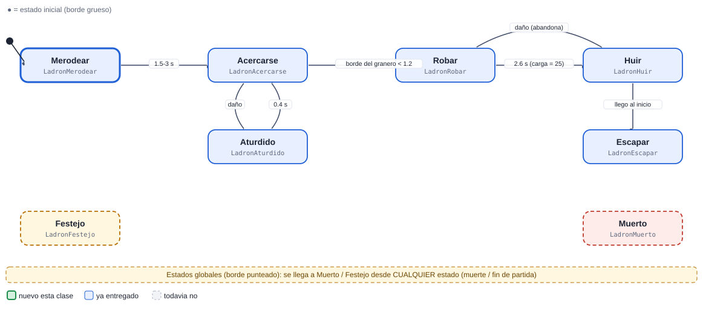

# 06 · Ladron

[Plan general](00_indice_y_plan.md) · [Guia de inicio](03_como_empezar.md) · [Como subir cambios](04_como_subir_cambios.md) · [Troubleshooting](05_troubleshooting.md) · [Estado general](01_estado_general.md) · [Steering](02_steering_behaviors.md) · [README](../README.md)

**Alta**  **Enemigo**

No pelea: va al granero, roba gemas y huye. Si escapa con la carga, el jugador pierde las gemas; si lo matan, las gemas regresan. Es la máquina que más conversa con la economía.

Peso de la máquina: **27.0 pts** · Steering a cargo: **0 pts** (ninguno) · Total del cupo 06: **27.0 pts** · Estados: **8** · Transiciones: **7**

## 1. Diagrama de estados


Las flechas se leen "desde → hasta" con la condición que dispara el cambio. El estado inicial es el de borde grueso. Cada estado devuelve el nombre del siguiente estado en `Actualizar` o `AlRecibir` (o `null` para quedarse).

> Documentos de apoyo: [Cómo subir tus cambios](04_como_subir_cambios.md) · [Troubleshooting (si el pipeline falla)](05_troubleshooting.md) · [Guía de inicio](03_como_empezar.md).

## Cómo empezar (primeros 30 minutos)

1. **Rama:** `git checkout main; git pull; git checkout -b clase-1/06-ladron`
2. **Mira tu agente en el juego:** abre `Assets/_Granero/Escenas/Granero.unity` y pulsa Play. Observa cómo se mueve con el cerebro demo; tu máquina lo va a reemplazar. *Aparece: oleadas 3 y 5.*
3. **Crea estos archivos** en `Assets/_Alumnos/Ladron/`: `LadronController.cs`, `LadronMerodear.cs`.
4. **Copia el esqueleto** de la sección de código más abajo (controller + primer estado) y registra tus estados en `new Maquina(new List<Estado> {...})`.
5. **Primer estado:** en `Entrar` pide la animación (`Sigilo`) y en `Actualizar` haz lo mínimo (mover con `Cuerpo.Mover`).
6. **Play:** en cuanto existe `LadronController`, el sistema lo usa en lugar del demo. Si ves tu primer estado funcionando, sigue con el siguiente.
7. **Commit y PR** el mismo día (flujo en la [guía de inicio](03_como_empezar.md)).

Guía completa con diagramas: [guía de inicio](03_como_empezar.md).

## 2. Estados

| Estado (clase) | Qué hace | Animación | Steering |
| --- | --- | --- | --- |
| `LadronMerodear` | Al aparecer, tantea el terreno 1.5-3 s con movimiento errante. | Sigilo | Wander |
| `LadronAcercarse` | Va al granero por la ruta y frena al llegar. | Correr (3.4 m/s) | PathFollowing + Arrive |
| `LadronRobar` | Anim RobarInicio -> RobarLoop (2.6 s). Al terminar: Economia.Robar(25). | RobarInicio / RobarLoop | — |
| `LadronHuir` | Corre de regreso al inicio con la carga, esquivando guardias. | Sprint | Evade |
| `LadronEscapar` | Llego al inicio con la carga: desaparece (las gemas se pierden). | — | — |
| `LadronAturdido` | Reaccion al daño (suelta el paso). | Dano1 | — |
| `LadronFestejo` (global) | Global. | Celebrar1 | — |
| `LadronMuerto` (global) | Global: devuelve la carga con Economia.Agregar. | Muerte1 | — |

## 3. Transiciones

| Desde | Hacia | Condición |
| --- | --- | --- |
| Merodear | Acercarse | 1.5-3 s |
| Acercarse | Robar | borde del granero &lt; 1.2 |
| Robar | Huir | 2.6 s (carga = 25) |
| Huir | Escapar | llego al inicio |
| Acercarse | Aturdido | daño |
| Aturdido | Acercarse | 0.4 s |
| Robar | Huir | daño (abandona) |
| *cualquiera* | Muerto | la vida llega a 0 (`Salud.AlMorir`) |
| *cualquiera* | Festejo | fin de partida (`Juego.AlCambiarFase`) |

**Eventos que escucha:** `dano`, `muerte`, `fin_juego`, `carga_robada`

## 4. Dependencias

### Mapa de dependencias


### 4.1 API base (ya hecha por el instructor)

| Clase | Qué usas |
| --- | --- |
| `Sensor` | HostilMasCercano / Contar, cada 0.2 s |
| `Cuerpo` | Mover / Mirar / Detener |
| `Agente` | Animar(Anim.X), Hostiles, DistanciaBorde |
| `Salud` | eventos AlDanar / AlMorir |
| `Reserva` | devolver el objeto al morir (pooling) |
| `Economia` | Robar(n) y Agregar(n) |
| `Ruta` | Ruta.Inicio / Ruta.Granero |
| `Steering` | Wander, Arrive, Evade, PathFollowing |

### 4.2 Comunicación con otras máquinas

| Con quién | Sentido | Cómo se comunican |
| --- | --- | --- |
| Economia | envía a | Economia.Robar(25) al robar; Economia.Agregar(carga) si muere con carga. |
| Director | recibe de | Lo crea desde la oleada 3; si escapa el Director lo cuenta como enemigo eliminado (Reserva). |
| Guardia | recibe de | Es su principal amenaza. |

> Regla de oro: las máquinas **no se llaman entre sí**. Se comunican solo por la API base y sus eventos (`Agente.AlMorirAlguien`, `Juego.AlCambiarFase`, `Alertas.AlAlerta`, `Economia`, `Sensor`...). Así nadie queda bloqueado esperando el código de un compañero.

### 4.3 Steering behaviours que usa (los programa otro compañero)

| Behaviour | Responsable | Se entrega en | Mientras tanto |
| --- | --- | --- | --- |
| [`Steering.Wander`](02_steering_behaviors.md#wander-vagar-6-pts) | Cupo 10 (Aldeano) | Clase 3 | usa `Cuerpo.Mover` con dirección directa hacia el objetivo |
| [`Steering.PathFollowing`](02_steering_behaviors.md#path-following-seguir-camino-7-pts) | Cupo 01 (Soldado) | Clase 2 | usa `Cuerpo.Mover` con dirección directa hacia el objetivo |
| [`Steering.Arrive`](02_steering_behaviors.md#arrive-llegar-4-pts) | Cupo 02 (Bruto) | Clase 2 | usa `Cuerpo.Mover` con dirección directa hacia el objetivo |
| [`Steering.Evade`](02_steering_behaviors.md#evade-escapar-con-predicción-6-pts) | Cupo 12 (Reparador) | Clase 3 | usa `Cuerpo.Mover` con dirección directa hacia el objetivo |

El archivo `Steering.cs` ya existe como clase parcial vacía: cada responsable agrega SU archivo `Steering<Nombre>.cs`. Tu máquina solo llama a `Steering.<Nombre>(...)` cuando exista.

## 5. Entregas por clase


Azul: se entrega ese día. Celeste: se mantiene funcionando en las clases siguientes (se vuelve a revisar).

| Clase y día | Estados nuevos | Acumulado | Qué debe funcionar | Steering |
| --- | --- | --- | --- | --- |
| **1** Lun 9 nov | Merodear | 1/8 · 12% | Onboarding y primer commit: el Controller crea la Maquina e inicia en Merodear (puede ser un esqueleto que solo escribe un mensaje en consola). Compila, se ve en Play y el PR pasa la revision. | — |
| **2** Mié 11 nov | Acercarse, Muerto | 3/8 · 38% | Acercarse: Va al granero por la ruta y frena al llegar. Muerto: Global: devuelve la carga con Economia.Agregar. | — |
| **3** Mié 18 nov | Robar, Huir | 5/8 · 62% | Robar: Anim RobarInicio -> RobarLoop (2.6 s). Al terminar: Economia.Robar(25). Huir: Corre de regreso al inicio con la carga, esquivando guardias. | — |
| **4** Lun 23 nov | Escapar, Aturdido | 7/8 · 88% | Escapar: Llego al inicio con la carga: desaparece (las gemas se pierden). Aturdido: Reaccion al daño (suelta el paso). | — |
| **5** Mié 25 nov | Festejo | 8/8 · 100% | Festejo: Global. | — |
| **6** Lun 30 nov | (colch&oacute;n) | 8/8 · 100% | Colchon (opcional): se usa solo para corregir pendientes o para ponerse al corriente. No hay estados nuevos. | — |

Guías: [Cómo subir tus cambios](04_como_subir_cambios.md) · [Troubleshooting (si el pipeline falla)](05_troubleshooting.md).

### Detalle de cada entrega (qué entregar, cómo comprobarlo y qué comandos usar)

> Antes de tu primera entrega lee **[Cómo subir tus cambios](04_como_subir_cambios.md)**. Si el pipeline marca algo en rojo: **[Troubleshooting (si el pipeline falla)](05_troubleshooting.md)**. Todas las fechas son el día de clase; el lunes 16 de noviembre es puente (no hay clase).

### Clase 1 · Lun 9 nov · Onboarding y primer commit · PR a más tardar ese día, 23:59 (CDMX)

**Rama:** `clase-1/06-ladron`  ·  **Avance esperado:** 1 de 8 estados (12%)


#### Onboarding (2 horas): recorre todo y sube tu primer commit


> Hoy no se califica cuánto programaste, sino que **recorriste el flujo completo una vez**: clonar, correr el juego, leer tu ficha, crear tu rama, hacer que tu máquina arranque y llegar hasta un PR revisado. Todo lo demás se construye sobre esto.

##### 1 · Clonar y abrir (0-15 min)

```bash
git clone https://github.com/BanyoLoper/tower-defense.git td
cd td
git status
```

Abre la carpeta `td` con Unity `6000.3.10f1` (la primera vez tarda). Debe decir `On branch main` y *working tree clean*. Si falla: [Troubleshooting (si el pipeline falla)](05_troubleshooting.md).

##### 2 · Jugar la base (15-30 min)

Abre `Assets/_Granero/Escenas/Granero.unity` y pulsa Play. Pulsa ESPACIO para llamar oleadas; mira cómo aparecen enemigos y torres y recorre la Hierarchy. Así sabes qué hace el juego sin tu código.

##### 3 · Leer tu ficha y el Estado base (30-50 min)

Lee de esta ficha el diagrama de estados, *Qué es tu máquina* y las reglas. Abre `Assets/_Granero/Scripts/Maquina/` y mira `Estado.cs`, `Maquina.cs` y `Contexto.cs`; la explicación está en [Estado general](01_estado_general.md).

##### 4 · Crear tu rama (50-60 min)

```bash
git checkout main
git pull
git checkout -b clase-1/06-ladron
```

Es la rama de hoy; el nombre debe ser exacto.

##### 5 · Controller + estado inicial (60-95 min)

Crea los dos archivos de abajo en `Assets/_Alumnos/Ladron/` (Unity genera los `.meta`). Es la versión mínima del esqueleto completo que aparece más abajo en esta ficha: solo registra `LadronMerodear`. Pulsa Play y, si hace falta, llama oleadas con ESPACIO hasta que aparezca tu agente (oleadas 3 y 5): la consola debe mostrar *Ladron: entre a Merodear*.

##### 6 · Primer commit y push (95-110 min)

```bash
git status
git add Assets/_Alumnos/Ladron
git commit -m "clase 1: Ladron - controller y Merodear"
git push -u origin clase-1/06-ladron
```

`git status` debe mostrar solo tu carpeta (y los `.meta`).

##### 7 · Pull Request y reporte (110-120 min)

```bash
gh pr create --base main --title "Clase 1 - Ladron (cupo 06)" --body "Onboarding: controller y Merodear"
gh pr view --comments
```

Sin la CLI, crea el PR en la web ([Cómo subir tus cambios](04_como_subir_cambios.md)). En 1-2 minutos el Action comenta; si hay ❌, corrige y haz `git push`.

**Código del paso 5** (copia y pega; los nombres ya son los de tu máquina):

```csharp
// Assets/_Alumnos/Ladron/LadronController.cs
using System.Collections.Generic;
using UnityEngine;

namespace Alumnos.Ladron
{
    public class LadronController : MonoBehaviour
    {
        Maquina maq;
        readonly Contexto ctx = new Contexto();

        void Awake()
        {
            ctx.Fijar("agente", GetComponent<Agente>());
            ctx.Fijar("ctrl", this);
            maq = new Maquina(new List<Estado> { new LadronMerodear() }, ctx);   // por ahora solo este estado
        }

        void OnEnable() { maq.Iniciar("LadronMerodear"); }
        void Update() { maq.Actualizar(Time.deltaTime); }
    }
}

// Assets/_Alumnos/Ladron/LadronMerodear.cs
using UnityEngine;

namespace Alumnos.Ladron
{
    public class LadronMerodear : Estado
    {
        public override void Entrar(string anterior)
        {
            Debug.Log("Ladron: entre a Merodear");   // prueba de vida: debe salir en la consola al hacer Play
        }

        public override string Actualizar(float dt) { return null; }   // null = quedarse en este estado

        public override string AlRecibir(string trigger, int valor) { return null; }
    }
}
```

¿Terminaste antes? Es opcional y no se califica hoy: empieza el siguiente estado (la clase 2 trae `LadronAcercarse`, `LadronMuerto`).

| Archivo (en `Assets/_Alumnos/Ladron/`) | Qué debe tener |
| --- | --- |
| `LadronController.cs` | **Nuevo.** `class LadronController : MonoBehaviour` dentro de `namespace Alumnos.Ladron`. Crea el `Contexto`, la `Maquina` con tus estados e inicia en `Merodear`. |
| `LadronMerodear.cs` | **Nuevo.** `class LadronMerodear : Estado`. Al aparecer, tantea el terreno 1.5-3 s con movimiento errante. Animación: `Sigilo`. |
| `*.meta` | Cada archivo nuevo trae su `.meta` (Unity lo crea al abrir el proyecto). Sube los dos. |

**Qué debe verse en Play al terminar esta clase**

- Onboarding y primer commit: el Controller crea la Maquina e inicia en Merodear (puede ser un esqueleto que solo escribe un mensaje en consola). Compila, se ve en Play y el PR pasa la revision.
- Cómo probarlo: abre `Granero.unity`, pulsa Play y espera la oleada con ESPACIO. Tu agente aparece: oleadas 3 y 5.

**Lo que revisa el Action en esta clase** (debe existir cada clase, hereda de `Estado` y estar registrada en el controller): `LadronMerodear`.

Todavía NO se pide: `LadronAcercarse`, `LadronRobar`, `LadronHuir`, `LadronEscapar`, `LadronAturdido`, `LadronFestejo`, `LadronMuerto`.

**Lista de comprobación antes del PR**

- [ ] Unity compila: la consola está vacía (sin errores rojos).
- [ ] Probado en Play (lo de arriba funciona).
- [ ] `git status` solo muestra archivos de `Assets/_Alumnos/Ladron/` (y sus `.meta`).
- [ ] Todo tu código está dentro de `namespace Alumnos.Ladron` (los `Steering*.cs` no llevan namespace) y es ASCII (sin acentos ni ñ).
- [ ] La rama se llama exactamente `clase-1/06-ladron` y el PR se crea hoy (máximo el Lun 9 nov).
- [ ] Leíste el comentario del Action en tu PR y corregiste cada ❌.

**Comandos de esta entrega** (copiar y pegar; si algo falla ve a [Troubleshooting (si el pipeline falla)](05_troubleshooting.md)):

```bash
git checkout main
git pull
git checkout -b clase-1/06-ladron
# ... programas y pruebas en Unity ...
git status
git add Assets/_Alumnos/Ladron
git commit -m "clase 1: Ladron - Merodear"
git push -u origin clase-1/06-ladron
```

### Clase 2 · Mié 11 nov · PR a más tardar ese día, 23:59 (CDMX)

**Rama:** `clase-2/06-ladron`  ·  **Avance esperado:** 3 de 8 estados (38%)


| Archivo (en `Assets/_Alumnos/Ladron/`) | Qué debe tener |
| --- | --- |
| `LadronController.cs` | **Lo modificas.** Registra en la lista de la máquina los estados nuevos: `new LadronAcercarse()`, `new LadronMuerto()`. |
| `LadronAcercarse.cs` | **Nuevo.** `class LadronAcercarse : Estado`. Va al granero por la ruta y frena al llegar. Animación: `Correr (3.4 m/s)`. |
| `LadronMuerto.cs` | **Nuevo.** `class LadronMuerto : Estado`. Global: devuelve la carga con Economia.Agregar. Animación: `Muerte1`. |
| `*.meta` | Cada archivo nuevo trae su `.meta` (Unity lo crea al abrir el proyecto). Sube los dos. |

**Qué debe verse en Play al terminar esta clase**

- Acercarse: Va al granero por la ruta y frena al llegar. Muerto: Global: devuelve la carga con Economia.Agregar.
- Cómo probarlo: abre `Granero.unity`, pulsa Play y espera la oleada con ESPACIO. Tu agente aparece: oleadas 3 y 5.

**Lo que revisa el Action en esta clase** (debe existir cada clase, hereda de `Estado` y estar registrada en el controller): `LadronMerodear`, `LadronAcercarse`, `LadronMuerto`.

Todavía NO se pide: `LadronRobar`, `LadronHuir`, `LadronEscapar`, `LadronAturdido`, `LadronFestejo`.

**Lista de comprobación antes del PR**

- [ ] Unity compila: la consola está vacía (sin errores rojos).
- [ ] Probado en Play (lo de arriba funciona).
- [ ] `git status` solo muestra archivos de `Assets/_Alumnos/Ladron/` (y sus `.meta`).
- [ ] Todo tu código está dentro de `namespace Alumnos.Ladron` (los `Steering*.cs` no llevan namespace) y es ASCII (sin acentos ni ñ).
- [ ] La rama se llama exactamente `clase-2/06-ladron` y el PR se crea hoy (máximo el Mié 11 nov).
- [ ] Leíste el comentario del Action en tu PR y corregiste cada ❌.

**Comandos de esta entrega** (copiar y pegar; si algo falla ve a [Troubleshooting (si el pipeline falla)](05_troubleshooting.md)):

```bash
git checkout main
git pull
git checkout -b clase-2/06-ladron
# ... programas y pruebas en Unity ...
git status
git add Assets/_Alumnos/Ladron
git commit -m "clase 2: Ladron - Acercarse, Muerto"
git push -u origin clase-2/06-ladron
```

### Clase 3 · Mié 18 nov · PR a más tardar ese día, 23:59 (CDMX)

**Rama:** `clase-3/06-ladron`  ·  **Avance esperado:** 5 de 8 estados (62%)


| Archivo (en `Assets/_Alumnos/Ladron/`) | Qué debe tener |
| --- | --- |
| `LadronController.cs` | **Lo modificas.** Registra en la lista de la máquina los estados nuevos: `new LadronRobar()`, `new LadronHuir()`. |
| `LadronRobar.cs` | **Nuevo.** `class LadronRobar : Estado`. Anim RobarInicio -> RobarLoop (2.6 s). Al terminar: Economia.Robar(25). Animación: `RobarInicio / RobarLoop`. |
| `LadronHuir.cs` | **Nuevo.** `class LadronHuir : Estado`. Corre de regreso al inicio con la carga, esquivando guardias. Animación: `Sprint`. |
| `*.meta` | Cada archivo nuevo trae su `.meta` (Unity lo crea al abrir el proyecto). Sube los dos. |

**Qué debe verse en Play al terminar esta clase**

- Robar: Anim RobarInicio -> RobarLoop (2.6 s). Al terminar: Economia.Robar(25). Huir: Corre de regreso al inicio con la carga, esquivando guardias.
- Cómo probarlo: abre `Granero.unity`, pulsa Play y espera la oleada con ESPACIO. Tu agente aparece: oleadas 3 y 5.

**Lo que revisa el Action en esta clase** (debe existir cada clase, hereda de `Estado` y estar registrada en el controller): `LadronMerodear`, `LadronAcercarse`, `LadronMuerto`, `LadronRobar`, `LadronHuir`.

Todavía NO se pide: `LadronEscapar`, `LadronAturdido`, `LadronFestejo`.

**Lista de comprobación antes del PR**

- [ ] Unity compila: la consola está vacía (sin errores rojos).
- [ ] Probado en Play (lo de arriba funciona).
- [ ] `git status` solo muestra archivos de `Assets/_Alumnos/Ladron/` (y sus `.meta`).
- [ ] Todo tu código está dentro de `namespace Alumnos.Ladron` (los `Steering*.cs` no llevan namespace) y es ASCII (sin acentos ni ñ).
- [ ] La rama se llama exactamente `clase-3/06-ladron` y el PR se crea hoy (máximo el Mié 18 nov).
- [ ] Leíste el comentario del Action en tu PR y corregiste cada ❌.

**Comandos de esta entrega** (copiar y pegar; si algo falla ve a [Troubleshooting (si el pipeline falla)](05_troubleshooting.md)):

```bash
git checkout main
git pull
git checkout -b clase-3/06-ladron
# ... programas y pruebas en Unity ...
git status
git add Assets/_Alumnos/Ladron
git commit -m "clase 3: Ladron - Robar, Huir"
git push -u origin clase-3/06-ladron
```

### Clase 4 · Lun 23 nov · PR a más tardar ese día, 23:59 (CDMX)

**Rama:** `clase-4/06-ladron`  ·  **Avance esperado:** 7 de 8 estados (88%)


| Archivo (en `Assets/_Alumnos/Ladron/`) | Qué debe tener |
| --- | --- |
| `LadronController.cs` | **Lo modificas.** Registra en la lista de la máquina los estados nuevos: `new LadronEscapar()`, `new LadronAturdido()`. |
| `LadronEscapar.cs` | **Nuevo.** `class LadronEscapar : Estado`. Llego al inicio con la carga: desaparece (las gemas se pierden). |
| `LadronAturdido.cs` | **Nuevo.** `class LadronAturdido : Estado`. Reaccion al daño (suelta el paso). Animación: `Dano1`. |
| `*.meta` | Cada archivo nuevo trae su `.meta` (Unity lo crea al abrir el proyecto). Sube los dos. |

**Qué debe verse en Play al terminar esta clase**

- Escapar: Llego al inicio con la carga: desaparece (las gemas se pierden). Aturdido: Reaccion al daño (suelta el paso).
- Cómo probarlo: abre `Granero.unity`, pulsa Play y espera la oleada con ESPACIO. Tu agente aparece: oleadas 3 y 5.

**Lo que revisa el Action en esta clase** (debe existir cada clase, hereda de `Estado` y estar registrada en el controller): `LadronMerodear`, `LadronAcercarse`, `LadronMuerto`, `LadronRobar`, `LadronHuir`, `LadronEscapar`, `LadronAturdido`.

Todavía NO se pide: `LadronFestejo`.

**Lista de comprobación antes del PR**

- [ ] Unity compila: la consola está vacía (sin errores rojos).
- [ ] Probado en Play (lo de arriba funciona).
- [ ] `git status` solo muestra archivos de `Assets/_Alumnos/Ladron/` (y sus `.meta`).
- [ ] Todo tu código está dentro de `namespace Alumnos.Ladron` (los `Steering*.cs` no llevan namespace) y es ASCII (sin acentos ni ñ).
- [ ] La rama se llama exactamente `clase-4/06-ladron` y el PR se crea hoy (máximo el Lun 23 nov).
- [ ] Leíste el comentario del Action en tu PR y corregiste cada ❌.

**Comandos de esta entrega** (copiar y pegar; si algo falla ve a [Troubleshooting (si el pipeline falla)](05_troubleshooting.md)):

```bash
git checkout main
git pull
git checkout -b clase-4/06-ladron
# ... programas y pruebas en Unity ...
git status
git add Assets/_Alumnos/Ladron
git commit -m "clase 4: Ladron - Escapar, Aturdido"
git push -u origin clase-4/06-ladron
```

### Clase 5 · Mié 25 nov · PR a más tardar ese día, 23:59 (CDMX)

**Rama:** `clase-5/06-ladron`  ·  **Avance esperado:** 8 de 8 estados (100%)


| Archivo (en `Assets/_Alumnos/Ladron/`) | Qué debe tener |
| --- | --- |
| `LadronController.cs` | **Lo modificas.** Registra en la lista de la máquina los estados nuevos: `new LadronFestejo()`. |
| `LadronFestejo.cs` | **Nuevo.** `class LadronFestejo : Estado`. Global. Animación: `Celebrar1`. |
| `*.meta` | Cada archivo nuevo trae su `.meta` (Unity lo crea al abrir el proyecto). Sube los dos. |

**Qué debe verse en Play al terminar esta clase**

- Festejo: Global.
- Cómo probarlo: abre `Granero.unity`, pulsa Play y espera la oleada con ESPACIO. Tu agente aparece: oleadas 3 y 5.

**Lo que revisa el Action en esta clase** (debe existir cada clase, hereda de `Estado` y estar registrada en el controller): `LadronMerodear`, `LadronAcercarse`, `LadronMuerto`, `LadronRobar`, `LadronHuir`, `LadronEscapar`, `LadronAturdido`, `LadronFestejo`.

**Lista de comprobación antes del PR**

- [ ] Unity compila: la consola está vacía (sin errores rojos).
- [ ] Probado en Play (lo de arriba funciona).
- [ ] `git status` solo muestra archivos de `Assets/_Alumnos/Ladron/` (y sus `.meta`).
- [ ] Todo tu código está dentro de `namespace Alumnos.Ladron` (los `Steering*.cs` no llevan namespace) y es ASCII (sin acentos ni ñ).
- [ ] La rama se llama exactamente `clase-5/06-ladron` y el PR se crea hoy (máximo el Mié 25 nov).
- [ ] Leíste el comentario del Action en tu PR y corregiste cada ❌.

**Comandos de esta entrega** (copiar y pegar; si algo falla ve a [Troubleshooting (si el pipeline falla)](05_troubleshooting.md)):

```bash
git checkout main
git pull
git checkout -b clase-5/06-ladron
# ... programas y pruebas en Unity ...
git status
git add Assets/_Alumnos/Ladron
git commit -m "clase 5: Ladron - Festejo"
git push -u origin clase-5/06-ladron
```

### Clase 6 · Lun 30 nov · Colchón (opcional, no se califica) · PR a más tardar ese día, 23:59 (CDMX)

**Rama:** `clase-6/06-ladron`  ·  **Avance esperado:** 8 de 8 estados (100%)



| Archivo (en `Assets/_Alumnos/Ladron/`) | Qué debe tener |
| --- | --- |
| `LadronController.cs` | **Lo modificas.** Registra en la lista de la máquina los estados nuevos: ninguno nuevo (solo ajustes). |
| (ninguno obligatorio) | Colchón: sin contenido nuevo. Solo corriges lo que marcó el Action o terminas lo que se quedó atrás. |
| `*.meta` | Cada archivo nuevo trae su `.meta` (Unity lo crea al abrir el proyecto). Sube los dos. |

**Qué debe verse en Play al terminar esta clase**

- Esta clase **no tiene contenido nuevo y no cuenta para la calificación** (el promedio es de las clases 1 a 5).
- Úsala para: corregir los ❌ que dejó el Action, terminar estados atrasados y probar tu máquina junto con las otras.
- Si necesitas entregar correcciones, crea la rama `clase-6/06-ladron` y su PR; si no, no hace falta.

**Lo que revisa el Action en esta clase** (debe existir cada clase, hereda de `Estado` y estar registrada en el controller): `LadronMerodear`, `LadronAcercarse`, `LadronMuerto`, `LadronRobar`, `LadronHuir`, `LadronEscapar`, `LadronAturdido`, `LadronFestejo`.

**Lista de comprobación antes del PR**

- [ ] Unity compila: la consola está vacía (sin errores rojos).
- [ ] Probado en Play (lo de arriba funciona).
- [ ] `git status` solo muestra archivos de `Assets/_Alumnos/Ladron/` (y sus `.meta`).
- [ ] Todo tu código está dentro de `namespace Alumnos.Ladron` (los `Steering*.cs` no llevan namespace) y es ASCII (sin acentos ni ñ).
- [ ] La rama se llama exactamente `clase-6/06-ladron` y el PR se crea hoy (máximo el Lun 30 nov).
- [ ] Leíste el comentario del Action en tu PR y corregiste cada ❌.

**Comandos de esta entrega** (copiar y pegar; si algo falla ve a [Troubleshooting (si el pipeline falla)](05_troubleshooting.md)):

```bash
git checkout main
git pull
git checkout -b clase-6/06-ladron
# ... programas y pruebas en Unity ...
git status
git add Assets/_Alumnos/Ladron
git commit -m "clase 6: Ladron - correcciones"
git push -u origin clase-6/06-ladron
```

### Rúbrica (igual en todas las clases)

| Criterio | Puntos | Qué se revisa |
| --- | --- | --- |
| Funciona en el juego | 50 | El agente/sistema hace lo pedido en Play, sin errores en consola, con el prefab real. |
| Estados entregados | 30 | Cumple los estados de ESA clase (ver tabla). Cada estado que falta resta proporcionalmente. |
| Codigo y rendimiento | 20 | Una clase por estado con prefijo del rol, ASCII, sin new/LINQ en Update, eventos desuscritos, cero basura medido. |
| Total por clase | 100 | La calificación final es el promedio de las 5 entregas de las clases 1 a 5 (cada una pesa igual). La clase 6 es colchón y no cuenta. |

## 6. Esqueleto de código

Punto de partida. Copia el patrón del `SoldadoController`/estados de referencia; el resto de estados siguen la misma forma. Nombres de clase únicos: `Ladron<Estado>`.

```csharp
// LadronController.cs
using System.Collections.Generic;
using UnityEngine;

namespace Alumnos.Ladron
{
public class LadronController : MonoBehaviour
{
    Maquina maq;
    readonly Contexto ctx = new Contexto();
    Agente ag;

    void Awake()
    {
        ag = GetComponent<Agente>();
        ctx.Fijar("agente", ag);
        ctx.Fijar("ctrl", this);
        maq = new Maquina(new List<Estado> { new LadronMerodear(), new LadronAcercarse(), new LadronRobar(), new LadronHuir(), new LadronEscapar(), new LadronAturdido(), new LadronFestejo(), new LadronMuerto() }, ctx);
    }

    void OnEnable()   // OJO: los agentes vienen de la Reserva (se reutilizan): reinicia todo aqui
    {
        maq.Iniciar("LadronMerodear");
        ag.salud.AlMorir += AlMorir;
    }

    void OnDisable()
    {
        ag.salud.AlMorir -= AlMorir;   // siempre desuscribirse
    }

    void AlMorir(GameObject origen) { maq.CambiarA("LadronMuerto"); }

    void Update() { maq.Actualizar(Time.deltaTime); }
}
}

// LadronMerodear.cs  (un archivo por estado; mismo namespace y prefijo del rol)
using UnityEngine;

namespace Alumnos.Ladron
{
public class LadronMerodear : Estado
{
    float t;
    public override void Entrar(string anterior)
    {
        t = 0f;
        var ag = Ctx.Obtener<Agente>("agente");
        ag.Animar(Anim.Caminar);   // usa las constantes de la clase Anim
    }
    public override string Actualizar(float dt)
    {
        t += dt;
        // TODO: logica del estado; devuelve el NOMBRE del siguiente estado o null para quedarse
        return null;
    }
    public override string AlRecibir(string trigger, int valor) { return null; }
}
}
```

## 7. Reglas que se califican siempre

- Todo tu código va dentro de `namespace Alumnos.<TuMaquina>` (ej. `Alumnos.MagoEnemigo`). Los archivos `Steering*.cs` NO llevan namespace.
- Una clase por estado, hereda de `Estado`, nombre con prefijo del rol. Ninguna clase puede llamarse igual que una del juego base.
- Nada de `new`, LINQ, `GetComponent` ni `Find` dentro de `Actualizar`: guarda referencias en `Entrar` o en el Contexto.
- El Sensor se consulta cada 0.2 s, no cada frame.
- Suscripciones a eventos en `OnEnable`, baja en `OnDisable` (los agentes se reutilizan).
- Todo el código en ASCII (sin acentos ni ñ).
