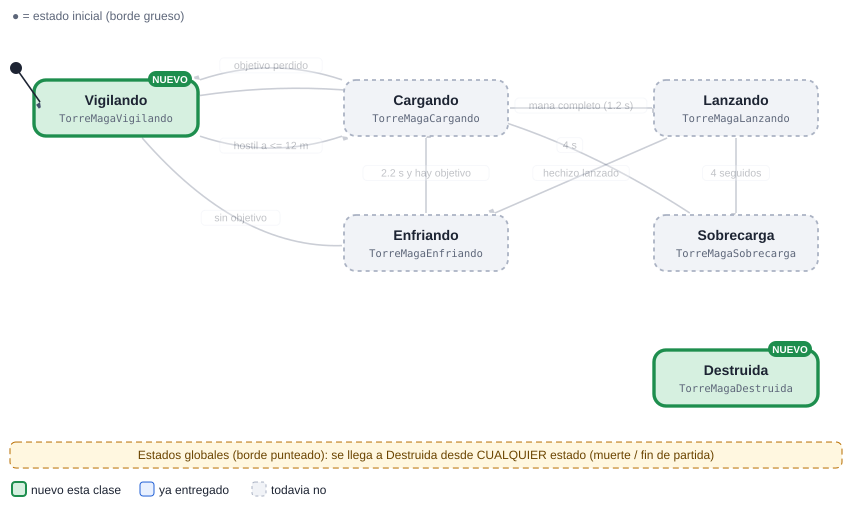
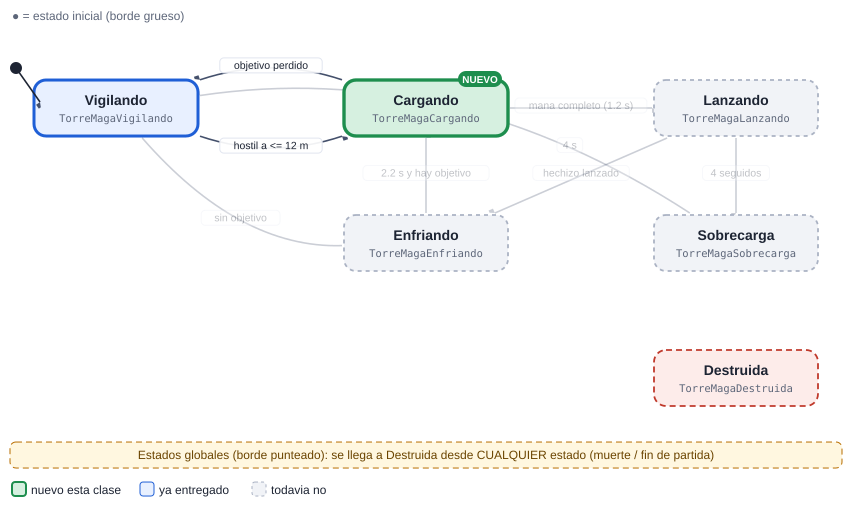
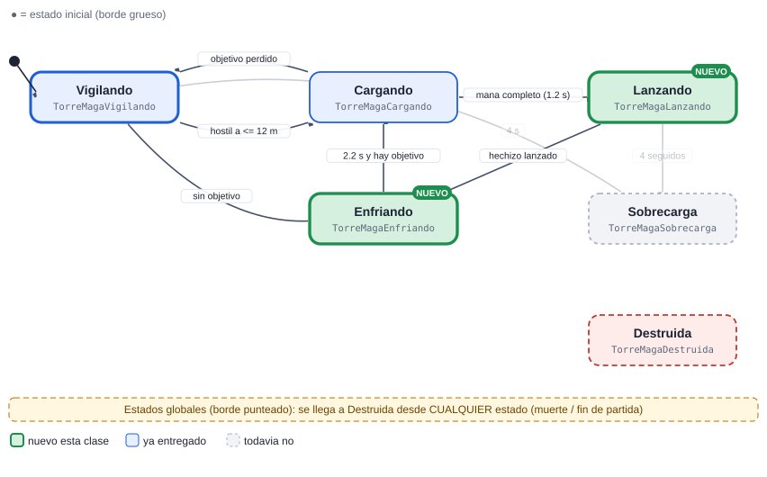
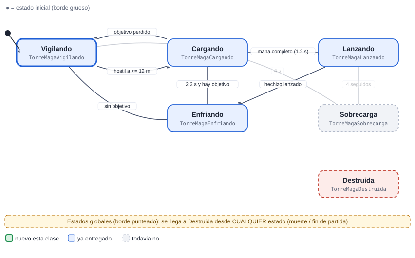
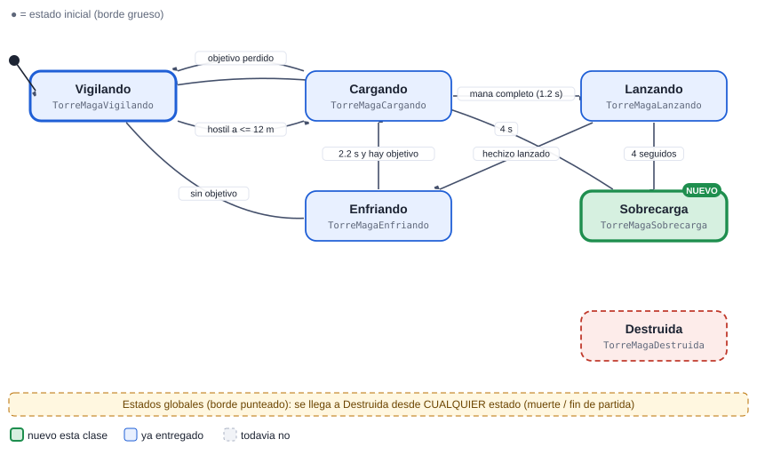

# 08 · Torre maga

[Plan general](00_indice_y_plan.md) · [Guia de inicio](03_como_empezar.md) · [Como subir cambios](04_como_subir_cambios.md) · [Troubleshooting](05_troubleshooting.md) · [Estado general](01_estado_general.md) · [Steering](02_steering_behaviors.md) · [README](../README.md)

**Ligera**  **Defensa**

Torre de área: carga mana, lanza una bola de fuego que explota y se enfria. Si lanza 4 hechizos seguidos se sobrecarga y queda fuera de combate un rato.

Peso de la máquina: **19.5 pts** · Steering a cargo: **10 pts** (ObstacleAvoidance (10 pts)) · Total del cupo 08: **29.5 pts** · Estados: **6** · Transiciones: **8**

## 1. Diagrama de estados


Las flechas se leen "desde → hasta" con la condición que dispara el cambio. El estado inicial es el de borde grueso. Cada estado devuelve el nombre del siguiente estado en `Actualizar` o `AlRecibir` (o `null` para quedarse).

> Documentos de apoyo: [Cómo subir tus cambios](04_como_subir_cambios.md) · [Troubleshooting (si el pipeline falla)](05_troubleshooting.md) · [Guía de inicio](03_como_empezar.md).

## Cómo empezar (primeros 30 minutos)

1. **Rama:** `git checkout main; git pull; git checkout -b clase-1/08-torremaga`
2. **Mira tu agente en el juego:** abre `Assets/_Granero/Escenas/Granero.unity` y pulsa Play. Observa cómo se mueve con el cerebro demo; tu máquina lo va a reemplazar. *Aparece: la construyes tu: elige plataforma y pulsa 2.*
3. **Crea estos archivos** en `Assets/_Alumnos/TorreMaga/`: `TorreMagaController.cs`, `TorreMagaVigilando.cs`, `TorreMagaDestruida.cs`.
4. **Copia el esqueleto** de la sección de código más abajo (controller + primer estado) y registra tus estados en `new Maquina(new List<Estado> {...})`.
5. **Primer estado:** en `Entrar` pide la animación (`HechizoIdle`) y en `Actualizar` haz lo mínimo (mover con `Cuerpo.Mover`).
6. **Play:** en cuanto existe `TorreMagaController`, el sistema lo usa en lugar del demo. Si ves tu primer estado funcionando, sigue con el siguiente.
7. **Commit y PR** el mismo día (flujo en la [guía de inicio](03_como_empezar.md)).

Guía completa con diagramas: [guía de inicio](03_como_empezar.md).

## 2. Estados

| Estado (clase) | Qué hace | Animación | Steering |
| --- | --- | --- | --- |
| `TorreMagaVigilando` | Idle con el Sensor cada 0.2 s (alcance 12 m). | HechizoIdle | — |
| `TorreMagaCargando` | Acumula mana 1.2 s con Fx.Aura sobre el baston. | HechizoIdle | — |
| `TorreMagaLanzando` | Lanza la bola (área 2.4 m) apuntando al lugar futuro del objetivo. | HechizoLanzar | Pursuit (prediccion) |
| `TorreMagaEnfriando` | Pausa corta 2.2 s. | HechizoIdle | — |
| `TorreMagaSobrecarga` | Tras 4 lanzamientos seguidos: 4 s sin disparar, con Fx.Fuego. | Idle | — |
| `TorreMagaDestruida` (global) | Global. | — | — |

## 3. Transiciones

| Desde | Hacia | Condición |
| --- | --- | --- |
| Vigilando | Cargando | hostil a &lt;= 12 m |
| Cargando | Lanzando | mana completo (1.2 s) |
| Cargando | Vigilando | objetivo perdido |
| Lanzando | Enfriando | hechizo lanzado |
| Enfriando | Cargando | 2.2 s y hay objetivo |
| Enfriando | Vigilando | sin objetivo |
| Lanzando | Sobrecarga | 4 seguidos |
| Sobrecarga | Vigilando | 4 s |
| *cualquiera* | Destruida | la vida llega a 0 (`Salud.AlMorir`) |

**Eventos que escucha:** `dano`, `muerte`, `contador_lanzamientos (Ctx)`

## 4. Dependencias

### Mapa de dependencias


### 4.1 API base (ya hecha por el instructor)

| Clase | Qué usas |
| --- | --- |
| `Sensor` | HostilMasCercano / Contar, cada 0.2 s |
| `Cuerpo` | Mover / Mirar / Detener |
| `Agente` | Animar(Anim.X), Hostiles, DistanciaBorde |
| `Salud` | eventos AlDanar / AlMorir |
| `Reserva` | devolver el objeto al morir (pooling) |
| `ProyectilBase` | Lanzar con radioExplosion |
| `Efectos` | Fx.Aura, Fx.Fuego, Fx.Explosion |
| `Steering` | Pursuit |

### 4.2 Comunicación con otras máquinas

| Con quién | Sentido | Cómo se comunican |
| --- | --- | --- |
| Plataforma (SlotTorre) | recibe de | Igual que la Torre lanzadora. |
| Soldado..Jefe | envía a | Dano en área a grupos. |

> Regla de oro: las máquinas **no se llaman entre sí**. Se comunican solo por la API base y sus eventos (`Agente.AlMorirAlguien`, `Juego.AlCambiarFase`, `Alertas.AlAlerta`, `Economia`, `Sensor`...). Así nadie queda bloqueado esperando el código de un compañero.

### 4.3 Steering behaviours que usa (los programa otro compañero)

| Behaviour | Responsable | Se entrega en | Mientras tanto |
| --- | --- | --- | --- |
| [`Steering.Pursuit`](02_steering_behaviors.md#pursuit-perseguir-con-predicción-6-pts) | Cupo 14 (Tutorial) | Clase 3 | usa `Cuerpo.Mover` con dirección directa hacia el objetivo |

El archivo `Steering.cs` ya existe como clase parcial vacía: cada responsable agrega SU archivo `Steering<Nombre>.cs`. Tu máquina solo llama a `Steering.<Nombre>(...)` cuando exista.

## 5. Steering que debes programar tú (cupo 08)

| Behaviour | Pts | Entrega | Lo usan |
| --- | --- | --- | --- |
| [Obstacle Avoidance (evitar obstaculos)](02_steering_behaviors.md#obstacle-avoidance-evitar-obstaculos-10-pts) | 10 | Clase 4 | Bruto, Jefe, Aldeano |

### Cómo probar tu steering aislado

Crea en tu carpeta de máquina un script de prueba (no se usa en el juego final) y ponlo en un objeto con un `Cuerpo` sobre el NavMesh de la escena:

```csharp
using UnityEngine;

namespace Alumnos.TorreMaga   // el namespace de tu MAQUINA (el probe no es parte de Steering)
{
public class ProbeObstacleAvoidance : MonoBehaviour   // nombre unico: Probe + tu steering
{
    public Transform objetivo;
    public float vMax = 3f;
    Cuerpo cuerpo;
    void Awake() { cuerpo = GetComponent<Cuerpo>(); }
    void Update()
    {
        Vector3 v = Steering.ObstacleAvoidance(transform.position, objetivo.position, vMax);   // ajusta los parametros a tu firma
        cuerpo.Mover(v, Time.deltaTime);
    }
}
}
```

## 6. Entregas por clase


Azul: se entrega ese día. Celeste: se mantiene funcionando en las clases siguientes (se vuelve a revisar).

| Clase y día | Estados nuevos | Acumulado | Qué debe funcionar | Steering |
| --- | --- | --- | --- | --- |
| **1** Lun 9 nov | Vigilando, Destruida | 2/6 · 33% | Esqueleto y destruccion. | — |
| **2** Mié 11 nov | Cargando | 3/6 · 50% | Carga de mana con efecto visual. | — |
| **3** Mié 18 nov | Lanzando, Enfriando | 5/6 · 83% | Lanzamiento de área con cooldown. | — |
| **4** Lun 23 nov | Sobrecarga | 6/6 · 100% | Contador de lanzamientos en Contexto y estado de sobrecarga. | ObstacleAvoidance |
| **5** Mié 25 nov | (pulido) | 6/6 · 100% | Prediccion de puntería y balance. | — |
| **6** Lun 30 nov | (pulido) | 6/6 · 100% | Pulido, cero basura, demo. | — |

Guías: [Cómo subir tus cambios](04_como_subir_cambios.md) · [Troubleshooting (si el pipeline falla)](05_troubleshooting.md).

### Detalle de cada entrega (qué entregar, cómo comprobarlo y qué comandos usar)

> Antes de tu primera entrega lee **[Cómo subir tus cambios](04_como_subir_cambios.md)**. Si el pipeline marca algo en rojo: **[Troubleshooting (si el pipeline falla)](05_troubleshooting.md)**. Todas las fechas son el día de clase; el lunes 16 de noviembre es puente (no hay clase).

### Clase 1 · Lun 9 nov · PR a más tardar ese día, 23:59 (CDMX)

**Rama:** `clase-1/08-torremaga`  ·  **Avance esperado:** 2 de 6 estados (33%)



| Archivo (en `Assets/_Alumnos/TorreMaga/`) | Qué debe tener |
| --- | --- |
| `TorreMagaController.cs` | **Nuevo.** `class TorreMagaController : MonoBehaviour` dentro de `namespace Alumnos.TorreMaga`. Crea el `Contexto`, la `Maquina` con tus estados e inicia en `Vigilando`. |
| `TorreMagaVigilando.cs` | **Nuevo.** `class TorreMagaVigilando : Estado`. Idle con el Sensor cada 0.2 s (alcance 12 m). Animación: `HechizoIdle`. |
| `TorreMagaDestruida.cs` | **Nuevo.** `class TorreMagaDestruida : Estado`. Global. |
| `*.meta` | Cada archivo nuevo trae su `.meta` (Unity lo crea al abrir el proyecto). Sube los dos. |

**Qué debe verse en Play al terminar esta clase**

- Esqueleto y destruccion.
- Cómo probarlo: abre `Granero.unity`, pulsa Play y mira a tus agentes desde el inicio. Tu agente aparece: la construyes tu: elige plataforma y pulsa 2.

**Lo que revisa el Action en esta clase** (debe existir cada clase, hereda de `Estado` y estar registrada en el controller): `TorreMagaVigilando`, `TorreMagaDestruida`.

Todavía NO se pide: `TorreMagaCargando`, `TorreMagaLanzando`, `TorreMagaEnfriando`, `TorreMagaSobrecarga`.

**Lista de comprobación antes del PR**

- [ ] Unity compila: la consola está vacía (sin errores rojos).
- [ ] Probado en Play (lo de arriba funciona).
- [ ] `git status` solo muestra archivos de `Assets/_Alumnos/TorreMaga/` y de `Assets/_Alumnos/Steering/` (y sus `.meta`).
- [ ] Todo tu código está dentro de `namespace Alumnos.TorreMaga` (los `Steering*.cs` no llevan namespace) y es ASCII (sin acentos ni ñ).
- [ ] La rama se llama exactamente `clase-1/08-torremaga` y el PR se crea hoy (máximo el Lun 9 nov).
- [ ] Leíste el comentario del Action en tu PR y corregiste cada ❌.

**Comandos de esta entrega** (copiar y pegar; si algo falla ve a [Troubleshooting (si el pipeline falla)](05_troubleshooting.md)):

```bash
git checkout main
git pull
git checkout -b clase-1/08-torremaga
# ... programas y pruebas en Unity ...
git status
git add Assets/_Alumnos/TorreMaga
git commit -m "clase 1: TorreMaga - Vigilando, Destruida"
git push -u origin clase-1/08-torremaga
```

### Clase 2 · Mié 11 nov · PR a más tardar ese día, 23:59 (CDMX)

**Rama:** `clase-2/08-torremaga`  ·  **Avance esperado:** 3 de 6 estados (50%)



| Archivo (en `Assets/_Alumnos/TorreMaga/`) | Qué debe tener |
| --- | --- |
| `TorreMagaController.cs` | **Lo modificas.** Registra en la lista de la máquina los estados nuevos: `new TorreMagaCargando()`. |
| `TorreMagaCargando.cs` | **Nuevo.** `class TorreMagaCargando : Estado`. Acumula mana 1.2 s con Fx.Aura sobre el baston. Animación: `HechizoIdle`. |
| `*.meta` | Cada archivo nuevo trae su `.meta` (Unity lo crea al abrir el proyecto). Sube los dos. |

**Qué debe verse en Play al terminar esta clase**

- Carga de mana con efecto visual.
- Cómo probarlo: abre `Granero.unity`, pulsa Play y mira a tus agentes desde el inicio. Tu agente aparece: la construyes tu: elige plataforma y pulsa 2.

**Lo que revisa el Action en esta clase** (debe existir cada clase, hereda de `Estado` y estar registrada en el controller): `TorreMagaVigilando`, `TorreMagaDestruida`, `TorreMagaCargando`.

Todavía NO se pide: `TorreMagaLanzando`, `TorreMagaEnfriando`, `TorreMagaSobrecarga`.

**Lista de comprobación antes del PR**

- [ ] Unity compila: la consola está vacía (sin errores rojos).
- [ ] Probado en Play (lo de arriba funciona).
- [ ] `git status` solo muestra archivos de `Assets/_Alumnos/TorreMaga/` y de `Assets/_Alumnos/Steering/` (y sus `.meta`).
- [ ] Todo tu código está dentro de `namespace Alumnos.TorreMaga` (los `Steering*.cs` no llevan namespace) y es ASCII (sin acentos ni ñ).
- [ ] La rama se llama exactamente `clase-2/08-torremaga` y el PR se crea hoy (máximo el Mié 11 nov).
- [ ] Leíste el comentario del Action en tu PR y corregiste cada ❌.

**Comandos de esta entrega** (copiar y pegar; si algo falla ve a [Troubleshooting (si el pipeline falla)](05_troubleshooting.md)):

```bash
git checkout main
git pull
git checkout -b clase-2/08-torremaga
# ... programas y pruebas en Unity ...
git status
git add Assets/_Alumnos/TorreMaga
git commit -m "clase 2: TorreMaga - Cargando"
git push -u origin clase-2/08-torremaga
```

### Clase 3 · Mié 18 nov · PR a más tardar ese día, 23:59 (CDMX)

**Rama:** `clase-3/08-torremaga`  ·  **Avance esperado:** 5 de 6 estados (83%)



| Archivo (en `Assets/_Alumnos/TorreMaga/`) | Qué debe tener |
| --- | --- |
| `TorreMagaController.cs` | **Lo modificas.** Registra en la lista de la máquina los estados nuevos: `new TorreMagaLanzando()`, `new TorreMagaEnfriando()`. |
| `TorreMagaLanzando.cs` | **Nuevo.** `class TorreMagaLanzando : Estado`. Lanza la bola (área 2.4 m) apuntando al lugar futuro del objetivo. Animación: `HechizoLanzar`. |
| `TorreMagaEnfriando.cs` | **Nuevo.** `class TorreMagaEnfriando : Estado`. Pausa corta 2.2 s. Animación: `HechizoIdle`. |
| `*.meta` | Cada archivo nuevo trae su `.meta` (Unity lo crea al abrir el proyecto). Sube los dos. |

**Qué debe verse en Play al terminar esta clase**

- Lanzamiento de área con cooldown.
- Cómo probarlo: abre `Granero.unity`, pulsa Play y mira a tus agentes desde el inicio. Tu agente aparece: la construyes tu: elige plataforma y pulsa 2.

**Lo que revisa el Action en esta clase** (debe existir cada clase, hereda de `Estado` y estar registrada en el controller): `TorreMagaVigilando`, `TorreMagaDestruida`, `TorreMagaCargando`, `TorreMagaLanzando`, `TorreMagaEnfriando`.

Todavía NO se pide: `TorreMagaSobrecarga`.

**Lista de comprobación antes del PR**

- [ ] Unity compila: la consola está vacía (sin errores rojos).
- [ ] Probado en Play (lo de arriba funciona).
- [ ] `git status` solo muestra archivos de `Assets/_Alumnos/TorreMaga/` y de `Assets/_Alumnos/Steering/` (y sus `.meta`).
- [ ] Todo tu código está dentro de `namespace Alumnos.TorreMaga` (los `Steering*.cs` no llevan namespace) y es ASCII (sin acentos ni ñ).
- [ ] La rama se llama exactamente `clase-3/08-torremaga` y el PR se crea hoy (máximo el Mié 18 nov).
- [ ] Leíste el comentario del Action en tu PR y corregiste cada ❌.

**Comandos de esta entrega** (copiar y pegar; si algo falla ve a [Troubleshooting (si el pipeline falla)](05_troubleshooting.md)):

```bash
git checkout main
git pull
git checkout -b clase-3/08-torremaga
# ... programas y pruebas en Unity ...
git status
git add Assets/_Alumnos/TorreMaga
git commit -m "clase 3: TorreMaga - Lanzando, Enfriando"
git push -u origin clase-3/08-torremaga
```

### Clase 4 · Lun 23 nov · PR a más tardar ese día, 23:59 (CDMX)

**Rama:** `clase-4/08-torremaga`  ·  **Avance esperado:** 6 de 6 estados (100%)  ·  **Steering:** ObstacleAvoidance


| Archivo (en `Assets/_Alumnos/TorreMaga/`) | Qué debe tener |
| --- | --- |
| `TorreMagaController.cs` | **Lo modificas.** Registra en la lista de la máquina los estados nuevos: `new TorreMagaSobrecarga()`. |
| `TorreMagaSobrecarga.cs` | **Nuevo.** `class TorreMagaSobrecarga : Estado`. Tras 4 lanzamientos seguidos: 4 s sin disparar, con Fx.Fuego. Animación: `Idle`. |
| `../Steering/SteeringObstacleAvoidance.cs` | **Nuevo.** `public static partial class Steering` (SIN namespace) con `public static Vector3 ObstacleAvoidance(Vector3 pos, Vector3 adelante, Vector3 deseada, float largo, float vMax, LayerMask capas)`. Prueba: Rodea un arbol y una roca de la escena sin atorarse ni generar basura (hits en arreglo reutilizado). |
| `*.meta` | Cada archivo nuevo trae su `.meta` (Unity lo crea al abrir el proyecto). Sube los dos. |

**Qué debe verse en Play al terminar esta clase**

- Contador de lanzamientos en Contexto y estado de sobrecarga.
- Cómo probarlo: abre `Granero.unity`, pulsa Play y mira a tus agentes desde el inicio. Tu agente aparece: la construyes tu: elige plataforma y pulsa 2.

**Lo que revisa el Action en esta clase** (debe existir cada clase, hereda de `Estado` y estar registrada en el controller): `TorreMagaVigilando`, `TorreMagaDestruida`, `TorreMagaCargando`, `TorreMagaLanzando`, `TorreMagaEnfriando`, `TorreMagaSobrecarga` y las del steering de esta clase.

**Lista de comprobación antes del PR**

- [ ] Unity compila: la consola está vacía (sin errores rojos).
- [ ] Probado en Play (lo de arriba funciona).
- [ ] `git status` solo muestra archivos de `Assets/_Alumnos/TorreMaga/` y de `Assets/_Alumnos/Steering/` (y sus `.meta`).
- [ ] Todo tu código está dentro de `namespace Alumnos.TorreMaga` (los `Steering*.cs` no llevan namespace) y es ASCII (sin acentos ni ñ).
- [ ] La rama se llama exactamente `clase-4/08-torremaga` y el PR se crea hoy (máximo el Lun 23 nov).
- [ ] Leíste el comentario del Action en tu PR y corregiste cada ❌.

**Comandos de esta entrega** (copiar y pegar; si algo falla ve a [Troubleshooting (si el pipeline falla)](05_troubleshooting.md)):

```bash
git checkout main
git pull
git checkout -b clase-4/08-torremaga
# ... programas y pruebas en Unity ...
git status
git add Assets/_Alumnos/TorreMaga  Assets/_Alumnos/Steering
git commit -m "clase 4: TorreMaga - Sobrecarga"
git push -u origin clase-4/08-torremaga
```

### Clase 5 · Mié 25 nov · PR a más tardar ese día, 23:59 (CDMX)

**Rama:** `clase-5/08-torremaga`  ·  **Avance esperado:** 6 de 6 estados (100%)



| Archivo (en `Assets/_Alumnos/TorreMaga/`) | Qué debe tener |
| --- | --- |
| `TorreMagaController.cs` | **Lo modificas.** Registra en la lista de la máquina los estados nuevos: ninguno nuevo (solo ajustes). |
| (todos tus archivos) | Pulido final: ver la lista de comprobación de abajo. No hay estados nuevos. |
| `*.meta` | Cada archivo nuevo trae su `.meta` (Unity lo crea al abrir el proyecto). Sube los dos. |

**Qué debe verse en Play al terminar esta clase**

- Prediccion de puntería y balance.
- Cómo probarlo: abre `Granero.unity`, pulsa Play y mira a tus agentes desde el inicio. Tu agente aparece: la construyes tu: elige plataforma y pulsa 2.

**Lo que revisa el Action en esta clase** (debe existir cada clase, hereda de `Estado` y estar registrada en el controller): `TorreMagaVigilando`, `TorreMagaDestruida`, `TorreMagaCargando`, `TorreMagaLanzando`, `TorreMagaEnfriando`, `TorreMagaSobrecarga`.

**Lista de comprobación antes del PR**

- [ ] Unity compila: la consola está vacía (sin errores rojos).
- [ ] Probado en Play (lo de arriba funciona).
- [ ] `git status` solo muestra archivos de `Assets/_Alumnos/TorreMaga/` y de `Assets/_Alumnos/Steering/` (y sus `.meta`).
- [ ] Todo tu código está dentro de `namespace Alumnos.TorreMaga` (los `Steering*.cs` no llevan namespace) y es ASCII (sin acentos ni ñ).
- [ ] La rama se llama exactamente `clase-5/08-torremaga` y el PR se crea hoy (máximo el Mié 25 nov).
- [ ] Leíste el comentario del Action en tu PR y corregiste cada ❌.

**Comandos de esta entrega** (copiar y pegar; si algo falla ve a [Troubleshooting (si el pipeline falla)](05_troubleshooting.md)):

```bash
git checkout main
git pull
git checkout -b clase-5/08-torremaga
# ... programas y pruebas en Unity ...
git status
git add Assets/_Alumnos/TorreMaga
git commit -m "clase 5: TorreMaga - pulido final"
git push -u origin clase-5/08-torremaga
```

### Clase 6 · Lun 30 nov · PR a más tardar ese día, 23:59 (CDMX)

**Rama:** `clase-6/08-torremaga`  ·  **Avance esperado:** 6 de 6 estados (100%)



| Archivo (en `Assets/_Alumnos/TorreMaga/`) | Qué debe tener |
| --- | --- |
| `TorreMagaController.cs` | **Lo modificas.** Registra en la lista de la máquina los estados nuevos: ninguno nuevo (solo ajustes). |
| (todos tus archivos) | Pulido final: ver la lista de comprobación de abajo. No hay estados nuevos. |
| `*.meta` | Cada archivo nuevo trae su `.meta` (Unity lo crea al abrir el proyecto). Sube los dos. |

**Qué debe verse en Play al terminar esta clase**

- Pulido, cero basura, demo.
- Una oleada completa de principio a fin sin errores ni avisos en la consola.
- Profiler: `GC Alloc` en 0 B dentro de tus `Actualizar` (medido en Play).
- Pooling correcto: el segundo agente que reaparece se comporta igual que el primero (todo se reinicia en `OnEnable`/`Entrar`).
- Demo en vivo de 3 minutos mostrando cada estado y cada transición de tu diagrama.

**Lo que revisa el Action en esta clase** (debe existir cada clase, hereda de `Estado` y estar registrada en el controller): `TorreMagaVigilando`, `TorreMagaDestruida`, `TorreMagaCargando`, `TorreMagaLanzando`, `TorreMagaEnfriando`, `TorreMagaSobrecarga`.

**Lista de comprobación antes del PR**

- [ ] Unity compila: la consola está vacía (sin errores rojos).
- [ ] Probado en Play (lo de arriba funciona).
- [ ] `git status` solo muestra archivos de `Assets/_Alumnos/TorreMaga/` y de `Assets/_Alumnos/Steering/` (y sus `.meta`).
- [ ] Todo tu código está dentro de `namespace Alumnos.TorreMaga` (los `Steering*.cs` no llevan namespace) y es ASCII (sin acentos ni ñ).
- [ ] La rama se llama exactamente `clase-6/08-torremaga` y el PR se crea hoy (máximo el Lun 30 nov).
- [ ] Leíste el comentario del Action en tu PR y corregiste cada ❌.

**Comandos de esta entrega** (copiar y pegar; si algo falla ve a [Troubleshooting (si el pipeline falla)](05_troubleshooting.md)):

```bash
git checkout main
git pull
git checkout -b clase-6/08-torremaga
# ... programas y pruebas en Unity ...
git status
git add Assets/_Alumnos/TorreMaga
git commit -m "clase 6: TorreMaga - pulido final"
git push -u origin clase-6/08-torremaga
```

### Rúbrica (igual en todas las clases)

| Criterio | Puntos | Qué se revisa |
| --- | --- | --- |
| Funciona en el juego | 50 | El agente/sistema hace lo pedido en Play, sin errores en consola, con el prefab real. |
| Estados entregados | 30 | Cumple los estados de ESA clase (ver tabla). Cada estado que falta resta proporcionalmente. |
| Codigo y rendimiento | 20 | Una clase por estado con prefijo del rol, ASCII, sin new/LINQ en Update, eventos desuscritos, cero basura medido. |
| Total por clase | 100 | La calificación final es el promedio de las 6 entregas (cada clase pesa igual). |

## 7. Esqueleto de código

Punto de partida. Copia el patrón del `SoldadoController`/estados de referencia; el resto de estados siguen la misma forma. Nombres de clase únicos: `TorreMaga<Estado>`.

```csharp
// TorreMagaController.cs
using System.Collections.Generic;
using UnityEngine;

namespace Alumnos.TorreMaga
{
public class TorreMagaController : MonoBehaviour
{
    Maquina maq;
    readonly Contexto ctx = new Contexto();
    Agente ag;

    void Awake()
    {
        ag = GetComponent<Agente>();
        ctx.Fijar("agente", ag);
        ctx.Fijar("ctrl", this);
        maq = new Maquina(new List<Estado> { new TorreMagaVigilando(), new TorreMagaCargando(), new TorreMagaLanzando(), new TorreMagaEnfriando(), new TorreMagaSobrecarga(), new TorreMagaDestruida() }, ctx);
    }

    void OnEnable()   // OJO: los agentes vienen de la Reserva (se reutilizan): reinicia todo aqui
    {
        maq.Iniciar("TorreMagaVigilando");
        ag.salud.AlMorir += AlMorir;
    }

    void OnDisable()
    {
        ag.salud.AlMorir -= AlMorir;   // siempre desuscribirse
    }

    void AlMorir(GameObject origen) { maq.CambiarA("TorreMagaDestruida"); }

    void Update() { maq.Actualizar(Time.deltaTime); }
}
}

// TorreMagaVigilando.cs  (un archivo por estado; mismo namespace y prefijo del rol)
using UnityEngine;

namespace Alumnos.TorreMaga
{
public class TorreMagaVigilando : Estado
{
    float t;
    public override void Entrar(string anterior)
    {
        t = 0f;
        var ag = Ctx.Obtener<Agente>("agente");
        ag.Animar(Anim.Caminar);   // usa las constantes de la clase Anim
    }
    public override string Actualizar(float dt)
    {
        t += dt;
        // TODO: logica del estado; devuelve el NOMBRE del siguiente estado o null para quedarse
        return null;
    }
    public override string AlRecibir(string trigger, int valor) { return null; }
}
}
```

## 8. Reglas que se califican siempre

- Todo tu código va dentro de `namespace Alumnos.<TuMaquina>` (ej. `Alumnos.MagoEnemigo`). Los archivos `Steering*.cs` NO llevan namespace.
- Una clase por estado, hereda de `Estado`, nombre con prefijo del rol. Ninguna clase puede llamarse igual que una del juego base.
- Nada de `new`, LINQ, `GetComponent` ni `Find` dentro de `Actualizar`: guarda referencias en `Entrar` o en el Contexto.
- El Sensor se consulta cada 0.2 s, no cada frame.
- Suscripciones a eventos en `OnEnable`, baja en `OnDisable` (los agentes se reutilizan).
- Todo el código en ASCII (sin acentos ni ñ).
