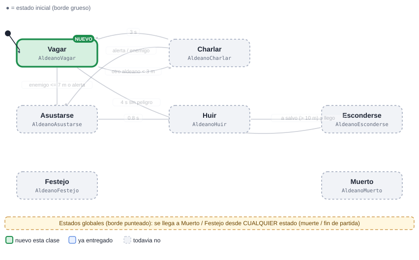
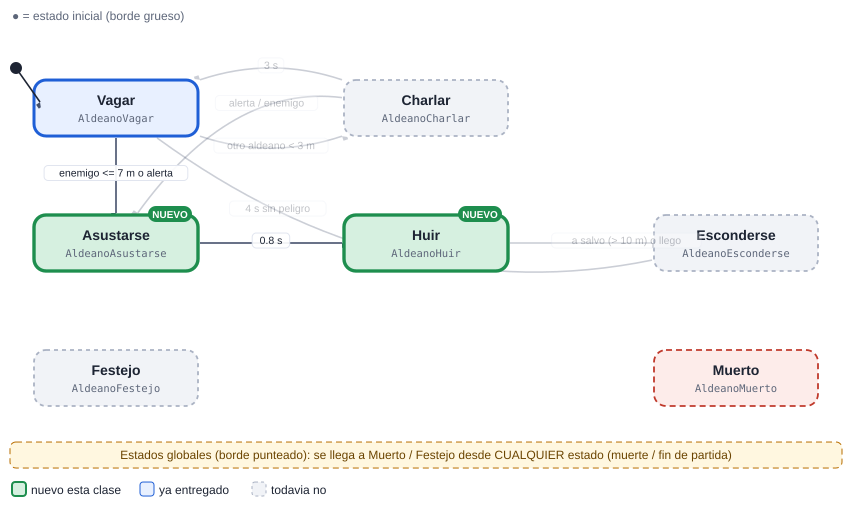
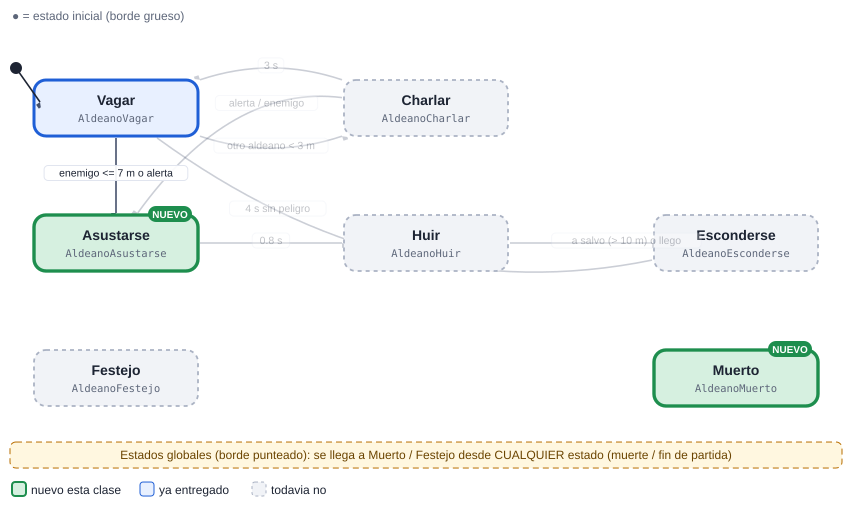
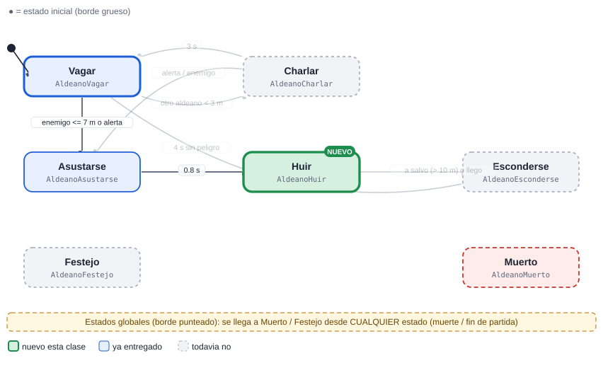
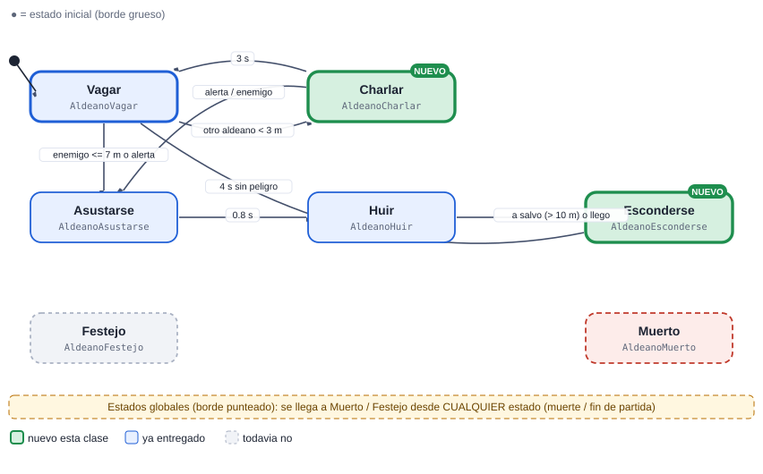
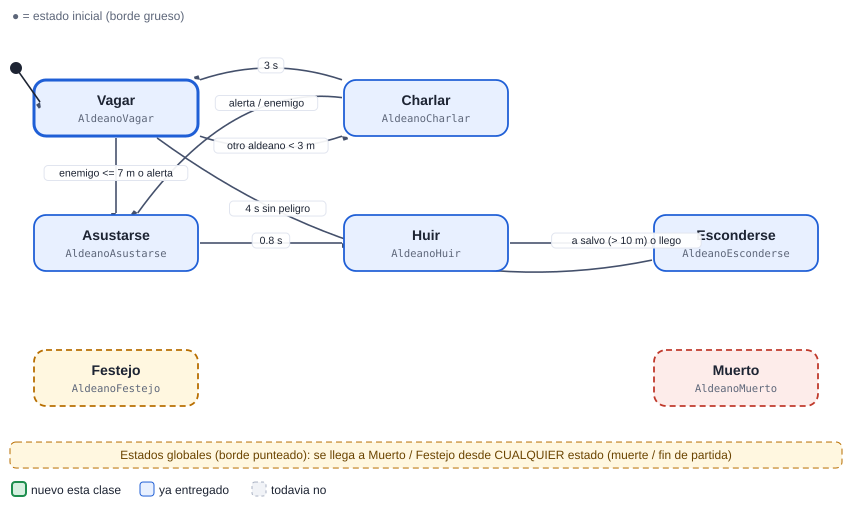

# 10 · Aldeano

[Plan general](00_indice_y_plan.md) · [Guia de inicio](03_como_empezar.md) · [Como subir cambios](04_como_subir_cambios.md) · [Troubleshooting](05_troubleshooting.md) · [Estado general](01_estado_general.md) · [Steering](02_steering_behaviors.md) · [README](../README.md)

**Media**  **Civil**

Civil de la aldea. Pasea y conversa; al ver enemigos o oir una alarma se asusta, huye y se esconde cerca del granero. Pasada la amenaza, vuelve a su vida.

Peso de la máquina: **25.0 pts** · Steering a cargo: **6 pts** (Wander (6 pts)) · Total del cupo 10: **31.0 pts** · Estados: **7** · Transiciones: **7**

## 1. Diagrama de estados


Las flechas se leen "desde → hasta" con la condición que dispara el cambio. El estado inicial es el de borde grueso. Cada estado devuelve el nombre del siguiente estado en `Actualizar` o `AlRecibir` (o `null` para quedarse).

> Documentos de apoyo: [Cómo subir tus cambios](04_como_subir_cambios.md) · [Troubleshooting (si el pipeline falla)](05_troubleshooting.md) · [Guía de inicio](03_como_empezar.md).

## Cómo empezar (primeros 30 minutos)

1. **Rama:** `git checkout main; git pull; git checkout -b clase-1/10-aldeano`
2. **Mira tu agente en el juego:** abre `Assets/_Granero/Escenas/Granero.unity` y pulsa Play. Observa cómo se mueve con el cerebro demo; tu máquina lo va a reemplazar. *Aparece: desde el inicio (nacen en la aldea).*
3. **Crea estos archivos** en `Assets/_Alumnos/Aldeano/`: `AldeanoController.cs`, `AldeanoVagar.cs`.
4. **Copia el esqueleto** de la sección de código más abajo (controller + primer estado) y registra tus estados en `new Maquina(new List<Estado> {...})`.
5. **Primer estado:** en `Entrar` pide la animación (`Caminar`) y en `Actualizar` haz lo mínimo (mover con `Cuerpo.Mover`).
6. **Play:** en cuanto existe `AldeanoController`, el sistema lo usa en lugar del demo. Si ves tu primer estado funcionando, sigue con el siguiente.
7. **Commit y PR** el mismo día (flujo en la [guía de inicio](03_como_empezar.md)).

Guía completa con diagramas: [guía de inicio](03_como_empezar.md).

## 2. Estados

| Estado (clase) | Qué hace | Animación | Steering |
| --- | --- | --- | --- |
| `AldeanoVagar` | Pasea sin rumbo por la aldea evitando arboles. | Caminar | Wander |
| `AldeanoCharlar` | Se detiene 3 s con otro aldeano cercano. | Hablar / Saludar | — |
| `AldeanoAsustarse` | Reaccion de susto 0.8 s al ver un enemigo o oir Alertas. | Miedo | — |
| `AldeanoHuir` | Se aleja del enemigo (con sesgo hacia el granero). | Correr | Flee |
| `AldeanoEsconderse` | Se pega a un escondite (casa/granero/rocas) fuera de la línea de visión del enemigo. | Agachado | Hide + Arrive |
| `AldeanoFestejo` (global) | Global: celebra en victoria, llora en derrota. | Celebrar / Llorar | — |
| `AldeanoMuerto` (global) | Global. | Muerte1 | — |

## 3. Transiciones

| Desde | Hacia | Condición |
| --- | --- | --- |
| Vagar | Charlar | otro aldeano &lt; 3 m |
| Charlar | Vagar | 3 s |
| Vagar | Asustarse | enemigo &lt;= 7 m o alerta |
| Charlar | Asustarse | alerta / enemigo |
| Asustarse | Huir | 0.8 s |
| Huir | Esconderse | a salvo (> 10 m) o llego |
| Esconderse | Vagar | 4 s sin peligro |
| *cualquiera* | Muerto | la vida llega a 0 (`Salud.AlMorir`) |
| *cualquiera* | Festejo | fin de partida (`Juego.AlCambiarFase`) |

**Eventos que escucha:** `dano`, `muerte`, `fin_juego`, `enemigo_visto`, `Alertas.AlAlerta`

## 4. Dependencias

### Mapa de dependencias


### 4.1 API base (ya hecha por el instructor)

| Clase | Qué usas |
| --- | --- |
| `Sensor` | HostilMasCercano / Contar, cada 0.2 s |
| `Cuerpo` | Mover / Mirar / Detener |
| `Agente` | Animar(Anim.X), Hostiles, DistanciaBorde |
| `Salud` | eventos AlDanar / AlMorir |
| `Reserva` | devolver el objeto al morir (pooling) |
| `Alertas` | AlAlerta: suscribirse en OnEnable, desuscribirse en OnDisable |
| `Steering` | Wander, Flee, Hide, Arrive |

### 4.2 Comunicación con otras máquinas

| Con quién | Sentido | Cómo se comunican |
| --- | --- | --- |
| Guardia | recibe de | Alertas.AlAlerta (posicion, radio). |
| Soldado..Jefe | recibe de | Su presencia dispara el susto (Sensor). |
| Director | recibe de | Nace al inicio con Juego.aldea. |

> Regla de oro: las máquinas **no se llaman entre sí**. Se comunican solo por la API base y sus eventos (`Agente.AlMorirAlguien`, `Juego.AlCambiarFase`, `Alertas.AlAlerta`, `Economia`, `Sensor`...). Así nadie queda bloqueado esperando el código de un compañero.

### 4.3 Steering behaviours que usa (los programa otro compañero)

| Behaviour | Responsable | Se entrega en | Mientras tanto |
| --- | --- | --- | --- |
| [`Steering.Wander`](02_steering_behaviors.md#wander-vagar-6-pts) | Cupo 10 (Aldeano) | Clase 3 | usa `Cuerpo.Mover` con dirección directa hacia el objetivo |
| [`Steering.Flee`](02_steering_behaviors.md#flee-huir-2-pts) | Cupo 09 (Guardia) | Clase 2 | usa `Cuerpo.Mover` con dirección directa hacia el objetivo |
| [`Steering.Hide`](02_steering_behaviors.md#hide-esconderse-8-pts) | Cupo 07 (TorreLanzadora) | Clase 4 | usa `Cuerpo.Mover` con dirección directa hacia el objetivo |
| [`Steering.Arrive`](02_steering_behaviors.md#arrive-llegar-4-pts) | Cupo 02 (Bruto) | Clase 2 | usa `Cuerpo.Mover` con dirección directa hacia el objetivo |

El archivo `Steering.cs` ya existe como clase parcial vacía: cada responsable agrega SU archivo `Steering<Nombre>.cs`. Tu máquina solo llama a `Steering.<Nombre>(...)` cuando exista.

## 5. Steering que debes programar tú (cupo 10)

| Behaviour | Pts | Entrega | Lo usan |
| --- | --- | --- | --- |
| [Wander (vagar)](02_steering_behaviors.md#wander-vagar-6-pts) | 6 | Clase 3 | Ladron, Aldeano |

### Cómo probar tu steering aislado

Crea en tu carpeta de máquina un script de prueba (no se usa en el juego final) y ponlo en un objeto con un `Cuerpo` sobre el NavMesh de la escena:

```csharp
using UnityEngine;

namespace Alumnos.Aldeano   // el namespace de tu MAQUINA (el probe no es parte de Steering)
{
public class ProbeWander : MonoBehaviour   // nombre unico: Probe + tu steering
{
    public Transform objetivo;
    public float vMax = 3f;
    Cuerpo cuerpo;
    void Awake() { cuerpo = GetComponent<Cuerpo>(); }
    void Update()
    {
        Vector3 v = Steering.Wander(transform.position, objetivo.position, vMax);   // ajusta los parametros a tu firma
        cuerpo.Mover(v, Time.deltaTime);
    }
}
}
```

## 6. Entregas por clase


Azul: se entrega ese día. Celeste: se mantiene funcionando en las clases siguientes (se vuelve a revisar).

| Clase y día | Estados nuevos | Acumulado | Qué debe funcionar | Steering |
| --- | --- | --- | --- | --- |
| **1** Lun 9 nov | Vagar | 1/7 · 14% | Onboarding y primer commit: el Controller crea la Maquina e inicia en Vagar (puede ser un esqueleto que solo escribe un mensaje en consola). Compila, se ve en Play y el PR pasa la revision. | — |
| **2** Mié 11 nov | Muerto, Asustarse | 3/7 · 43% | Muerto: Global. Asustarse: Reaccion de susto 0.8 s al ver un enemigo o oir Alertas. | — |
| **3** Mié 18 nov | Huir | 4/7 · 57% | Huir: Se aleja del enemigo (con sesgo hacia el granero). | Wander |
| **4** Lun 23 nov | Esconderse, Charlar | 6/7 · 86% | Esconderse: Se pega a un escondite (casa/granero/rocas) fuera de la línea de visión del enemigo. Charlar: Se detiene 3 s con otro aldeano cercano. | — |
| **5** Mié 25 nov | Festejo | 7/7 · 100% | Festejo: Global: celebra en victoria, llora en derrota. | — |
| **6** Lun 30 nov | (colch&oacute;n) | 7/7 · 100% | Colchon (opcional): se usa solo para corregir pendientes o para ponerse al corriente. No hay estados nuevos. | — |

Guías: [Cómo subir tus cambios](04_como_subir_cambios.md) · [Troubleshooting (si el pipeline falla)](05_troubleshooting.md).

### Detalle de cada entrega (qué entregar, cómo comprobarlo y qué comandos usar)

> Antes de tu primera entrega lee **[Cómo subir tus cambios](04_como_subir_cambios.md)**. Si el pipeline marca algo en rojo: **[Troubleshooting (si el pipeline falla)](05_troubleshooting.md)**. Todas las fechas son el día de clase; el lunes 16 de noviembre es puente (no hay clase).

### Clase 1 · Lun 9 nov · Onboarding y primer commit · PR a más tardar ese día, 23:59 (CDMX)

**Rama:** `clase-1/10-aldeano`  ·  **Avance esperado:** 1 de 7 estados (14%)



#### Onboarding (2 horas): recorre todo y sube tu primer commit



> Hoy no se califica cuánto programaste, sino que **recorriste el flujo completo una vez**: clonar, correr el juego, leer tu ficha, crear tu rama, hacer que tu máquina arranque y llegar hasta un PR revisado. Todo lo demás se construye sobre esto.

##### 1 · Clonar y abrir (0-15 min)

```bash
git clone https://github.com/BanyoLoper/tower-defense.git td
cd td
git status
```

Abre la carpeta `td` con Unity `6000.3.10f1` (la primera vez tarda). Debe decir `On branch main` y *working tree clean*. Si falla: [Troubleshooting (si el pipeline falla)](05_troubleshooting.md).

##### 2 · Jugar la base (15-30 min)

Abre `Assets/_Granero/Escenas/Granero.unity` y pulsa Play. Pulsa ESPACIO para llamar oleadas; mira cómo aparecen enemigos y torres y recorre la Hierarchy. Así sabes qué hace el juego sin tu código.

##### 3 · Leer tu ficha y el Estado base (30-50 min)

Lee de esta ficha el diagrama de estados, *Qué es tu máquina* y las reglas. Abre `Assets/_Granero/Scripts/Maquina/` y mira `Estado.cs`, `Maquina.cs` y `Contexto.cs`; la explicación está en [Estado general](01_estado_general.md).

##### 4 · Crear tu rama (50-60 min)

```bash
git checkout main
git pull
git checkout -b clase-1/10-aldeano
```

Es la rama de hoy; el nombre debe ser exacto.

##### 5 · Controller + estado inicial (60-95 min)

Crea los dos archivos de abajo en `Assets/_Alumnos/Aldeano/` (Unity genera los `.meta`). Es la versión mínima del esqueleto completo que aparece más abajo en esta ficha: solo registra `AldeanoVagar`. Pulsa Play y, si hace falta, llama oleadas con ESPACIO hasta que aparezca tu agente (desde el inicio (nacen en la aldea)): la consola debe mostrar *Aldeano: entre a Vagar*.

##### 6 · Primer commit y push (95-110 min)

```bash
git status
git add Assets/_Alumnos/Aldeano
git commit -m "clase 1: Aldeano - controller y Vagar"
git push -u origin clase-1/10-aldeano
```

`git status` debe mostrar solo tu carpeta (y los `.meta`).

##### 7 · Pull Request y reporte (110-120 min)

```bash
gh pr create --base main --title "Clase 1 - Aldeano (cupo 10)" --body "Onboarding: controller y Vagar"
gh pr view --comments
```

Sin la CLI, crea el PR en la web ([Cómo subir tus cambios](04_como_subir_cambios.md)). En 1-2 minutos el Action comenta; si hay ❌, corrige y haz `git push`.

**Código del paso 5** (copia y pega; los nombres ya son los de tu máquina):

```csharp
// Assets/_Alumnos/Aldeano/AldeanoController.cs
using System.Collections.Generic;
using UnityEngine;

namespace Alumnos.Aldeano
{
    public class AldeanoController : MonoBehaviour
    {
        Maquina maq;
        readonly Contexto ctx = new Contexto();

        void Awake()
        {
            ctx.Fijar("agente", GetComponent<Agente>());
            ctx.Fijar("ctrl", this);
            maq = new Maquina(new List<Estado> { new AldeanoVagar() }, ctx);   // por ahora solo este estado
        }

        void OnEnable() { maq.Iniciar("AldeanoVagar"); }
        void Update() { maq.Actualizar(Time.deltaTime); }
    }
}

// Assets/_Alumnos/Aldeano/AldeanoVagar.cs
using UnityEngine;

namespace Alumnos.Aldeano
{
    public class AldeanoVagar : Estado
    {
        public override void Entrar(string anterior)
        {
            Debug.Log("Aldeano: entre a Vagar");   // prueba de vida: debe salir en la consola al hacer Play
        }

        public override string Actualizar(float dt) { return null; }   // null = quedarse en este estado

        public override string AlRecibir(string trigger, int valor) { return null; }
    }
}
```

¿Terminaste antes? Es opcional y no se califica hoy: empieza el siguiente estado (la clase 2 trae `AldeanoMuerto`, `AldeanoAsustarse`).

| Archivo (en `Assets/_Alumnos/Aldeano/`) | Qué debe tener |
| --- | --- |
| `AldeanoController.cs` | **Nuevo.** `class AldeanoController : MonoBehaviour` dentro de `namespace Alumnos.Aldeano`. Crea el `Contexto`, la `Maquina` con tus estados e inicia en `Vagar`. |
| `AldeanoVagar.cs` | **Nuevo.** `class AldeanoVagar : Estado`. Pasea sin rumbo por la aldea evitando arboles. Animación: `Caminar`. |
| `*.meta` | Cada archivo nuevo trae su `.meta` (Unity lo crea al abrir el proyecto). Sube los dos. |

**Qué debe verse en Play al terminar esta clase**

- Onboarding y primer commit: el Controller crea la Maquina e inicia en Vagar (puede ser un esqueleto que solo escribe un mensaje en consola). Compila, se ve en Play y el PR pasa la revision.
- Cómo probarlo: abre `Granero.unity`, pulsa Play y mira a tus agentes desde el inicio. Tu agente aparece: desde el inicio (nacen en la aldea).

**Lo que revisa el Action en esta clase** (debe existir cada clase, hereda de `Estado` y estar registrada en el controller): `AldeanoVagar`.

Todavía NO se pide: `AldeanoCharlar`, `AldeanoAsustarse`, `AldeanoHuir`, `AldeanoEsconderse`, `AldeanoFestejo`, `AldeanoMuerto`.

**Lista de comprobación antes del PR**

- [ ] Unity compila: la consola está vacía (sin errores rojos).
- [ ] Probado en Play (lo de arriba funciona).
- [ ] `git status` solo muestra archivos de `Assets/_Alumnos/Aldeano/` y de `Assets/_Alumnos/Steering/` (y sus `.meta`).
- [ ] Todo tu código está dentro de `namespace Alumnos.Aldeano` (los `Steering*.cs` no llevan namespace) y es ASCII (sin acentos ni ñ).
- [ ] La rama se llama exactamente `clase-1/10-aldeano` y el PR se crea hoy (máximo el Lun 9 nov).
- [ ] Leíste el comentario del Action en tu PR y corregiste cada ❌.

**Comandos de esta entrega** (copiar y pegar; si algo falla ve a [Troubleshooting (si el pipeline falla)](05_troubleshooting.md)):

```bash
git checkout main
git pull
git checkout -b clase-1/10-aldeano
# ... programas y pruebas en Unity ...
git status
git add Assets/_Alumnos/Aldeano
git commit -m "clase 1: Aldeano - Vagar"
git push -u origin clase-1/10-aldeano
```

### Clase 2 · Mié 11 nov · PR a más tardar ese día, 23:59 (CDMX)

**Rama:** `clase-2/10-aldeano`  ·  **Avance esperado:** 3 de 7 estados (43%)



| Archivo (en `Assets/_Alumnos/Aldeano/`) | Qué debe tener |
| --- | --- |
| `AldeanoController.cs` | **Lo modificas.** Registra en la lista de la máquina los estados nuevos: `new AldeanoMuerto()`, `new AldeanoAsustarse()`. |
| `AldeanoMuerto.cs` | **Nuevo.** `class AldeanoMuerto : Estado`. Global. Animación: `Muerte1`. |
| `AldeanoAsustarse.cs` | **Nuevo.** `class AldeanoAsustarse : Estado`. Reaccion de susto 0.8 s al ver un enemigo o oir Alertas. Animación: `Miedo`. |
| `*.meta` | Cada archivo nuevo trae su `.meta` (Unity lo crea al abrir el proyecto). Sube los dos. |

**Qué debe verse en Play al terminar esta clase**

- Muerto: Global. Asustarse: Reaccion de susto 0.8 s al ver un enemigo o oir Alertas.
- Cómo probarlo: abre `Granero.unity`, pulsa Play y mira a tus agentes desde el inicio. Tu agente aparece: desde el inicio (nacen en la aldea).

**Lo que revisa el Action en esta clase** (debe existir cada clase, hereda de `Estado` y estar registrada en el controller): `AldeanoVagar`, `AldeanoMuerto`, `AldeanoAsustarse`.

Todavía NO se pide: `AldeanoCharlar`, `AldeanoHuir`, `AldeanoEsconderse`, `AldeanoFestejo`.

**Lista de comprobación antes del PR**

- [ ] Unity compila: la consola está vacía (sin errores rojos).
- [ ] Probado en Play (lo de arriba funciona).
- [ ] `git status` solo muestra archivos de `Assets/_Alumnos/Aldeano/` y de `Assets/_Alumnos/Steering/` (y sus `.meta`).
- [ ] Todo tu código está dentro de `namespace Alumnos.Aldeano` (los `Steering*.cs` no llevan namespace) y es ASCII (sin acentos ni ñ).
- [ ] La rama se llama exactamente `clase-2/10-aldeano` y el PR se crea hoy (máximo el Mié 11 nov).
- [ ] Leíste el comentario del Action en tu PR y corregiste cada ❌.

**Comandos de esta entrega** (copiar y pegar; si algo falla ve a [Troubleshooting (si el pipeline falla)](05_troubleshooting.md)):

```bash
git checkout main
git pull
git checkout -b clase-2/10-aldeano
# ... programas y pruebas en Unity ...
git status
git add Assets/_Alumnos/Aldeano
git commit -m "clase 2: Aldeano - Muerto, Asustarse"
git push -u origin clase-2/10-aldeano
```

### Clase 3 · Mié 18 nov · PR a más tardar ese día, 23:59 (CDMX)

**Rama:** `clase-3/10-aldeano`  ·  **Avance esperado:** 4 de 7 estados (57%)  ·  **Steering:** Wander



| Archivo (en `Assets/_Alumnos/Aldeano/`) | Qué debe tener |
| --- | --- |
| `AldeanoController.cs` | **Lo modificas.** Registra en la lista de la máquina los estados nuevos: `new AldeanoHuir()`. |
| `AldeanoHuir.cs` | **Nuevo.** `class AldeanoHuir : Estado`. Se aleja del enemigo (con sesgo hacia el granero). Animación: `Correr`. |
| `../Steering/SteeringWander.cs` | **Nuevo.** `public static partial class Steering` (SIN namespace) con `public static Vector3 Wander(Vector3 pos, Vector3 adelante, ref float angulo, float radio, float distancia, float jitter, float vMax)`. Prueba: Recorre una zona 30 s sin quedarse quieto ni moverse a tirones; no se sale del NavMesh. |
| `*.meta` | Cada archivo nuevo trae su `.meta` (Unity lo crea al abrir el proyecto). Sube los dos. |

**Qué debe verse en Play al terminar esta clase**

- Huir: Se aleja del enemigo (con sesgo hacia el granero).
- Cómo probarlo: abre `Granero.unity`, pulsa Play y mira a tus agentes desde el inicio. Tu agente aparece: desde el inicio (nacen en la aldea).

**Lo que revisa el Action en esta clase** (debe existir cada clase, hereda de `Estado` y estar registrada en el controller): `AldeanoVagar`, `AldeanoMuerto`, `AldeanoAsustarse`, `AldeanoHuir` y las del steering de esta clase.

Todavía NO se pide: `AldeanoCharlar`, `AldeanoEsconderse`, `AldeanoFestejo`.

**Lista de comprobación antes del PR**

- [ ] Unity compila: la consola está vacía (sin errores rojos).
- [ ] Probado en Play (lo de arriba funciona).
- [ ] `git status` solo muestra archivos de `Assets/_Alumnos/Aldeano/` y de `Assets/_Alumnos/Steering/` (y sus `.meta`).
- [ ] Todo tu código está dentro de `namespace Alumnos.Aldeano` (los `Steering*.cs` no llevan namespace) y es ASCII (sin acentos ni ñ).
- [ ] La rama se llama exactamente `clase-3/10-aldeano` y el PR se crea hoy (máximo el Mié 18 nov).
- [ ] Leíste el comentario del Action en tu PR y corregiste cada ❌.

**Comandos de esta entrega** (copiar y pegar; si algo falla ve a [Troubleshooting (si el pipeline falla)](05_troubleshooting.md)):

```bash
git checkout main
git pull
git checkout -b clase-3/10-aldeano
# ... programas y pruebas en Unity ...
git status
git add Assets/_Alumnos/Aldeano  Assets/_Alumnos/Steering
git commit -m "clase 3: Aldeano - Huir"
git push -u origin clase-3/10-aldeano
```

### Clase 4 · Lun 23 nov · PR a más tardar ese día, 23:59 (CDMX)

**Rama:** `clase-4/10-aldeano`  ·  **Avance esperado:** 6 de 7 estados (86%)



| Archivo (en `Assets/_Alumnos/Aldeano/`) | Qué debe tener |
| --- | --- |
| `AldeanoController.cs` | **Lo modificas.** Registra en la lista de la máquina los estados nuevos: `new AldeanoEsconderse()`, `new AldeanoCharlar()`. |
| `AldeanoEsconderse.cs` | **Nuevo.** `class AldeanoEsconderse : Estado`. Se pega a un escondite (casa/granero/rocas) fuera de la línea de visión del enemigo. Animación: `Agachado`. |
| `AldeanoCharlar.cs` | **Nuevo.** `class AldeanoCharlar : Estado`. Se detiene 3 s con otro aldeano cercano. Animación: `Hablar / Saludar`. |
| `*.meta` | Cada archivo nuevo trae su `.meta` (Unity lo crea al abrir el proyecto). Sube los dos. |

**Qué debe verse en Play al terminar esta clase**

- Esconderse: Se pega a un escondite (casa/granero/rocas) fuera de la línea de visión del enemigo. Charlar: Se detiene 3 s con otro aldeano cercano.
- Cómo probarlo: abre `Granero.unity`, pulsa Play y mira a tus agentes desde el inicio. Tu agente aparece: desde el inicio (nacen en la aldea).

**Lo que revisa el Action en esta clase** (debe existir cada clase, hereda de `Estado` y estar registrada en el controller): `AldeanoVagar`, `AldeanoMuerto`, `AldeanoAsustarse`, `AldeanoHuir`, `AldeanoEsconderse`, `AldeanoCharlar`.

Todavía NO se pide: `AldeanoFestejo`.

**Lista de comprobación antes del PR**

- [ ] Unity compila: la consola está vacía (sin errores rojos).
- [ ] Probado en Play (lo de arriba funciona).
- [ ] `git status` solo muestra archivos de `Assets/_Alumnos/Aldeano/` y de `Assets/_Alumnos/Steering/` (y sus `.meta`).
- [ ] Todo tu código está dentro de `namespace Alumnos.Aldeano` (los `Steering*.cs` no llevan namespace) y es ASCII (sin acentos ni ñ).
- [ ] La rama se llama exactamente `clase-4/10-aldeano` y el PR se crea hoy (máximo el Lun 23 nov).
- [ ] Leíste el comentario del Action en tu PR y corregiste cada ❌.

**Comandos de esta entrega** (copiar y pegar; si algo falla ve a [Troubleshooting (si el pipeline falla)](05_troubleshooting.md)):

```bash
git checkout main
git pull
git checkout -b clase-4/10-aldeano
# ... programas y pruebas en Unity ...
git status
git add Assets/_Alumnos/Aldeano
git commit -m "clase 4: Aldeano - Esconderse, Charlar"
git push -u origin clase-4/10-aldeano
```

### Clase 5 · Mié 25 nov · PR a más tardar ese día, 23:59 (CDMX)

**Rama:** `clase-5/10-aldeano`  ·  **Avance esperado:** 7 de 7 estados (100%)



| Archivo (en `Assets/_Alumnos/Aldeano/`) | Qué debe tener |
| --- | --- |
| `AldeanoController.cs` | **Lo modificas.** Registra en la lista de la máquina los estados nuevos: `new AldeanoFestejo()`. |
| `AldeanoFestejo.cs` | **Nuevo.** `class AldeanoFestejo : Estado`. Global: celebra en victoria, llora en derrota. Animación: `Celebrar / Llorar`. |
| `*.meta` | Cada archivo nuevo trae su `.meta` (Unity lo crea al abrir el proyecto). Sube los dos. |

**Qué debe verse en Play al terminar esta clase**

- Festejo: Global: celebra en victoria, llora en derrota.
- Cómo probarlo: abre `Granero.unity`, pulsa Play y mira a tus agentes desde el inicio. Tu agente aparece: desde el inicio (nacen en la aldea).

**Lo que revisa el Action en esta clase** (debe existir cada clase, hereda de `Estado` y estar registrada en el controller): `AldeanoVagar`, `AldeanoMuerto`, `AldeanoAsustarse`, `AldeanoHuir`, `AldeanoEsconderse`, `AldeanoCharlar`, `AldeanoFestejo`.

**Lista de comprobación antes del PR**

- [ ] Unity compila: la consola está vacía (sin errores rojos).
- [ ] Probado en Play (lo de arriba funciona).
- [ ] `git status` solo muestra archivos de `Assets/_Alumnos/Aldeano/` y de `Assets/_Alumnos/Steering/` (y sus `.meta`).
- [ ] Todo tu código está dentro de `namespace Alumnos.Aldeano` (los `Steering*.cs` no llevan namespace) y es ASCII (sin acentos ni ñ).
- [ ] La rama se llama exactamente `clase-5/10-aldeano` y el PR se crea hoy (máximo el Mié 25 nov).
- [ ] Leíste el comentario del Action en tu PR y corregiste cada ❌.

**Comandos de esta entrega** (copiar y pegar; si algo falla ve a [Troubleshooting (si el pipeline falla)](05_troubleshooting.md)):

```bash
git checkout main
git pull
git checkout -b clase-5/10-aldeano
# ... programas y pruebas en Unity ...
git status
git add Assets/_Alumnos/Aldeano
git commit -m "clase 5: Aldeano - Festejo"
git push -u origin clase-5/10-aldeano
```

### Clase 6 · Lun 30 nov · Colchón (opcional, no se califica) · PR a más tardar ese día, 23:59 (CDMX)

**Rama:** `clase-6/10-aldeano`  ·  **Avance esperado:** 7 de 7 estados (100%)


| Archivo (en `Assets/_Alumnos/Aldeano/`) | Qué debe tener |
| --- | --- |
| `AldeanoController.cs` | **Lo modificas.** Registra en la lista de la máquina los estados nuevos: ninguno nuevo (solo ajustes). |
| (ninguno obligatorio) | Colchón: sin contenido nuevo. Solo corriges lo que marcó el Action o terminas lo que se quedó atrás. |
| `*.meta` | Cada archivo nuevo trae su `.meta` (Unity lo crea al abrir el proyecto). Sube los dos. |

**Qué debe verse en Play al terminar esta clase**

- Esta clase **no tiene contenido nuevo y no cuenta para la calificación** (el promedio es de las clases 1 a 5).
- Úsala para: corregir los ❌ que dejó el Action, terminar estados atrasados y probar tu máquina junto con las otras.
- Si necesitas entregar correcciones, crea la rama `clase-6/10-aldeano` y su PR; si no, no hace falta.

**Lo que revisa el Action en esta clase** (debe existir cada clase, hereda de `Estado` y estar registrada en el controller): `AldeanoVagar`, `AldeanoMuerto`, `AldeanoAsustarse`, `AldeanoHuir`, `AldeanoEsconderse`, `AldeanoCharlar`, `AldeanoFestejo`.

**Lista de comprobación antes del PR**

- [ ] Unity compila: la consola está vacía (sin errores rojos).
- [ ] Probado en Play (lo de arriba funciona).
- [ ] `git status` solo muestra archivos de `Assets/_Alumnos/Aldeano/` y de `Assets/_Alumnos/Steering/` (y sus `.meta`).
- [ ] Todo tu código está dentro de `namespace Alumnos.Aldeano` (los `Steering*.cs` no llevan namespace) y es ASCII (sin acentos ni ñ).
- [ ] La rama se llama exactamente `clase-6/10-aldeano` y el PR se crea hoy (máximo el Lun 30 nov).
- [ ] Leíste el comentario del Action en tu PR y corregiste cada ❌.

**Comandos de esta entrega** (copiar y pegar; si algo falla ve a [Troubleshooting (si el pipeline falla)](05_troubleshooting.md)):

```bash
git checkout main
git pull
git checkout -b clase-6/10-aldeano
# ... programas y pruebas en Unity ...
git status
git add Assets/_Alumnos/Aldeano
git commit -m "clase 6: Aldeano - correcciones"
git push -u origin clase-6/10-aldeano
```

### Rúbrica (igual en todas las clases)

| Criterio | Puntos | Qué se revisa |
| --- | --- | --- |
| Funciona en el juego | 50 | El agente/sistema hace lo pedido en Play, sin errores en consola, con el prefab real. |
| Estados entregados | 30 | Cumple los estados de ESA clase (ver tabla). Cada estado que falta resta proporcionalmente. |
| Codigo y rendimiento | 20 | Una clase por estado con prefijo del rol, ASCII, sin new/LINQ en Update, eventos desuscritos, cero basura medido. |
| Total por clase | 100 | La calificación final es el promedio de las 5 entregas de las clases 1 a 5 (cada una pesa igual). La clase 6 es colchón y no cuenta. |

## 7. Esqueleto de código

Punto de partida. Copia el patrón del `SoldadoController`/estados de referencia; el resto de estados siguen la misma forma. Nombres de clase únicos: `Aldeano<Estado>`.

```csharp
// AldeanoController.cs
using System.Collections.Generic;
using UnityEngine;

namespace Alumnos.Aldeano
{
public class AldeanoController : MonoBehaviour
{
    Maquina maq;
    readonly Contexto ctx = new Contexto();
    Agente ag;

    void Awake()
    {
        ag = GetComponent<Agente>();
        ctx.Fijar("agente", ag);
        ctx.Fijar("ctrl", this);
        maq = new Maquina(new List<Estado> { new AldeanoVagar(), new AldeanoCharlar(), new AldeanoAsustarse(), new AldeanoHuir(), new AldeanoEsconderse(), new AldeanoFestejo(), new AldeanoMuerto() }, ctx);
    }

    void OnEnable()   // OJO: los agentes vienen de la Reserva (se reutilizan): reinicia todo aqui
    {
        maq.Iniciar("AldeanoVagar");
        ag.salud.AlMorir += AlMorir;
    }

    void OnDisable()
    {
        ag.salud.AlMorir -= AlMorir;   // siempre desuscribirse
    }

    void AlMorir(GameObject origen) { maq.CambiarA("AldeanoMuerto"); }

    void Update() { maq.Actualizar(Time.deltaTime); }
}
}

// AldeanoVagar.cs  (un archivo por estado; mismo namespace y prefijo del rol)
using UnityEngine;

namespace Alumnos.Aldeano
{
public class AldeanoVagar : Estado
{
    float t;
    public override void Entrar(string anterior)
    {
        t = 0f;
        var ag = Ctx.Obtener<Agente>("agente");
        ag.Animar(Anim.Caminar);   // usa las constantes de la clase Anim
    }
    public override string Actualizar(float dt)
    {
        t += dt;
        // TODO: logica del estado; devuelve el NOMBRE del siguiente estado o null para quedarse
        return null;
    }
    public override string AlRecibir(string trigger, int valor) { return null; }
}
}
```

## 8. Reglas que se califican siempre

- Todo tu código va dentro de `namespace Alumnos.<TuMaquina>` (ej. `Alumnos.MagoEnemigo`). Los archivos `Steering*.cs` NO llevan namespace.
- Una clase por estado, hereda de `Estado`, nombre con prefijo del rol. Ninguna clase puede llamarse igual que una del juego base.
- Nada de `new`, LINQ, `GetComponent` ni `Find` dentro de `Actualizar`: guarda referencias en `Entrar` o en el Contexto.
- El Sensor se consulta cada 0.2 s, no cada frame.
- Suscripciones a eventos en `OnEnable`, baja en `OnDisable` (los agentes se reutilizan).
- Todo el código en ASCII (sin acentos ni ñ).
