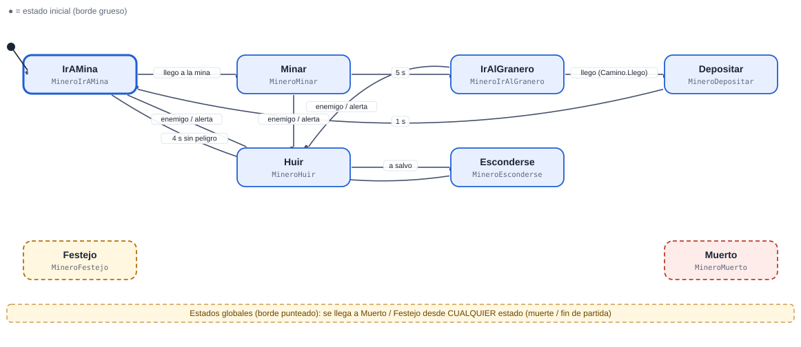
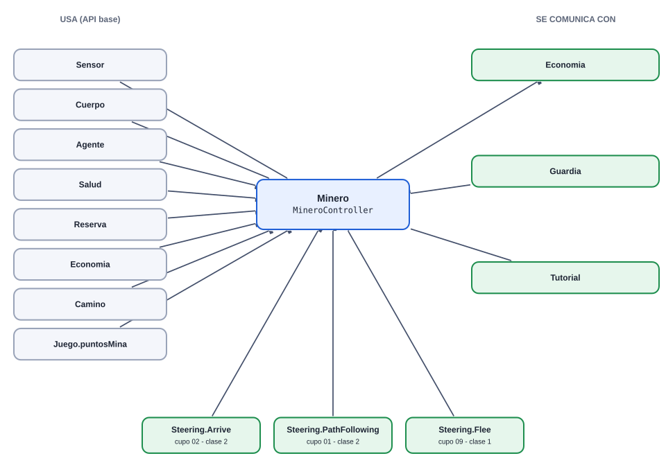
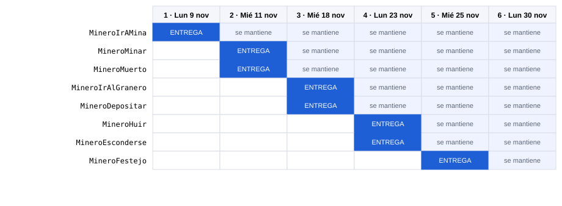
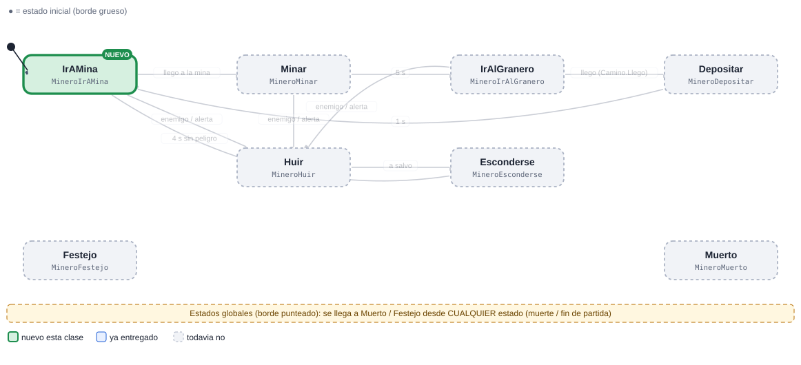
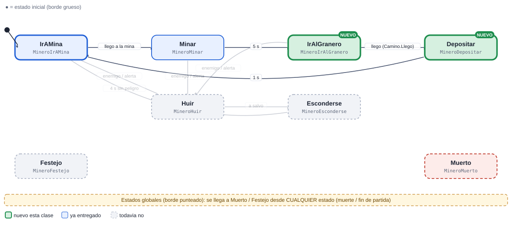
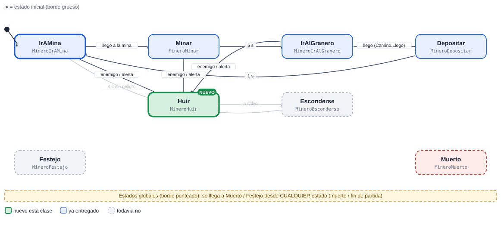
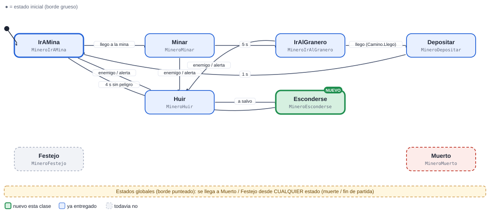
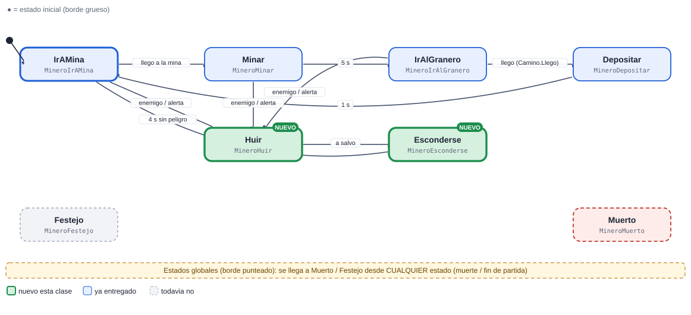
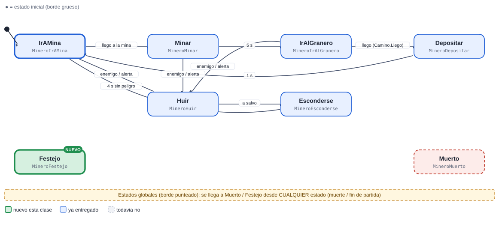
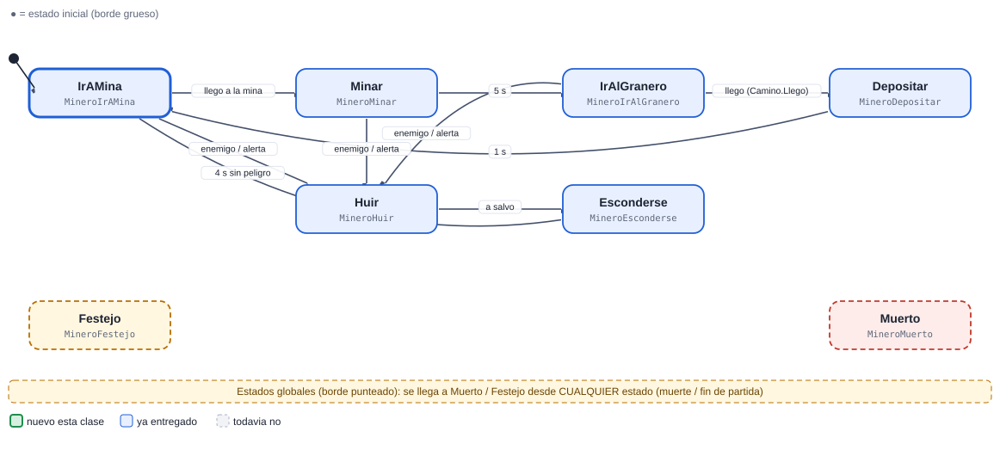

# 11 · Minero

[Plan general](00_indice_y_plan.md) · [Guia de inicio](03_como_empezar.md) · [Como subir cambios](04_como_subir_cambios.md) · [Troubleshooting](05_troubleshooting.md) · [Estado general](01_estado_general.md) · [Steering](02_steering_behaviors.md) · [README](../README.md)

**Muy alta**  **Civil**

Genera la economía: va a su mina, pica, regresa al granero y deposita las gemas. Si hay peligro huye y se esconde; al volver retoma el trabajo.

Peso de la máquina: **28.5 pts** · Steering a cargo: **0 pts** (ninguno) · Total del cupo 11: **28.5 pts** · Estados: **8** · Transiciones: **9**

## 1. Diagrama de estados



Las flechas se leen "desde → hasta" con la condición que dispara el cambio. El estado inicial es el de borde grueso. Cada estado devuelve el nombre del siguiente estado en `Actualizar` o `AlRecibir` (o `null` para quedarse).

> Documentos de apoyo: [Cómo subir tus cambios](04_como_subir_cambios.md) · [Troubleshooting (si el pipeline falla)](05_troubleshooting.md) · [Guía de inicio](03_como_empezar.md).

## Cómo empezar (primeros 30 minutos)

1. **Rama:** `git checkout main; git pull; git checkout -b clase-1/11-minero`
2. **Mira tu agente en el juego:** abre `Assets/_Granero/Escenas/Granero.unity` y pulsa Play. Observa cómo se mueve con el cerebro demo; tu máquina lo va a reemplazar. *Aparece: desde el inicio (nacen en la aldea).*
3. **Crea estos archivos** en `Assets/_Alumnos/Minero/`: `MineroController.cs`, `MineroIrAMina.cs`.
4. **Copia el esqueleto** de la sección de código más abajo (controller + primer estado) y registra tus estados en `new Maquina(new List<Estado> {...})`.
5. **Primer estado:** en `Entrar` pide la animación (`Caminar`) y en `Actualizar` haz lo mínimo (mover con `Cuerpo.Mover`).
6. **Play:** en cuanto existe `MineroController`, el sistema lo usa en lugar del demo. Si ves tu primer estado funcionando, sigue con el siguiente.
7. **Commit y PR** el mismo día (flujo en la [guía de inicio](03_como_empezar.md)).

Guía completa con diagramas: [guía de inicio](03_como_empezar.md).

## 2. Estados

| Estado (clase) | Qué hace | Animación | Steering |
| --- | --- | --- | --- |
| `MineroIrAMina` | Camina a su mina (puntosMina) con Camino. | Caminar | Arrive + PathFollowing |
| `MineroMinar` | Pica 5 s en su sitio. | Minar / MinarLoop | — |
| `MineroIrAlGranero` | Lleva las gemas al granero. | Caminar | PathFollowing |
| `MineroDepositar` | Entrega: Economia.Agregar(6). | Recolectar | — |
| `MineroHuir` | Se aleja del enemigo (conserva la carga). | Correr | Flee |
| `MineroEsconderse` | Espera escondido 4 s a que pase el peligro. | Agachado | — |
| `MineroFestejo` (global) | Global. | Celebrar1 | — |
| `MineroMuerto` (global) | Global: la carga se pierde. | Muerte1 | — |

## 3. Transiciones

| Desde | Hacia | Condición |
| --- | --- | --- |
| IrAMina | Minar | llego a la mina |
| Minar | IrAlGranero | 5 s |
| IrAlGranero | Depositar | llego (Camino.Llego) |
| Depositar | IrAMina | 1 s |
| IrAMina | Huir | enemigo / alerta |
| Minar | Huir | enemigo / alerta |
| IrAlGranero | Huir | enemigo / alerta |
| Huir | Esconderse | a salvo |
| Esconderse | IrAMina | 4 s sin peligro |
| *cualquiera* | Muerto | la vida llega a 0 (`Salud.AlMorir`) |
| *cualquiera* | Festejo | fin de partida (`Juego.AlCambiarFase`) |

**Eventos que escucha:** `dano`, `muerte`, `fin_juego`, `enemigo_visto`, `Alertas.AlAlerta`

## 4. Dependencias

### Mapa de dependencias



### 4.1 API base (ya hecha por el instructor)

| Clase | Qué usas |
| --- | --- |
| `Sensor` | HostilMasCercano / Contar, cada 0.2 s |
| `Cuerpo` | Mover / Mirar / Detener |
| `Agente` | Animar(Anim.X), Hostiles, DistanciaBorde |
| `Salud` | eventos AlDanar / AlMorir |
| `Reserva` | devolver el objeto al morir (pooling) |
| `Economia` | Agregar(n) |
| `Camino` | Calcular(desde,hasta) solo al entrar al estado |
| `Juego.puntosMina` | su mina asignada |
| `Steering` | Arrive, PathFollowing, Flee |

### 4.2 Comunicación con otras máquinas

| Con quién | Sentido | Cómo se comunican |
| --- | --- | --- |
| Economia | envía a | Economia.Agregar(6) por viaje; sube las gemas del jugador (HUD por evento). |
| Guardia | recibe de | Alertas.AlAlerta. |
| Tutorial | envía a | El Tutorial puede explicar de donde salen las gemas. |

> Regla de oro: las máquinas **no se llaman entre sí**. Se comunican solo por la API base y sus eventos (`Agente.AlMorirAlguien`, `Juego.AlCambiarFase`, `Alertas.AlAlerta`, `Economia`, `Sensor`...). Así nadie queda bloqueado esperando el código de un compañero.

### 4.3 Steering behaviours que usa (los programa otro compañero)

| Behaviour | Responsable | Se entrega en | Mientras tanto |
| --- | --- | --- | --- |
| [`Steering.Arrive`](02_steering_behaviors.md#arrive-llegar-4-pts) | Cupo 02 (Bruto) | Clase 2 | usa `Cuerpo.Mover` con dirección directa hacia el objetivo |
| [`Steering.PathFollowing`](02_steering_behaviors.md#path-following-seguir-camino-7-pts) | Cupo 01 (Soldado) | Clase 2 | usa `Cuerpo.Mover` con dirección directa hacia el objetivo |
| [`Steering.Flee`](02_steering_behaviors.md#flee-huir-2-pts) | Cupo 09 (Guardia) | Clase 2 | usa `Cuerpo.Mover` con dirección directa hacia el objetivo |

El archivo `Steering.cs` ya existe como clase parcial vacía: cada responsable agrega SU archivo `Steering<Nombre>.cs`. Tu máquina solo llama a `Steering.<Nombre>(...)` cuando exista.

## 5. Entregas por clase



Azul: se entrega ese día. Celeste: se mantiene funcionando en las clases siguientes (se vuelve a revisar).

| Clase y día | Estados nuevos | Acumulado | Qué debe funcionar | Steering |
| --- | --- | --- | --- | --- |
| **1** Lun 9 nov | IrAMina | 1/8 · 12% | Onboarding y primer commit: el Controller crea la Maquina e inicia en IrAMina (puede ser un esqueleto que solo escribe un mensaje en consola). Compila, se ve en Play y el PR pasa la revision. | — |
| **2** Mié 11 nov | Minar, Muerto | 3/8 · 38% | Minar: Pica 5 s en su sitio. Muerto: Global: la carga se pierde. | — |
| **3** Mié 18 nov | IrAlGranero, Depositar | 5/8 · 62% | IrAlGranero: Lleva las gemas al granero. Depositar: Entrega: Economia.Agregar(6). | — |
| **4** Lun 23 nov | Huir, Esconderse | 7/8 · 88% | Huir: Se aleja del enemigo (conserva la carga). Esconderse: Espera escondido 4 s a que pase el peligro. | — |
| **5** Mié 25 nov | Festejo | 8/8 · 100% | Festejo: Global. | — |
| **6** Lun 30 nov | (colch&oacute;n) | 8/8 · 100% | Colchon (opcional): se usa solo para corregir pendientes o para ponerse al corriente. No hay estados nuevos. | — |

Guías: [Cómo subir tus cambios](04_como_subir_cambios.md) · [Troubleshooting (si el pipeline falla)](05_troubleshooting.md).

### Detalle de cada entrega (qué entregar, cómo comprobarlo y qué comandos usar)

> Antes de tu primera entrega lee **[Cómo subir tus cambios](04_como_subir_cambios.md)**. Si el pipeline marca algo en rojo: **[Troubleshooting (si el pipeline falla)](05_troubleshooting.md)**. Todas las fechas son el día de clase; el lunes 16 de noviembre es puente (no hay clase).

### Clase 1 · Lun 9 nov · Onboarding y primer commit · PR a más tardar ese día, 23:59 (CDMX)

**Rama:** `clase-1/11-minero`  ·  **Avance esperado:** 1 de 8 estados (12%)



#### Onboarding (2 horas): recorre todo y sube tu primer commit



> Hoy no se califica cuánto programaste, sino que **recorriste el flujo completo una vez**: clonar, correr el juego, leer tu ficha, crear tu rama, hacer que tu máquina arranque y llegar hasta un PR revisado. Todo lo demás se construye sobre esto.

##### 1 · Clonar y abrir (0-15 min)

```bash
git clone https://github.com/BanyoLoper/tower-defense.git td
cd td
git status
```

Abre la carpeta `td` con Unity `6000.3.10f1` (la primera vez tarda). Debe decir `On branch main` y *working tree clean*. Si falla: [Troubleshooting (si el pipeline falla)](05_troubleshooting.md).

##### 2 · Jugar la base (15-30 min)

Abre `Assets/_Granero/Escenas/Granero.unity` y pulsa Play. Pulsa ESPACIO para llamar oleadas; mira cómo aparecen enemigos y torres y recorre la Hierarchy. Así sabes qué hace el juego sin tu código.

##### 3 · Leer tu ficha y el Estado base (30-50 min)

Lee de esta ficha el diagrama de estados, *Qué es tu máquina* y las reglas. Abre `Assets/_Granero/Scripts/Maquina/` y mira `Estado.cs`, `Maquina.cs` y `Contexto.cs`; la explicación está en [Estado general](01_estado_general.md).

##### 4 · Crear tu rama (50-60 min)

```bash
git checkout main
git pull
git checkout -b clase-1/11-minero
```

Es la rama de hoy; el nombre debe ser exacto.

##### 5 · Controller + estado inicial (60-95 min)

Crea los dos archivos de abajo en `Assets/_Alumnos/Minero/` (Unity genera los `.meta`). Es la versión mínima del esqueleto completo que aparece más abajo en esta ficha: solo registra `MineroIrAMina`. Pulsa Play y, si hace falta, llama oleadas con ESPACIO hasta que aparezca tu agente (desde el inicio (nacen en la aldea)): la consola debe mostrar *Minero: entre a IrAMina*.

##### 6 · Primer commit y push (95-110 min)

```bash
git status
git add Assets/_Alumnos/Minero
git commit -m "clase 1: Minero - controller y IrAMina"
git push -u origin clase-1/11-minero
```

`git status` debe mostrar solo tu carpeta (y los `.meta`).

##### 7 · Pull Request y reporte (110-120 min)

```bash
gh pr create --base main --title "Clase 1 - Minero (cupo 11)" --body "Onboarding: controller y IrAMina"
gh pr view --comments
```

Sin la CLI, crea el PR en la web ([Cómo subir tus cambios](04_como_subir_cambios.md)). En 1-2 minutos el Action comenta; si hay ❌, corrige y haz `git push`.

**Código del paso 5** (copia y pega; los nombres ya son los de tu máquina):

```csharp
// Assets/_Alumnos/Minero/MineroController.cs
using System.Collections.Generic;
using UnityEngine;

namespace Alumnos.Minero
{
    public class MineroController : MonoBehaviour
    {
        Maquina maq;
        readonly Contexto ctx = new Contexto();

        void Awake()
        {
            ctx.Fijar("agente", GetComponent<Agente>());
            ctx.Fijar("ctrl", this);
            maq = new Maquina(new List<Estado> { new MineroIrAMina() }, ctx);   // por ahora solo este estado
        }

        void OnEnable() { maq.Iniciar("MineroIrAMina"); }
        void Update() { maq.Actualizar(Time.deltaTime); }
    }
}

// Assets/_Alumnos/Minero/MineroIrAMina.cs
using UnityEngine;

namespace Alumnos.Minero
{
    public class MineroIrAMina : Estado
    {
        public override void Entrar(string anterior)
        {
            Debug.Log("Minero: entre a IrAMina");   // prueba de vida: debe salir en la consola al hacer Play
        }

        public override string Actualizar(float dt) { return null; }   // null = quedarse en este estado

        public override string AlRecibir(string trigger, int valor) { return null; }
    }
}
```

¿Terminaste antes? Es opcional y no se califica hoy: empieza el siguiente estado (la clase 2 trae `MineroMinar`, `MineroMuerto`).

| Archivo (en `Assets/_Alumnos/Minero/`) | Qué debe tener |
| --- | --- |
| `MineroController.cs` | **Nuevo.** `class MineroController : MonoBehaviour` dentro de `namespace Alumnos.Minero`. Crea el `Contexto`, la `Maquina` con tus estados e inicia en `IrAMina`. |
| `MineroIrAMina.cs` | **Nuevo.** `class MineroIrAMina : Estado`. Camina a su mina (puntosMina) con Camino. Animación: `Caminar`. |
| `*.meta` | Cada archivo nuevo trae su `.meta` (Unity lo crea al abrir el proyecto). Sube los dos. |

**Qué debe verse en Play al terminar esta clase**

- Onboarding y primer commit: el Controller crea la Maquina e inicia en IrAMina (puede ser un esqueleto que solo escribe un mensaje en consola). Compila, se ve en Play y el PR pasa la revision.
- Cómo probarlo: abre `Granero.unity`, pulsa Play y mira a tus agentes desde el inicio. Tu agente aparece: desde el inicio (nacen en la aldea).

**Lo que revisa el Action en esta clase** (debe existir cada clase, hereda de `Estado` y estar registrada en el controller): `MineroIrAMina`.

Todavía NO se pide: `MineroMinar`, `MineroIrAlGranero`, `MineroDepositar`, `MineroHuir`, `MineroEsconderse`, `MineroFestejo`, `MineroMuerto`.

**Lista de comprobación antes del PR**

- [ ] Unity compila: la consola está vacía (sin errores rojos).
- [ ] Probado en Play (lo de arriba funciona).
- [ ] `git status` solo muestra archivos de `Assets/_Alumnos/Minero/` (y sus `.meta`).
- [ ] Todo tu código está dentro de `namespace Alumnos.Minero` (los `Steering*.cs` no llevan namespace) y es ASCII (sin acentos ni ñ).
- [ ] La rama se llama exactamente `clase-1/11-minero` y el PR se crea hoy (máximo el Lun 9 nov).
- [ ] Leíste el comentario del Action en tu PR y corregiste cada ❌.

**Comandos de esta entrega** (copiar y pegar; si algo falla ve a [Troubleshooting (si el pipeline falla)](05_troubleshooting.md)):

```bash
git checkout main
git pull
git checkout -b clase-1/11-minero
# ... programas y pruebas en Unity ...
git status
git add Assets/_Alumnos/Minero
git commit -m "clase 1: Minero - IrAMina"
git push -u origin clase-1/11-minero
```

### Clase 2 · Mié 11 nov · PR a más tardar ese día, 23:59 (CDMX)

**Rama:** `clase-2/11-minero`  ·  **Avance esperado:** 3 de 8 estados (38%)



| Archivo (en `Assets/_Alumnos/Minero/`) | Qué debe tener |
| --- | --- |
| `MineroController.cs` | **Lo modificas.** Registra en la lista de la máquina los estados nuevos: `new MineroMinar()`, `new MineroMuerto()`. |
| `MineroMinar.cs` | **Nuevo.** `class MineroMinar : Estado`. Pica 5 s en su sitio. Animación: `Minar / MinarLoop`. |
| `MineroMuerto.cs` | **Nuevo.** `class MineroMuerto : Estado`. Global: la carga se pierde. Animación: `Muerte1`. |
| `*.meta` | Cada archivo nuevo trae su `.meta` (Unity lo crea al abrir el proyecto). Sube los dos. |

**Qué debe verse en Play al terminar esta clase**

- Minar: Pica 5 s en su sitio. Muerto: Global: la carga se pierde.
- Cómo probarlo: abre `Granero.unity`, pulsa Play y mira a tus agentes desde el inicio. Tu agente aparece: desde el inicio (nacen en la aldea).

**Lo que revisa el Action en esta clase** (debe existir cada clase, hereda de `Estado` y estar registrada en el controller): `MineroIrAMina`, `MineroMinar`, `MineroMuerto`.

Todavía NO se pide: `MineroIrAlGranero`, `MineroDepositar`, `MineroHuir`, `MineroEsconderse`, `MineroFestejo`.

**Lista de comprobación antes del PR**

- [ ] Unity compila: la consola está vacía (sin errores rojos).
- [ ] Probado en Play (lo de arriba funciona).
- [ ] `git status` solo muestra archivos de `Assets/_Alumnos/Minero/` (y sus `.meta`).
- [ ] Todo tu código está dentro de `namespace Alumnos.Minero` (los `Steering*.cs` no llevan namespace) y es ASCII (sin acentos ni ñ).
- [ ] La rama se llama exactamente `clase-2/11-minero` y el PR se crea hoy (máximo el Mié 11 nov).
- [ ] Leíste el comentario del Action en tu PR y corregiste cada ❌.

**Comandos de esta entrega** (copiar y pegar; si algo falla ve a [Troubleshooting (si el pipeline falla)](05_troubleshooting.md)):

```bash
git checkout main
git pull
git checkout -b clase-2/11-minero
# ... programas y pruebas en Unity ...
git status
git add Assets/_Alumnos/Minero
git commit -m "clase 2: Minero - Minar, Muerto"
git push -u origin clase-2/11-minero
```

### Clase 3 · Mié 18 nov · PR a más tardar ese día, 23:59 (CDMX)

**Rama:** `clase-3/11-minero`  ·  **Avance esperado:** 5 de 8 estados (62%)



| Archivo (en `Assets/_Alumnos/Minero/`) | Qué debe tener |
| --- | --- |
| `MineroController.cs` | **Lo modificas.** Registra en la lista de la máquina los estados nuevos: `new MineroIrAlGranero()`, `new MineroDepositar()`. |
| `MineroIrAlGranero.cs` | **Nuevo.** `class MineroIrAlGranero : Estado`. Lleva las gemas al granero. Animación: `Caminar`. |
| `MineroDepositar.cs` | **Nuevo.** `class MineroDepositar : Estado`. Entrega: Economia.Agregar(6). Animación: `Recolectar`. |
| `*.meta` | Cada archivo nuevo trae su `.meta` (Unity lo crea al abrir el proyecto). Sube los dos. |

**Qué debe verse en Play al terminar esta clase**

- IrAlGranero: Lleva las gemas al granero. Depositar: Entrega: Economia.Agregar(6).
- Cómo probarlo: abre `Granero.unity`, pulsa Play y mira a tus agentes desde el inicio. Tu agente aparece: desde el inicio (nacen en la aldea).

**Lo que revisa el Action en esta clase** (debe existir cada clase, hereda de `Estado` y estar registrada en el controller): `MineroIrAMina`, `MineroMinar`, `MineroMuerto`, `MineroIrAlGranero`, `MineroDepositar`.

Todavía NO se pide: `MineroHuir`, `MineroEsconderse`, `MineroFestejo`.

**Lista de comprobación antes del PR**

- [ ] Unity compila: la consola está vacía (sin errores rojos).
- [ ] Probado en Play (lo de arriba funciona).
- [ ] `git status` solo muestra archivos de `Assets/_Alumnos/Minero/` (y sus `.meta`).
- [ ] Todo tu código está dentro de `namespace Alumnos.Minero` (los `Steering*.cs` no llevan namespace) y es ASCII (sin acentos ni ñ).
- [ ] La rama se llama exactamente `clase-3/11-minero` y el PR se crea hoy (máximo el Mié 18 nov).
- [ ] Leíste el comentario del Action en tu PR y corregiste cada ❌.

**Comandos de esta entrega** (copiar y pegar; si algo falla ve a [Troubleshooting (si el pipeline falla)](05_troubleshooting.md)):

```bash
git checkout main
git pull
git checkout -b clase-3/11-minero
# ... programas y pruebas en Unity ...
git status
git add Assets/_Alumnos/Minero
git commit -m "clase 3: Minero - IrAlGranero, Depositar"
git push -u origin clase-3/11-minero
```

### Clase 4 · Lun 23 nov · PR a más tardar ese día, 23:59 (CDMX)

**Rama:** `clase-4/11-minero`  ·  **Avance esperado:** 7 de 8 estados (88%)



| Archivo (en `Assets/_Alumnos/Minero/`) | Qué debe tener |
| --- | --- |
| `MineroController.cs` | **Lo modificas.** Registra en la lista de la máquina los estados nuevos: `new MineroHuir()`, `new MineroEsconderse()`. |
| `MineroHuir.cs` | **Nuevo.** `class MineroHuir : Estado`. Se aleja del enemigo (conserva la carga). Animación: `Correr`. |
| `MineroEsconderse.cs` | **Nuevo.** `class MineroEsconderse : Estado`. Espera escondido 4 s a que pase el peligro. Animación: `Agachado`. |
| `*.meta` | Cada archivo nuevo trae su `.meta` (Unity lo crea al abrir el proyecto). Sube los dos. |

**Qué debe verse en Play al terminar esta clase**

- Huir: Se aleja del enemigo (conserva la carga). Esconderse: Espera escondido 4 s a que pase el peligro.
- Cómo probarlo: abre `Granero.unity`, pulsa Play y mira a tus agentes desde el inicio. Tu agente aparece: desde el inicio (nacen en la aldea).

**Lo que revisa el Action en esta clase** (debe existir cada clase, hereda de `Estado` y estar registrada en el controller): `MineroIrAMina`, `MineroMinar`, `MineroMuerto`, `MineroIrAlGranero`, `MineroDepositar`, `MineroHuir`, `MineroEsconderse`.

Todavía NO se pide: `MineroFestejo`.

**Lista de comprobación antes del PR**

- [ ] Unity compila: la consola está vacía (sin errores rojos).
- [ ] Probado en Play (lo de arriba funciona).
- [ ] `git status` solo muestra archivos de `Assets/_Alumnos/Minero/` (y sus `.meta`).
- [ ] Todo tu código está dentro de `namespace Alumnos.Minero` (los `Steering*.cs` no llevan namespace) y es ASCII (sin acentos ni ñ).
- [ ] La rama se llama exactamente `clase-4/11-minero` y el PR se crea hoy (máximo el Lun 23 nov).
- [ ] Leíste el comentario del Action en tu PR y corregiste cada ❌.

**Comandos de esta entrega** (copiar y pegar; si algo falla ve a [Troubleshooting (si el pipeline falla)](05_troubleshooting.md)):

```bash
git checkout main
git pull
git checkout -b clase-4/11-minero
# ... programas y pruebas en Unity ...
git status
git add Assets/_Alumnos/Minero
git commit -m "clase 4: Minero - Huir, Esconderse"
git push -u origin clase-4/11-minero
```

### Clase 5 · Mié 25 nov · PR a más tardar ese día, 23:59 (CDMX)

**Rama:** `clase-5/11-minero`  ·  **Avance esperado:** 8 de 8 estados (100%)



| Archivo (en `Assets/_Alumnos/Minero/`) | Qué debe tener |
| --- | --- |
| `MineroController.cs` | **Lo modificas.** Registra en la lista de la máquina los estados nuevos: `new MineroFestejo()`. |
| `MineroFestejo.cs` | **Nuevo.** `class MineroFestejo : Estado`. Global. Animación: `Celebrar1`. |
| `*.meta` | Cada archivo nuevo trae su `.meta` (Unity lo crea al abrir el proyecto). Sube los dos. |

**Qué debe verse en Play al terminar esta clase**

- Festejo: Global.
- Cómo probarlo: abre `Granero.unity`, pulsa Play y mira a tus agentes desde el inicio. Tu agente aparece: desde el inicio (nacen en la aldea).

**Lo que revisa el Action en esta clase** (debe existir cada clase, hereda de `Estado` y estar registrada en el controller): `MineroIrAMina`, `MineroMinar`, `MineroMuerto`, `MineroIrAlGranero`, `MineroDepositar`, `MineroHuir`, `MineroEsconderse`, `MineroFestejo`.

**Lista de comprobación antes del PR**

- [ ] Unity compila: la consola está vacía (sin errores rojos).
- [ ] Probado en Play (lo de arriba funciona).
- [ ] `git status` solo muestra archivos de `Assets/_Alumnos/Minero/` (y sus `.meta`).
- [ ] Todo tu código está dentro de `namespace Alumnos.Minero` (los `Steering*.cs` no llevan namespace) y es ASCII (sin acentos ni ñ).
- [ ] La rama se llama exactamente `clase-5/11-minero` y el PR se crea hoy (máximo el Mié 25 nov).
- [ ] Leíste el comentario del Action en tu PR y corregiste cada ❌.

**Comandos de esta entrega** (copiar y pegar; si algo falla ve a [Troubleshooting (si el pipeline falla)](05_troubleshooting.md)):

```bash
git checkout main
git pull
git checkout -b clase-5/11-minero
# ... programas y pruebas en Unity ...
git status
git add Assets/_Alumnos/Minero
git commit -m "clase 5: Minero - Festejo"
git push -u origin clase-5/11-minero
```

### Clase 6 · Lun 30 nov · Colchón (opcional, no se califica) · PR a más tardar ese día, 23:59 (CDMX)

**Rama:** `clase-6/11-minero`  ·  **Avance esperado:** 8 de 8 estados (100%)



| Archivo (en `Assets/_Alumnos/Minero/`) | Qué debe tener |
| --- | --- |
| `MineroController.cs` | **Lo modificas.** Registra en la lista de la máquina los estados nuevos: ninguno nuevo (solo ajustes). |
| (ninguno obligatorio) | Colchón: sin contenido nuevo. Solo corriges lo que marcó el Action o terminas lo que se quedó atrás. |
| `*.meta` | Cada archivo nuevo trae su `.meta` (Unity lo crea al abrir el proyecto). Sube los dos. |

**Qué debe verse en Play al terminar esta clase**

- Esta clase **no tiene contenido nuevo y no cuenta para la calificación** (el promedio es de las clases 1 a 5).
- Úsala para: corregir los ❌ que dejó el Action, terminar estados atrasados y probar tu máquina junto con las otras.
- Si necesitas entregar correcciones, crea la rama `clase-6/11-minero` y su PR; si no, no hace falta.

**Lo que revisa el Action en esta clase** (debe existir cada clase, hereda de `Estado` y estar registrada en el controller): `MineroIrAMina`, `MineroMinar`, `MineroMuerto`, `MineroIrAlGranero`, `MineroDepositar`, `MineroHuir`, `MineroEsconderse`, `MineroFestejo`.

**Lista de comprobación antes del PR**

- [ ] Unity compila: la consola está vacía (sin errores rojos).
- [ ] Probado en Play (lo de arriba funciona).
- [ ] `git status` solo muestra archivos de `Assets/_Alumnos/Minero/` (y sus `.meta`).
- [ ] Todo tu código está dentro de `namespace Alumnos.Minero` (los `Steering*.cs` no llevan namespace) y es ASCII (sin acentos ni ñ).
- [ ] La rama se llama exactamente `clase-6/11-minero` y el PR se crea hoy (máximo el Lun 30 nov).
- [ ] Leíste el comentario del Action en tu PR y corregiste cada ❌.

**Comandos de esta entrega** (copiar y pegar; si algo falla ve a [Troubleshooting (si el pipeline falla)](05_troubleshooting.md)):

```bash
git checkout main
git pull
git checkout -b clase-6/11-minero
# ... programas y pruebas en Unity ...
git status
git add Assets/_Alumnos/Minero
git commit -m "clase 6: Minero - correcciones"
git push -u origin clase-6/11-minero
```

### Rúbrica (igual en todas las clases)

| Criterio | Puntos | Qué se revisa |
| --- | --- | --- |
| Funciona en el juego | 50 | El agente/sistema hace lo pedido en Play, sin errores en consola, con el prefab real. |
| Estados entregados | 30 | Cumple los estados de ESA clase (ver tabla). Cada estado que falta resta proporcionalmente. |
| Codigo y rendimiento | 20 | Una clase por estado con prefijo del rol, ASCII, sin new/LINQ en Update, eventos desuscritos, cero basura medido. |
| Total por clase | 100 | La calificación final es el promedio de las 5 entregas de las clases 1 a 5 (cada una pesa igual). La clase 6 es colchón y no cuenta. |

## 6. Esqueleto de código

Punto de partida. Copia el patrón del `SoldadoController`/estados de referencia; el resto de estados siguen la misma forma. Nombres de clase únicos: `Minero<Estado>`.

```csharp
// MineroController.cs
using System.Collections.Generic;
using UnityEngine;

namespace Alumnos.Minero
{
public class MineroController : MonoBehaviour
{
    Maquina maq;
    readonly Contexto ctx = new Contexto();
    Agente ag;

    void Awake()
    {
        ag = GetComponent<Agente>();
        ctx.Fijar("agente", ag);
        ctx.Fijar("ctrl", this);
        maq = new Maquina(new List<Estado> { new MineroIrAMina(), new MineroMinar(), new MineroIrAlGranero(), new MineroDepositar(), new MineroHuir(), new MineroEsconderse(), new MineroFestejo(), new MineroMuerto() }, ctx);
    }

    void OnEnable()   // OJO: los agentes vienen de la Reserva (se reutilizan): reinicia todo aqui
    {
        maq.Iniciar("MineroIrAMina");
        ag.salud.AlMorir += AlMorir;
    }

    void OnDisable()
    {
        ag.salud.AlMorir -= AlMorir;   // siempre desuscribirse
    }

    void AlMorir(GameObject origen) { maq.CambiarA("MineroMuerto"); }

    void Update() { maq.Actualizar(Time.deltaTime); }
}
}

// MineroIrAMina.cs  (un archivo por estado; mismo namespace y prefijo del rol)
using UnityEngine;

namespace Alumnos.Minero
{
public class MineroIrAMina : Estado
{
    float t;
    public override void Entrar(string anterior)
    {
        t = 0f;
        var ag = Ctx.Obtener<Agente>("agente");
        ag.Animar(Anim.Caminar);   // usa las constantes de la clase Anim
    }
    public override string Actualizar(float dt)
    {
        t += dt;
        // TODO: logica del estado; devuelve el NOMBRE del siguiente estado o null para quedarse
        return null;
    }
    public override string AlRecibir(string trigger, int valor) { return null; }
}
}
```

## 7. Reglas que se califican siempre

- Todo tu código va dentro de `namespace Alumnos.<TuMaquina>` (ej. `Alumnos.MagoEnemigo`). Los archivos `Steering*.cs` NO llevan namespace.
- Una clase por estado, hereda de `Estado`, nombre con prefijo del rol. Ninguna clase puede llamarse igual que una del juego base.
- Nada de `new`, LINQ, `GetComponent` ni `Find` dentro de `Actualizar`: guarda referencias en `Entrar` o en el Contexto.
- El Sensor se consulta cada 0.2 s, no cada frame.
- Suscripciones a eventos en `OnEnable`, baja en `OnDisable` (los agentes se reutilizan).
- Todo el código en ASCII (sin acentos ni ñ).
