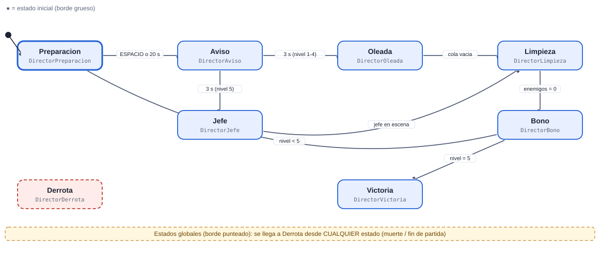
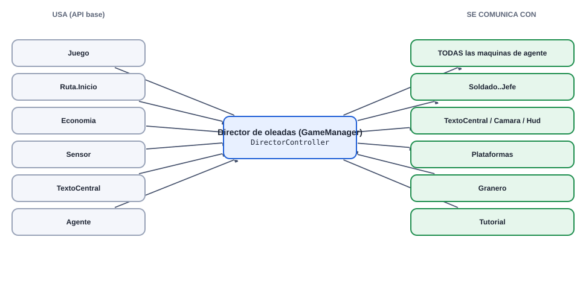
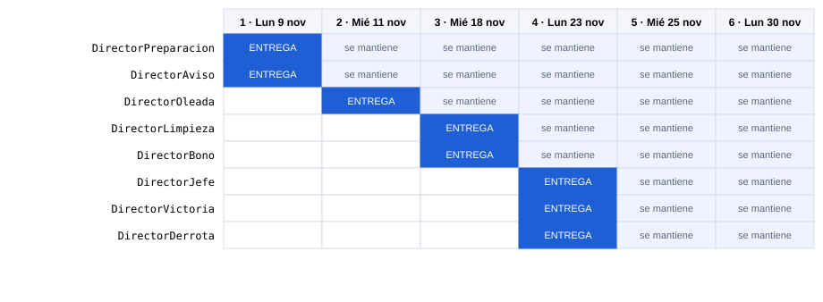
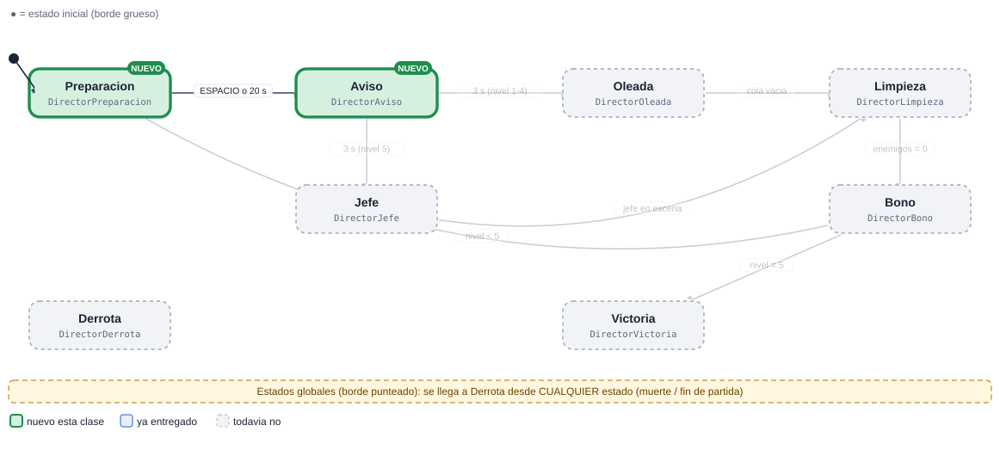
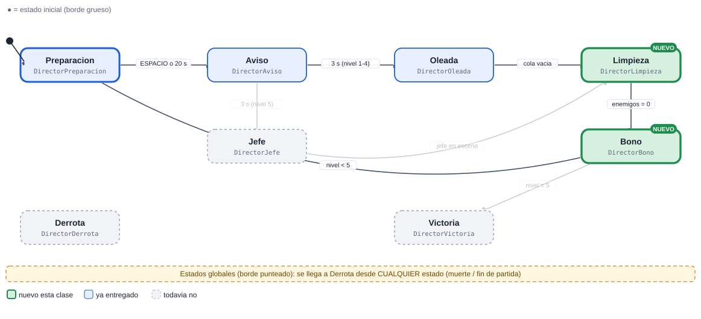
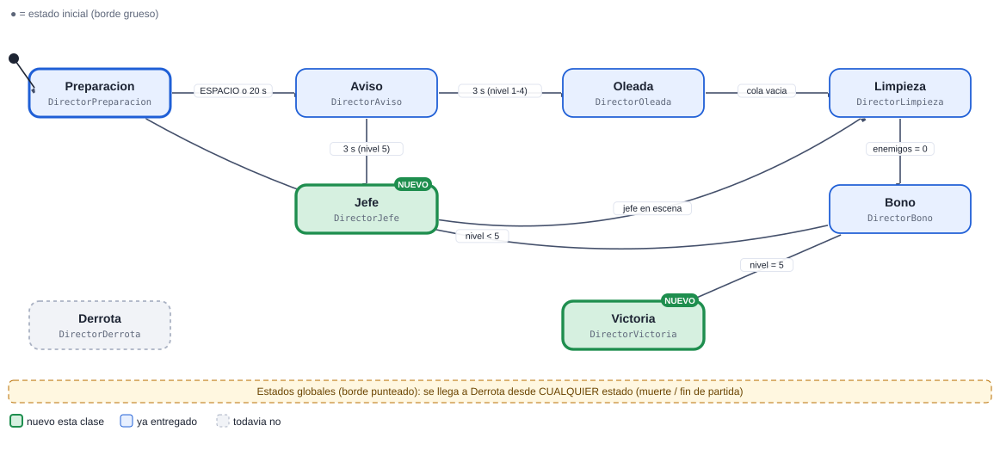
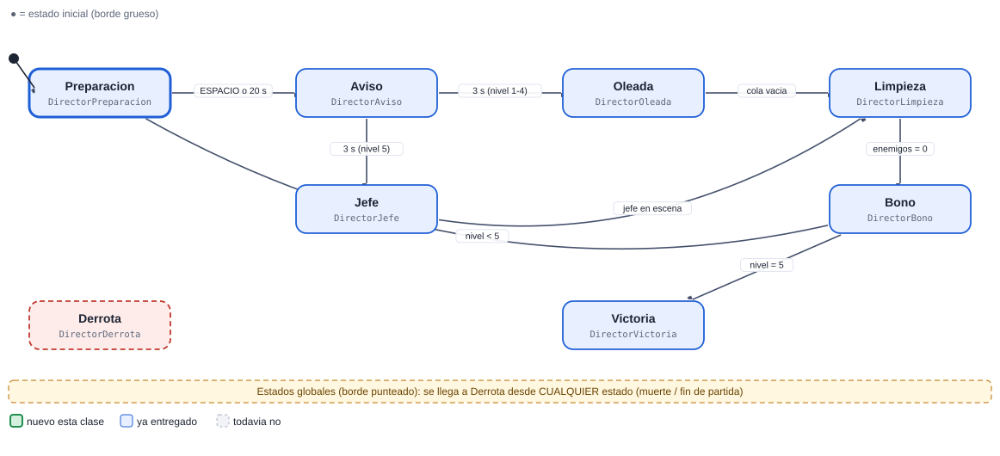

# 13 · Director de oleadas (GameManager)

[Plan general](00_indice_y_plan.md) · [Guia de inicio](03_como_empezar.md) · [Como subir cambios](04_como_subir_cambios.md) · [Troubleshooting](05_troubleshooting.md) · [Estado general](01_estado_general.md) · [Steering](02_steering_behaviors.md) · [README](../README.md)

**Muy alta**  **Sistema**

Reemplaza al director demo (clase Juego). Es el cerebro de la partida: decide cuando se acerca y cuando empieza cada oleada, cuantos enemigos salen, cuando termina y si se gana o se pierde. TODAS las demas máquinas dependen de los eventos que publica.

Peso de la máquina: **29.0 pts** · Steering a cargo: **0 pts** (ninguno) · Total del cupo 13: **29.0 pts** · Estados: **8** · Transiciones: **8**

## 1. Diagrama de estados



Las flechas se leen "desde → hasta" con la condición que dispara el cambio. El estado inicial es el de borde grueso. Cada estado devuelve el nombre del siguiente estado en `Actualizar` o `AlRecibir` (o `null` para quedarse).

> Documentos de apoyo: [Cómo subir tus cambios](04_como_subir_cambios.md) · [Troubleshooting (si el pipeline falla)](05_troubleshooting.md) · [Guía de inicio](03_como_empezar.md).

## Cómo empezar (primeros 30 minutos)

1. **Rama:** `git checkout main; git pull; git checkout -b clase-1/13-director`
2. **Mira tu agente en el juego:** abre `Assets/_Granero/Escenas/Granero.unity` y pulsa Play. Observa el juego tal como funciona hoy con el demo del instructor; tu máquina lo va a reemplazar. *Aparece: arranca solo con la escena (Juego crea DirectorController si existe).*
3. **Crea estos archivos** en `Assets/_Alumnos/Director/`: `DirectorController.cs`, `DirectorPreparacion.cs`, `DirectorAviso.cs`.
4. **Copia el esqueleto** de la sección de código más abajo (controller + primer estado) y registra tus estados en `new Maquina(new List<Estado> {...})`.
5. **Primer estado:** en `Entrar` publica el mensaje o la fase correspondiente y en `Actualizar` espera el evento o el tiempo que lo hace cambiar.
6. **Play:** en cuanto existe `DirectorController`, el sistema lo usa en lugar del demo. Si ves tu primer estado funcionando, sigue con el siguiente.
7. **Commit y PR** el mismo día (flujo en la [guía de inicio](03_como_empezar.md)).

Guía completa con diagramas: [guía de inicio](03_como_empezar.md).

## 2. Estados

| Estado (clase) | Qué hace | Animación | Steering |
| --- | --- | --- | --- |
| `DirectorPreparacion` | Espera al jugador (ESPACIO o 20 s) y publica Juego.Preparar(nivel). | — | — |
| `DirectorAviso` | Cuenta regresiva 3 s ('se acerca'). Muestra TextoCentral. | — | — |
| `DirectorOleada` | Saca enemigos de la cola con intervalo (Juego.Aparecer) y publica Juego.Lanzar(nivel). | — | — |
| `DirectorJefe` | Oleada 5: escoltas + el Jefe al final. Aviso especial. | — | — |
| `DirectorLimpieza` | Espera a que no queden enemigos (Sensor.Contar cada 0.4 s). | — | — |
| `DirectorBono` | Economia.Agregar(bono) y sube el nivel (abre plataformas). | — | — |
| `DirectorVictoria` | Juego.Terminar(true). | — | — |
| `DirectorDerrota` (global) | Global: el granero cayo -> Juego.Terminar(false). | — | — |

## 3. Transiciones

| Desde | Hacia | Condición |
| --- | --- | --- |
| Preparacion | Aviso | ESPACIO o 20 s |
| Aviso | Oleada | 3 s (nivel 1-4) |
| Aviso | Jefe | 3 s (nivel 5) |
| Oleada | Limpieza | cola vacia |
| Jefe | Limpieza | jefe en escena |
| Limpieza | Bono | enemigos = 0 |
| Bono | Preparacion | nivel &lt; 5 |
| Bono | Victoria | nivel = 5 |
| *cualquiera* | Derrota | el granero cae (`Salud.AlMorir` del granero) |

**Eventos que escucha:** `tecla ESPACIO`, `timer`, `Sensor.Contar == 0`, `Salud.AlMorir (granero)`, `Agente.AlMorirAlguien (jefe)`

## 4. Dependencias

### Mapa de dependencias



### 4.1 API base (ya hecha por el instructor)

| Clase | Qué usas |
| --- | --- |
| `Juego (API)` | Preparar / Lanzar / Terminar / FijarEnemigosVivos / Aparecer |
| `Ruta.Inicio` | punto de aparición |
| `Economia` | Agregar(bono) |
| `Sensor` | Contar(Bando.Enemigo) |
| `TextoCentral` | Mostrar(...) |
| `Agente` | AlMorirAlguien |

### 4.2 Comunicación con otras máquinas

| Con quién | Sentido | Cómo se comunican |
| --- | --- | --- |
| TODAS las máquinas de agente | envía a | Publica Juego.AlCambiarFase: la usan para el Festejo. |
| Soldado..Jefe | envía a | Los crea con Juego.Aparecer(rol,pos,rot). |
| TextoCentral / Camara / Hud | envía a | Eventos AlAcercarse / AlComenzar / AlCambiarFase. |
| Plataformas | envía a | Al subir el nivel se abren (SlotTorre lee Juego.Nivel). |
| Granero | recibe de | Se suscribe a Salud.AlMorir del granero para la Derrota. |
| Tutorial | envía a | Mismos eventos. |

> Regla de oro: las máquinas **no se llaman entre sí**. Se comunican solo por la API base y sus eventos (`Agente.AlMorirAlguien`, `Juego.AlCambiarFase`, `Alertas.AlAlerta`, `Economia`, `Sensor`...). Así nadie queda bloqueado esperando el código de un compañero.

## 5. Entregas por clase



Azul: se entrega ese día. Celeste: se mantiene funcionando en las clases siguientes (se vuelve a revisar).

| Clase y día | Estados nuevos | Acumulado | Qué debe funcionar | Steering |
| --- | --- | --- | --- | --- |
| **1** Lun 9 nov | Preparacion, Aviso | 2/8 · 25% | Clase Controller + máquina; publica Preparar/Lanzar. Con DirectorController presente, el demo se apaga solo. | — |
| **2** Mié 11 nov | Oleada | 3/8 · 38% | Cola de spawn con intervalos y roles por oleada (datos en arreglos, sin LINQ). | — |
| **3** Mié 18 nov | Limpieza, Bono | 5/8 · 62% | Fin de oleada, bono y apertura de plataformas. Se juegan 3 oleadas de punta a punta. | — |
| **4** Lun 23 nov | Jefe, Victoria, Derrota | 8/8 · 100% | Oleada final con jefe y condiciones de victoria/derrota. | — |
| **5** Mié 25 nov | (pulido) | 8/8 · 100% | Balance de las 5 oleadas (dificultad creciente) y prueba con 14 máquinas juntas. | — |
| **6** Lun 30 nov | (pulido) | 8/8 · 100% | Rendimiento (60 fps estables con 100+ agentes), pulido, demo. | — |

Guías: [Cómo subir tus cambios](04_como_subir_cambios.md) · [Troubleshooting (si el pipeline falla)](05_troubleshooting.md).

### Detalle de cada entrega (qué entregar, cómo comprobarlo y qué comandos usar)

> Antes de tu primera entrega lee **[Cómo subir tus cambios](04_como_subir_cambios.md)**. Si el pipeline marca algo en rojo: **[Troubleshooting (si el pipeline falla)](05_troubleshooting.md)**. Todas las fechas son el día de clase; el lunes 16 de noviembre es puente (no hay clase).

### Clase 1 · Lun 9 nov · PR a más tardar ese día, 23:59 (CDMX)

**Rama:** `clase-1/13-director`  ·  **Avance esperado:** 2 de 8 estados (25%)



| Archivo (en `Assets/_Alumnos/Director/`) | Qué debe tener |
| --- | --- |
| `DirectorController.cs` | **Nuevo.** `class DirectorController : MonoBehaviour` dentro de `namespace Alumnos.Director`. Crea el `Contexto`, la `Maquina` con tus estados e inicia en `Preparacion`. |
| `DirectorPreparacion.cs` | **Nuevo.** `class DirectorPreparacion : Estado`. Espera al jugador (ESPACIO o 20 s) y publica Juego.Preparar(nivel). |
| `DirectorAviso.cs` | **Nuevo.** `class DirectorAviso : Estado`. Cuenta regresiva 3 s ('se acerca'). Muestra TextoCentral. |
| `*.meta` | Cada archivo nuevo trae su `.meta` (Unity lo crea al abrir el proyecto). Sube los dos. |

**Qué debe verse en Play al terminar esta clase**

- Clase Controller + máquina; publica Preparar/Lanzar. Con DirectorController presente, el demo se apaga solo.
- Cómo probarlo: abre `Granero.unity` y pulsa Play. arranca solo con la escena (Juego crea DirectorController si existe)

**Lo que revisa el Action en esta clase** (debe existir cada clase, hereda de `Estado` y estar registrada en el controller): `DirectorPreparacion`, `DirectorAviso`.

Todavía NO se pide: `DirectorOleada`, `DirectorJefe`, `DirectorLimpieza`, `DirectorBono`, `DirectorVictoria`, `DirectorDerrota`.

**Lista de comprobación antes del PR**

- [ ] Unity compila: la consola está vacía (sin errores rojos).
- [ ] Probado en Play (lo de arriba funciona).
- [ ] `git status` solo muestra archivos de `Assets/_Alumnos/Director/` (y sus `.meta`).
- [ ] Todo tu código está dentro de `namespace Alumnos.Director` (los `Steering*.cs` no llevan namespace) y es ASCII (sin acentos ni ñ).
- [ ] La rama se llama exactamente `clase-1/13-director` y el PR se crea hoy (máximo el Lun 9 nov).
- [ ] Leíste el comentario del Action en tu PR y corregiste cada ❌.

**Comandos de esta entrega** (copiar y pegar; si algo falla ve a [Troubleshooting (si el pipeline falla)](05_troubleshooting.md)):

```bash
git checkout main
git pull
git checkout -b clase-1/13-director
# ... programas y pruebas en Unity ...
git status
git add Assets/_Alumnos/Director
git commit -m "clase 1: Director - Preparacion, Aviso"
git push -u origin clase-1/13-director
```

### Clase 2 · Mié 11 nov · PR a más tardar ese día, 23:59 (CDMX)

**Rama:** `clase-2/13-director`  ·  **Avance esperado:** 3 de 8 estados (38%)


| Archivo (en `Assets/_Alumnos/Director/`) | Qué debe tener |
| --- | --- |
| `DirectorController.cs` | **Lo modificas.** Registra en la lista de la máquina los estados nuevos: `new DirectorOleada()`. |
| `DirectorOleada.cs` | **Nuevo.** `class DirectorOleada : Estado`. Saca enemigos de la cola con intervalo (Juego.Aparecer) y publica Juego.Lanzar(nivel). |
| `*.meta` | Cada archivo nuevo trae su `.meta` (Unity lo crea al abrir el proyecto). Sube los dos. |

**Qué debe verse en Play al terminar esta clase**

- Cola de spawn con intervalos y roles por oleada (datos en arreglos, sin LINQ).
- Cómo probarlo: abre `Granero.unity` y pulsa Play. arranca solo con la escena (Juego crea DirectorController si existe)

**Lo que revisa el Action en esta clase** (debe existir cada clase, hereda de `Estado` y estar registrada en el controller): `DirectorPreparacion`, `DirectorAviso`, `DirectorOleada`.

Todavía NO se pide: `DirectorJefe`, `DirectorLimpieza`, `DirectorBono`, `DirectorVictoria`, `DirectorDerrota`.

**Lista de comprobación antes del PR**

- [ ] Unity compila: la consola está vacía (sin errores rojos).
- [ ] Probado en Play (lo de arriba funciona).
- [ ] `git status` solo muestra archivos de `Assets/_Alumnos/Director/` (y sus `.meta`).
- [ ] Todo tu código está dentro de `namespace Alumnos.Director` (los `Steering*.cs` no llevan namespace) y es ASCII (sin acentos ni ñ).
- [ ] La rama se llama exactamente `clase-2/13-director` y el PR se crea hoy (máximo el Mié 11 nov).
- [ ] Leíste el comentario del Action en tu PR y corregiste cada ❌.

**Comandos de esta entrega** (copiar y pegar; si algo falla ve a [Troubleshooting (si el pipeline falla)](05_troubleshooting.md)):

```bash
git checkout main
git pull
git checkout -b clase-2/13-director
# ... programas y pruebas en Unity ...
git status
git add Assets/_Alumnos/Director
git commit -m "clase 2: Director - Oleada"
git push -u origin clase-2/13-director
```

### Clase 3 · Mié 18 nov · PR a más tardar ese día, 23:59 (CDMX)

**Rama:** `clase-3/13-director`  ·  **Avance esperado:** 5 de 8 estados (62%)



| Archivo (en `Assets/_Alumnos/Director/`) | Qué debe tener |
| --- | --- |
| `DirectorController.cs` | **Lo modificas.** Registra en la lista de la máquina los estados nuevos: `new DirectorLimpieza()`, `new DirectorBono()`. |
| `DirectorLimpieza.cs` | **Nuevo.** `class DirectorLimpieza : Estado`. Espera a que no queden enemigos (Sensor.Contar cada 0.4 s). |
| `DirectorBono.cs` | **Nuevo.** `class DirectorBono : Estado`. Economia.Agregar(bono) y sube el nivel (abre plataformas). |
| `*.meta` | Cada archivo nuevo trae su `.meta` (Unity lo crea al abrir el proyecto). Sube los dos. |

**Qué debe verse en Play al terminar esta clase**

- Fin de oleada, bono y apertura de plataformas. Se juegan 3 oleadas de punta a punta.
- Cómo probarlo: abre `Granero.unity` y pulsa Play. arranca solo con la escena (Juego crea DirectorController si existe)

**Lo que revisa el Action en esta clase** (debe existir cada clase, hereda de `Estado` y estar registrada en el controller): `DirectorPreparacion`, `DirectorAviso`, `DirectorOleada`, `DirectorLimpieza`, `DirectorBono`.

Todavía NO se pide: `DirectorJefe`, `DirectorVictoria`, `DirectorDerrota`.

**Lista de comprobación antes del PR**

- [ ] Unity compila: la consola está vacía (sin errores rojos).
- [ ] Probado en Play (lo de arriba funciona).
- [ ] `git status` solo muestra archivos de `Assets/_Alumnos/Director/` (y sus `.meta`).
- [ ] Todo tu código está dentro de `namespace Alumnos.Director` (los `Steering*.cs` no llevan namespace) y es ASCII (sin acentos ni ñ).
- [ ] La rama se llama exactamente `clase-3/13-director` y el PR se crea hoy (máximo el Mié 18 nov).
- [ ] Leíste el comentario del Action en tu PR y corregiste cada ❌.

**Comandos de esta entrega** (copiar y pegar; si algo falla ve a [Troubleshooting (si el pipeline falla)](05_troubleshooting.md)):

```bash
git checkout main
git pull
git checkout -b clase-3/13-director
# ... programas y pruebas en Unity ...
git status
git add Assets/_Alumnos/Director
git commit -m "clase 3: Director - Limpieza, Bono"
git push -u origin clase-3/13-director
```

### Clase 4 · Lun 23 nov · PR a más tardar ese día, 23:59 (CDMX)

**Rama:** `clase-4/13-director`  ·  **Avance esperado:** 8 de 8 estados (100%)


| Archivo (en `Assets/_Alumnos/Director/`) | Qué debe tener |
| --- | --- |
| `DirectorController.cs` | **Lo modificas.** Registra en la lista de la máquina los estados nuevos: `new DirectorJefe()`, `new DirectorVictoria()`, `new DirectorDerrota()`. |
| `DirectorJefe.cs` | **Nuevo.** `class DirectorJefe : Estado`. Oleada 5: escoltas + el Jefe al final. Aviso especial. |
| `DirectorVictoria.cs` | **Nuevo.** `class DirectorVictoria : Estado`. Juego.Terminar(true). |
| `DirectorDerrota.cs` | **Nuevo.** `class DirectorDerrota : Estado`. Global: el granero cayo -> Juego.Terminar(false). |
| `*.meta` | Cada archivo nuevo trae su `.meta` (Unity lo crea al abrir el proyecto). Sube los dos. |

**Qué debe verse en Play al terminar esta clase**

- Oleada final con jefe y condiciones de victoria/derrota.
- Cómo probarlo: abre `Granero.unity` y pulsa Play. arranca solo con la escena (Juego crea DirectorController si existe)

**Lo que revisa el Action en esta clase** (debe existir cada clase, hereda de `Estado` y estar registrada en el controller): `DirectorPreparacion`, `DirectorAviso`, `DirectorOleada`, `DirectorLimpieza`, `DirectorBono`, `DirectorJefe`, `DirectorVictoria`, `DirectorDerrota`.

**Lista de comprobación antes del PR**

- [ ] Unity compila: la consola está vacía (sin errores rojos).
- [ ] Probado en Play (lo de arriba funciona).
- [ ] `git status` solo muestra archivos de `Assets/_Alumnos/Director/` (y sus `.meta`).
- [ ] Todo tu código está dentro de `namespace Alumnos.Director` (los `Steering*.cs` no llevan namespace) y es ASCII (sin acentos ni ñ).
- [ ] La rama se llama exactamente `clase-4/13-director` y el PR se crea hoy (máximo el Lun 23 nov).
- [ ] Leíste el comentario del Action en tu PR y corregiste cada ❌.

**Comandos de esta entrega** (copiar y pegar; si algo falla ve a [Troubleshooting (si el pipeline falla)](05_troubleshooting.md)):

```bash
git checkout main
git pull
git checkout -b clase-4/13-director
# ... programas y pruebas en Unity ...
git status
git add Assets/_Alumnos/Director
git commit -m "clase 4: Director - Jefe, Victoria, Derrota"
git push -u origin clase-4/13-director
```

### Clase 5 · Mié 25 nov · PR a más tardar ese día, 23:59 (CDMX)

**Rama:** `clase-5/13-director`  ·  **Avance esperado:** 8 de 8 estados (100%)



| Archivo (en `Assets/_Alumnos/Director/`) | Qué debe tener |
| --- | --- |
| `DirectorController.cs` | **Lo modificas.** Registra en la lista de la máquina los estados nuevos: ninguno nuevo (solo ajustes). |
| (todos tus archivos) | Pulido final: ver la lista de comprobación de abajo. No hay estados nuevos. |
| `*.meta` | Cada archivo nuevo trae su `.meta` (Unity lo crea al abrir el proyecto). Sube los dos. |

**Qué debe verse en Play al terminar esta clase**

- Balance de las 5 oleadas (dificultad creciente) y prueba con 14 máquinas juntas.
- Cómo probarlo: abre `Granero.unity` y pulsa Play. arranca solo con la escena (Juego crea DirectorController si existe)

**Lo que revisa el Action en esta clase** (debe existir cada clase, hereda de `Estado` y estar registrada en el controller): `DirectorPreparacion`, `DirectorAviso`, `DirectorOleada`, `DirectorLimpieza`, `DirectorBono`, `DirectorJefe`, `DirectorVictoria`, `DirectorDerrota`.

**Lista de comprobación antes del PR**

- [ ] Unity compila: la consola está vacía (sin errores rojos).
- [ ] Probado en Play (lo de arriba funciona).
- [ ] `git status` solo muestra archivos de `Assets/_Alumnos/Director/` (y sus `.meta`).
- [ ] Todo tu código está dentro de `namespace Alumnos.Director` (los `Steering*.cs` no llevan namespace) y es ASCII (sin acentos ni ñ).
- [ ] La rama se llama exactamente `clase-5/13-director` y el PR se crea hoy (máximo el Mié 25 nov).
- [ ] Leíste el comentario del Action en tu PR y corregiste cada ❌.

**Comandos de esta entrega** (copiar y pegar; si algo falla ve a [Troubleshooting (si el pipeline falla)](05_troubleshooting.md)):

```bash
git checkout main
git pull
git checkout -b clase-5/13-director
# ... programas y pruebas en Unity ...
git status
git add Assets/_Alumnos/Director
git commit -m "clase 5: Director - pulido final"
git push -u origin clase-5/13-director
```

### Clase 6 · Lun 30 nov · PR a más tardar ese día, 23:59 (CDMX)

**Rama:** `clase-6/13-director`  ·  **Avance esperado:** 8 de 8 estados (100%)



| Archivo (en `Assets/_Alumnos/Director/`) | Qué debe tener |
| --- | --- |
| `DirectorController.cs` | **Lo modificas.** Registra en la lista de la máquina los estados nuevos: ninguno nuevo (solo ajustes). |
| (todos tus archivos) | Pulido final: ver la lista de comprobación de abajo. No hay estados nuevos. |
| `*.meta` | Cada archivo nuevo trae su `.meta` (Unity lo crea al abrir el proyecto). Sube los dos. |

**Qué debe verse en Play al terminar esta clase**

- Rendimiento (60 fps estables con 100+ agentes), pulido, demo.
- Una oleada completa de principio a fin sin errores ni avisos en la consola.
- Profiler: `GC Alloc` en 0 B dentro de tus `Actualizar` (medido en Play).
- Pooling correcto: el segundo agente que reaparece se comporta igual que el primero (todo se reinicia en `OnEnable`/`Entrar`).
- Demo en vivo de 3 minutos mostrando cada estado y cada transición de tu diagrama.

**Lo que revisa el Action en esta clase** (debe existir cada clase, hereda de `Estado` y estar registrada en el controller): `DirectorPreparacion`, `DirectorAviso`, `DirectorOleada`, `DirectorLimpieza`, `DirectorBono`, `DirectorJefe`, `DirectorVictoria`, `DirectorDerrota`.

**Lista de comprobación antes del PR**

- [ ] Unity compila: la consola está vacía (sin errores rojos).
- [ ] Probado en Play (lo de arriba funciona).
- [ ] `git status` solo muestra archivos de `Assets/_Alumnos/Director/` (y sus `.meta`).
- [ ] Todo tu código está dentro de `namespace Alumnos.Director` (los `Steering*.cs` no llevan namespace) y es ASCII (sin acentos ni ñ).
- [ ] La rama se llama exactamente `clase-6/13-director` y el PR se crea hoy (máximo el Lun 30 nov).
- [ ] Leíste el comentario del Action en tu PR y corregiste cada ❌.

**Comandos de esta entrega** (copiar y pegar; si algo falla ve a [Troubleshooting (si el pipeline falla)](05_troubleshooting.md)):

```bash
git checkout main
git pull
git checkout -b clase-6/13-director
# ... programas y pruebas en Unity ...
git status
git add Assets/_Alumnos/Director
git commit -m "clase 6: Director - pulido final"
git push -u origin clase-6/13-director
```

### Rúbrica (igual en todas las clases)

| Criterio | Puntos | Qué se revisa |
| --- | --- | --- |
| Funciona en el juego | 50 | El agente/sistema hace lo pedido en Play, sin errores en consola, con el prefab real. |
| Estados entregados | 30 | Cumple los estados de ESA clase (ver tabla). Cada estado que falta resta proporcionalmente. |
| Codigo y rendimiento | 20 | Una clase por estado con prefijo del rol, ASCII, sin new/LINQ en Update, eventos desuscritos, cero basura medido. |
| Total por clase | 100 | La calificación final es el promedio de las 6 entregas (cada clase pesa igual). |

## 6. Esqueleto de código

Punto de partida. Copia el patrón del `SoldadoController`/estados de referencia; el resto de estados siguen la misma forma. Nombres de clase únicos: `Director<Estado>`.

```csharp
// DirectorController.cs
using System.Collections.Generic;
using UnityEngine;

namespace Alumnos.Director
{
public class DirectorController : MonoBehaviour
{
    Maquina maq;
    readonly Contexto ctx = new Contexto();
    Agente ag;

    void Awake()
    {
        ctx.Fijar("ctrl", this);
        maq = new Maquina(new List<Estado> { new DirectorPreparacion(), new DirectorAviso(), new DirectorOleada(), new DirectorJefe(), new DirectorLimpieza(), new DirectorBono(), new DirectorVictoria(), new DirectorDerrota() }, ctx);
    }

    void OnEnable()   // OJO: los agentes vienen de la Reserva (se reutilizan): reinicia todo aqui
    {
        maq.Iniciar("DirectorPreparacion");
    }

    void OnDisable()
    {
    }

    void Update() { maq.Actualizar(Time.deltaTime); }
}
}

// DirectorPreparacion.cs  (un archivo por estado; mismo namespace y prefijo del rol)
using UnityEngine;

namespace Alumnos.Director
{
public class DirectorPreparacion : Estado
{
    float t;
    public override void Entrar(string anterior)
    {
        t = 0f;
        // TODO: Espera al jugador (ESPACIO o 20 s) y publica Juego
    }
    public override string Actualizar(float dt)
    {
        t += dt;
        // TODO: logica del estado; devuelve el NOMBRE del siguiente estado o null para quedarse
        return null;
    }
    public override string AlRecibir(string trigger, int valor) { return null; }
}
}
```

## 7. Reglas que se califican siempre

- Todo tu código va dentro de `namespace Alumnos.<TuMaquina>` (ej. `Alumnos.MagoEnemigo`). Los archivos `Steering*.cs` NO llevan namespace.
- Una clase por estado, hereda de `Estado`, nombre con prefijo del rol. Ninguna clase puede llamarse igual que una del juego base.
- Nada de `new`, LINQ, `GetComponent` ni `Find` dentro de `Actualizar`: guarda referencias en `Entrar` o en el Contexto.
- El Sensor se consulta cada 0.2 s, no cada frame.
- Suscripciones a eventos en `OnEnable`, baja en `OnDisable` (los agentes se reutilizan).
- Todo el código en ASCII (sin acentos ni ñ).

## Anexo: composición de las oleadas del demo

| Oleada | Enemigos | Intervalo (s) |
| --- | --- | --- |
| 1 | 6 Soldados | 1.6 |
| 2 | 8 Soldados + 4 Lanceros | 1.3 |
| 3 | 8 Soldados + 5 Ladrones + 2 Magos | 1.1 |
| 4 | 8 Soldados + 6 Lanceros + 3 Magos + 3 Brutos | 1.0 |
| 5 | 12 Soldados + 4 Ladrones + 4 Brutos + 1 Jefe | 0.8 |

Punto de partida: son los valores del director demo (`Juego.cs`). Puedes balancearlos, pero cada oleada debe ser ganable con las torres que permite el presupuesto de gemas.
