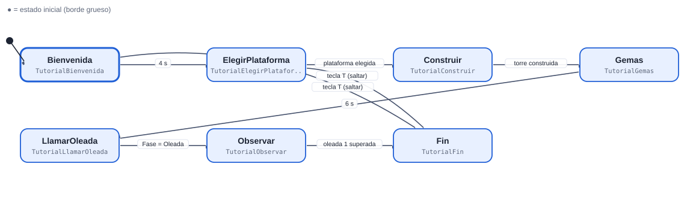
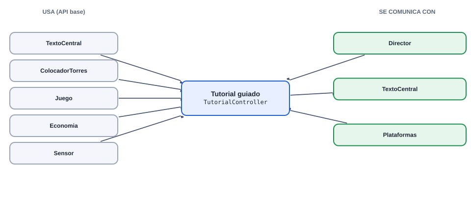
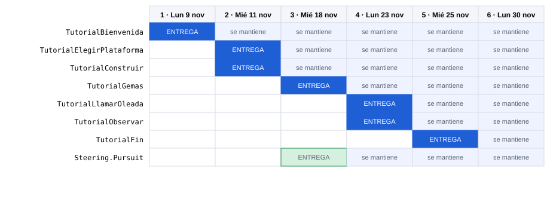

# 14 · Tutorial guiado

[Plan general](00_indice_y_plan.md) · [Guia de inicio](03_como_empezar.md) · [Estado general](01_estado_general.md) · [Steering](02_steering_behaviors.md) · [README](../README.md)

**Media**  **Sistema**

Guia al jugador nuevo con mensajes en el centro de la pantalla: elegir plataforma, construir, llamar la oleada y entender las gemas. Es una máquina lineal con esperas por eventos; solo observa el juego, no lo modifica.

Peso de la máquina: **22.5 pts** · Steering a cargo: **6 pts** (Pursuit (6 pts)) · Total del cupo 14: **28.5 pts** · Estados: **7** · Transiciones: **8**

## 1. Diagrama de estados



Las flechas se leen "desde → hasta" con la condición que dispara el cambio. El estado inicial es el de borde grueso. Cada estado devuelve el nombre del siguiente estado en `Actualizar` o `AlRecibir` (o `null` para quedarse).

## Cómo empezar (primeros 30 minutos)

1. **Rama:** `git checkout main && git pull && git checkout -b clase-1/14-tutorial`
2. **Mira tu agente en el juego:** abre `Assets/_Granero/Escenas/Granero.unity` y pulsa Play. Observa el juego tal como funciona hoy con el demo del instructor; tu máquina lo va a reemplazar. *Aparece: arranca solo con la escena (Juego crea TutorialController si existe).*
3. **Crea estos archivos** en `Assets/_Alumnos/Tutorial/`: `TutorialController.cs`, `TutorialBienvenida.cs`, `TutorialElegirPlataforma.cs`.
4. **Copia el esqueleto** de la sección de código más abajo (controller + primer estado) y registra tus estados en `new Maquina(new List<Estado> {...})`.
5. **Primer estado:** en `Entrar` publica el mensaje o la fase correspondiente y en `Actualizar` espera el evento o el tiempo que lo hace cambiar.
6. **Play:** en cuanto existe `TutorialController`, el sistema lo usa en lugar del demo. Si ves tu primer estado funcionando, sigue con el siguiente.
7. **Commit y PR** el mismo día (flujo en la [guía de inicio](03_como_empezar.md)).

Guía completa con diagramas: [guía de inicio](03_como_empezar.md).

## 2. Estados

| Estado (clase) | Qué hace | Animación | Steering |
| --- | --- | --- | --- |
| `TutorialBienvenida` | Mensaje de bienvenida 4 s. | — | — |
| `TutorialElegirPlataforma` | Pide hacer clic en una plataforma; espera ColocadorTorres.Elegido. | — | — |
| `TutorialConstruir` | Pide construir (1 o 2); espera que aparezca una torre. | — | — |
| `TutorialGemas` | Explica gemas y plataformas bloqueadas (tecla U). | — | — |
| `TutorialLlamarOleada` | Pide pulsar ESPACIO; espera Juego.Fase == Oleada. | — | — |
| `TutorialObservar` | Comenta que las torres atacan; espera el fin de la oleada 1. | — | — |
| `TutorialFin` | Se despide y se desactiva. | — | — |

## 3. Transiciones

| Desde | Hacia | Condición |
| --- | --- | --- |
| Bienvenida | ElegirPlataforma | 4 s |
| ElegirPlataforma | Construir | plataforma elegida |
| Construir | Gemas | torre construida |
| Gemas | LlamarOleada | 6 s |
| LlamarOleada | Observar | Fase = Oleada |
| Observar | Fin | oleada 1 superada |
| Bienvenida | Fin | tecla T (saltar) |
| ElegirPlataforma | Fin | tecla T (saltar) |

**Eventos que escucha:** `ColocadorTorres.Elegido`, `Economia.AlCambiar`, `Juego.AlCambiarFase`, `tecla T (saltar)`

## 4. Dependencias

### Mapa de dependencias



### 4.1 API base (ya hecha por el instructor)

| Clase | Qué usas |
| --- | --- |
| `TextoCentral` | Mostrar(titulo, subtitulo, color, segundos) |
| `ColocadorTorres` | Elegido, Hover, AlCambiarHover |
| `Juego` | Fase, Nivel y eventos |
| `Economia` | AlCambiar |
| `Sensor` | Contar(Bando.Defensor) para detectar torres nuevas |

### 4.2 Comunicación con otras máquinas

| Con quién | Sentido | Cómo se comunican |
| --- | --- | --- |
| Director | recibe de | Sus eventos (AlComenzar, AlCambiarFase) avanzan el tutorial. |
| TextoCentral | envía a | Muestra los mensajes (cola de mensajes ya resuelta). |
| Plataformas | recibe de | Lee Elegido y Hover. |

> Regla de oro: las máquinas **no se llaman entre sí**. Se comunican solo por la API base y sus eventos (`Agente.AlMorirAlguien`, `Juego.AlCambiarFase`, `Alertas.AlAlerta`, `Economia`, `Sensor`...). Así nadie queda bloqueado esperando el código de un compañero.

## 5. Steering que debes programar tú (cupo 14)

| Behaviour | Pts | Entrega | Lo usan |
| --- | --- | --- | --- |
| [Pursuit (perseguir con predicción)](02_steering_behaviors.md#pursuit-perseguir-con-predicción-6-pts) | 6 | Clase 3 | Guardia, TorreLanzadora, TorreMaga |

### Cómo probar tu steering aislado

Crea en tu carpeta de máquina un script de prueba (no se usa en el juego final) y ponlo en un objeto con un `Cuerpo` sobre el NavMesh de la escena:

```csharp
using UnityEngine;

namespace Alumnos.Tutorial   // el namespace de tu MAQUINA (el probe no es parte de Steering)
{
public class ProbePursuit : MonoBehaviour   // nombre unico: Probe + tu steering
{
    public Transform objetivo;
    public float vMax = 3f;
    Cuerpo cuerpo;
    void Awake() { cuerpo = GetComponent<Cuerpo>(); }
    void Update()
    {
        Vector3 v = Steering.Pursuit(transform.position, objetivo.position, vMax);   // ajusta los parametros a tu firma
        cuerpo.Mover(v, Time.deltaTime);
    }
}
}
```

## 6. Entregas por clase



Azul: se entrega ese día. Celeste: se mantiene funcionando en las clases siguientes (se vuelve a revisar).

| Clase | Estados nuevos | Acumulado | Qué debe funcionar | Steering |
| --- | --- | --- | --- | --- |
| **1** | Bienvenida, ElegirPlataforma | 2/7 · 29% | Controller + máquina; primeros dos pasos con TextoCentral. | — |
| **2** | Construir | 3/7 · 43% | Detecta que el jugador construyo. | — |
| **3** | Gemas | 4/7 · 57% | Explicacion de gemas y desbloqueo con detección de eventos de Economia. | Pursuit |
| **4** | LlamarOleada, Observar | 6/7 · 86% | Pasos ligados a las fases del juego. | — |
| **5** | Fin | 7/7 · 100% | Salto con tecla T, final y limpieza (sin dejar suscripciones). | — |
| **6** | (pulido) | 7/7 · 100% | Pulido, mensajes bien escritos, cero basura, demo. | — |

### Rúbrica (igual en todas las clases)

| Criterio | Puntos | Qué se revisa |
| --- | --- | --- |
| Funciona en el juego | 50 | El agente/sistema hace lo pedido en Play, sin errores en consola, con el prefab real. |
| Estados entregados | 30 | Cumple los estados de ESA clase (ver tabla). Cada estado que falta resta proporcionalmente. |
| Codigo y rendimiento | 20 | Una clase por estado con prefijo del rol, ASCII, sin new/LINQ en Update, eventos desuscritos, cero basura medido. |
| Total por clase | 100 | La calificación final es el promedio de las 6 entregas (cada clase pesa igual). |

## 7. Esqueleto de código

Punto de partida. Copia el patrón del `SoldadoController`/estados de referencia; el resto de estados siguen la misma forma. Nombres de clase únicos: `Tutorial<Estado>`.

```csharp
// TutorialController.cs
using System.Collections.Generic;
using UnityEngine;

namespace Alumnos.Tutorial
{
public class TutorialController : MonoBehaviour
{
    Maquina maq;
    readonly Contexto ctx = new Contexto();
    Agente ag;

    void Awake()
    {
        ctx.Fijar("ctrl", this);
        maq = new Maquina(new List<Estado> { new TutorialBienvenida(), new TutorialElegirPlataforma(), new TutorialConstruir(), new TutorialGemas(), new TutorialLlamarOleada(), new TutorialObservar(), new TutorialFin() }, ctx);
    }

    void OnEnable()   // OJO: los agentes vienen de la Reserva (se reutilizan): reinicia todo aqui
    {
        maq.Iniciar("TutorialBienvenida");
    }

    void OnDisable()
    {
    }

    void Update() { maq.Actualizar(Time.deltaTime); }
}
}

// TutorialBienvenida.cs  (un archivo por estado; mismo namespace y prefijo del rol)
using UnityEngine;

namespace Alumnos.Tutorial
{
public class TutorialBienvenida : Estado
{
    float t;
    public override void Entrar(string anterior)
    {
        t = 0f;
        // TODO: Mensaje de bienvenida 4 s
    }
    public override string Actualizar(float dt)
    {
        t += dt;
        // TODO: logica del estado; devuelve el NOMBRE del siguiente estado o null para quedarse
        return null;
    }
    public override string AlRecibir(string trigger, int valor) { return null; }
}
}
```

## 8. Reglas que se califican siempre

- Todo tu código va dentro de `namespace Alumnos.<TuMaquina>` (ej. `Alumnos.MagoEnemigo`). Los archivos `Steering*.cs` NO llevan namespace.
- Una clase por estado, hereda de `Estado`, nombre con prefijo del rol. Ninguna clase puede llamarse igual que una del juego base.
- Nada de `new`, LINQ, `GetComponent` ni `Find` dentro de `Actualizar`: guarda referencias en `Entrar` o en el Contexto.
- El Sensor se consulta cada 0.2 s, no cada frame.
- Suscripciones a eventos en `OnEnable`, baja en `OnDisable` (los agentes se reutilizan).
- Todo el código en ASCII (sin acentos ni ñ).
